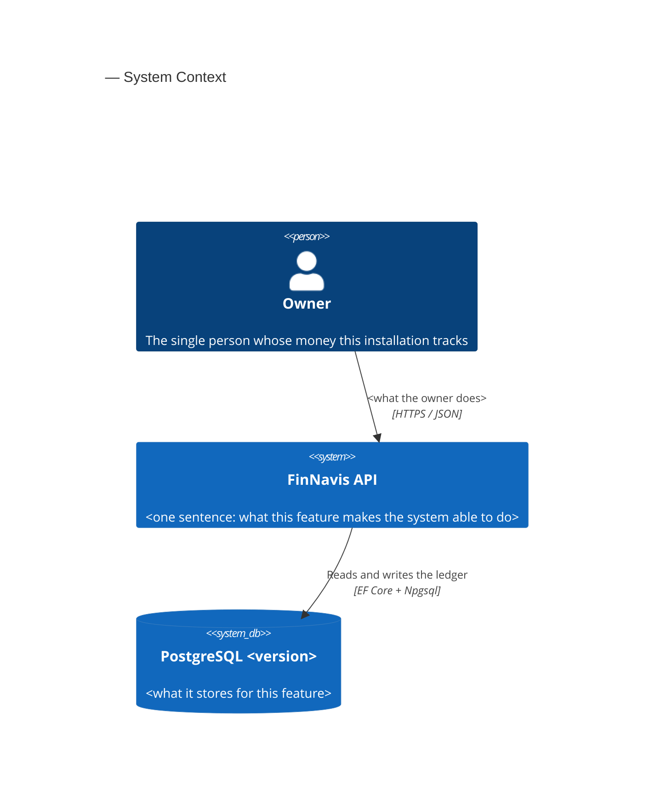
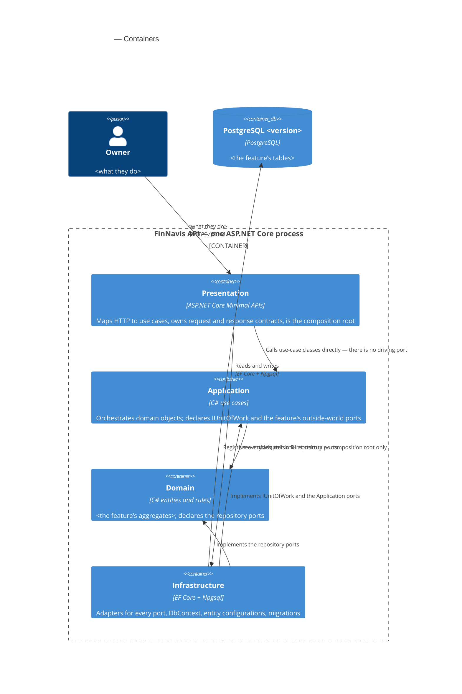
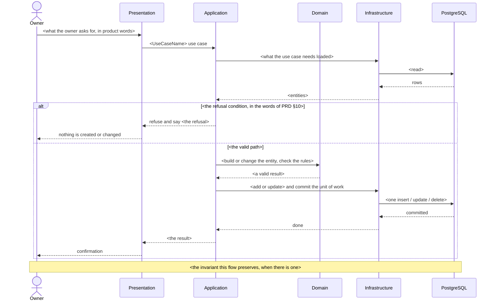

# Diagrams — C4 for §3 and §5, sequences for §6

Used in Phase 4 whenever a Mermaid block is written, and in Phase 6 as a backstop.

Three rules hold for every diagram in this document:

1. **Write it, validate it, then describe it.** The block goes into `sad.md` first. Then the question
   to the user describes what it says in prose — who talks to what, in which order, where it can
   fail. Never paste raw Mermaid source as the question: reading diagram syntax out of a terminal
   prompt is a tax on the reader, and they will approve it without reading.
2. **Names come from somewhere.** Actors from `docs/GLOSSARY.md`. Containers from §5. Sequence participants
   from §5 by name. A diagram is the one place where an invented name looks authoritative.
3. **A broken block is never committed.** Run the lint below before the section's commit.

## The participant vocabulary of this repo

Reuse these names. Consistency across §3, §5 and §6 is what makes the three diagrams readable as one
story.

| Name in a diagram | Is | Appears in |
|---|---|---|
| `Owner` | The single person the product serves. From `docs/GLOSSARY.md` | §3, §5, §6 |
| `FinNavis API` | The whole ASP.NET Core process, seen from outside | §3 |
| `Presentation` | Minimal API endpoints, contracts, composition root | §5, §6 |
| `Application` | Use cases, `IUnitOfWork`, outside-world ports | §5, §6 |
| `Domain` | Entities, value objects, rules, repository ports | §5, §6 |
| `Infrastructure` | EF Core adapters, `DbContext`, configurations, migrations | §5, §6 |
| `PostgreSQL <version>` | The database, a separate process on the same host | §3, §5, §6 |
| `Web client` | The React PWA, **only** when `web-frontend` is a declared surface | §3, §5, §6 |

There is no identity provider, no broker, no cache and no third-party system in this product today.
If one appears in a diagram, it is either a scope change the PRD does not carry, or a mistake.

## C4 Context (L1) — §3

The system boundary: who talks to it from outside, and what it depends on.



Five to ten elements, no more. The rings do **not** appear here — at L1 the API is one box.

## C4 Container (L2) — §5

One container per declared `target_surface`, plus the datastore. For a `backend-service` surface the
four rings are drawn inside one boundary, with a line saying why: they compile into one process and
are not separately deployable, but the boundary between them *is* the architecture here, and it is
enforced by `tests/FinNavis.ArchitectureTests`.



**The arrows are the dependency rule, so getting them backwards is a real error, not a cosmetic one.**
`Infrastructure` points **inward** at `Domain` and `Application` because it implements their ports.
`Presentation` points at `Infrastructure` only for DI registration, and the label must say so —
otherwise a reader concludes Infrastructure sits between Presentation and Application, which
`ARCHITECTURE.md` explicitly denies.

When `web-frontend` is a declared surface, add a second container outside the API boundary and an
arrow from the Owner to it, and move the Owner → Presentation arrow to Web client → Presentation.

## Sequence diagrams — §6



What makes a §6 diagram worth its lines:

- **It shows the refusals.** A happy path alone tells the reader nothing they could not guess. Every
  `alt` branch should trace to an acceptance criterion or a PRD §10 refusal row — cite the AC ids in
  the flow heading.
- **Messages are semantic.** "record an expense with account, amount, date and category" — not
  `POST /transactions`. Verbs, paths and status codes belong to the API-contract stage. A diagram
  that carries them has to be rewritten the first time a route changes.
- **A `Note over` earns its place by stating an invariant** that the arrows imply but do not say —
  "no balance is stored, so every affected balance follows on the next read". Decorative notes are
  noise.
- **A read flow skips Domain.** If the read goes through a query port, say in a note that no
  repository is used and no entity is loaded. That is the whole point of the port, and it is
  invisible in the arrows.

Heading format, so the flows stay traceable:

```
**Critical flow <N>: <what happens>** (US-<nn> — AC-<nn>, AC-<nn>)
```

## The lint — run before every commit that touched a diagram

If `mmdc` is available, render-parse the file and fix anything that fails. It usually is not, so run
this structurally instead. Each check has caught a real break.

1. **Fence and type.** The block opens with ```` ```mermaid ```` and its first non-empty line is
   `C4Context`, `C4Container` or `sequenceDiagram`. A stray closing fence with no opener leaves the
   rest of the document inside a code block — this happened in `core-ledger` and needed a fix commit.
2. **Every fence is closed.** Count the ```` ``` ```` markers in the file: the total must be even.
3. **Declare before relate.** Every id used in a `Rel(...)` line was declared by a `Person`,
   `System`, `System_Ext`, `SystemDb`, `Container` or `ContainerDb` line above it.
4. **Spelling of the boundary.** `Container_Boundary`, not `Container_Bondary`. The typo parses as an
   unknown element and silently swallows everything inside the braces.
5. **Braces balance** inside every `Container_Boundary`.
6. **Sequence participants are declared** with `actor` or `participant` before their first arrow, and
   every alias used in an arrow exists.
7. **`alt` / `else` / `opt` / `loop` blocks are closed with `end`** — count them.
8. **No placeholder survived.** No `<` … `>` stub, no `TODO`, no `NNNN` inside any block.
9. **Names check out.** Every actor is in `docs/GLOSSARY.md`; every §6 participant is a §5 container.

A block that fails any check is fixed before the commit, not after. A broken diagram in a committed
document is worse than no diagram: it renders as an error box, and nobody fixes an error box in a
file they are only reading.
