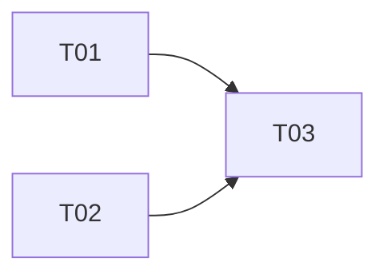

# Epic — <slug>

> **PRD:** [PRD.md](../PRD.md) · **Design:** [sad.md](../sad.md) · **Data model:** [data-model.md](../data-model.md) · **API:** [openapi.yaml](../contracts/openapi.yaml) · **ADRs:** [adr/](../adr/)
>
> **Size:** <XS|S|M|L|XL> (from [`.size`](../.size)). **Surface:** `<target_surfaces>`, read from
> `sad.md` frontmatter — so there is **no `ui` task layer**.

## Goal

<!-- instruction: 2–3 sentences tied to PRD §2. What shipping this epic delivers, and what cannot
start until it does. If the epic also creates part of the deployment unit (compose, test harness,
CI), say so here — it is the usual surprise. -->

## Scope

- **In:** <the rings, aggregates, ports, tables, operations and quality gates this epic covers>.
- **Out (PRD §3):** <the non-goals, by name, so a reader sees they were considered>.
- **Out of this epic, though named upstream:** <items from sad.md §11 or api-sync-report.md
  Deferrals that this epic does not close — each one gets a row in the table at the bottom>.

## Task map

<!-- instruction: the dependency graph as a Mermaid flowchart — the same edges as tasks.json deps.
Declare every node with a quoted label first, then the edges. Validate per
.claude/skills/finnavis-break-tasks/references/mermaid-lint.md before committing. -->

**Parallel branches.** <!-- instruction: name them in words. Which tasks start at once, and which
fan out after each join. A reader planning an evening needs this more than the diagram. -->

**Serialization lanes** (how the implement stage reads the DAG):

- `layer: migration` is always serialized — <which task, or "none in this epic">.
- Overlapping `files_hint` serializes regardless of layer: <pairs, with the shared file named>.
- No `ui` layer exists — `target_surfaces` declares `<surface>` only.

## Tasks

See [tracker.md](./tracker.md) for status. Machine contract: [tasks.json](./tasks.json).

| # | Task | Layer | Blocked by | DoD (short) |
|---|---|---|---|---|
| [T01](./T01-<slug>.md) | <title> | <layer> | — | <one line> |
| [T02](./T02-<slug>.md) | <title> | <layer> | — | <one line> |
| [T03](./T03-<slug>.md) | <title> | <layer> | T01, T02 | <one line> |

**Acceptance-criteria coverage.** <!-- instruction: state that all N PRD §5 criteria are claimed by
at least one task, and name the ones claimed by several — with the reason. "AC-14 is claimed at
three levels (query, use case, quality gate) because that is where each is actually proved." -->

## Risks / Hard rules

<!-- instruction: constraints a task must not break. Each is already a Hard rule upstream, so
breaking one is a review failure, not a judgement call. Cite the source for every line. The usual
set for this repo: -->

- **No `CHECK` constraint, no trigger, no stored procedure, no business `DEFAULT`.** Business logic
  lives in the Domain entities (`.claude/rules/migrations.md`).
- **Every error response is the flat `{code, message, details?}` envelope.** ASP.NET Core's
  `application/problem+json` default must be turned off, or the API answers with two shapes
  depending on how deep into the pipeline the request got (`CLAUDE.md` §API, `docs/adr/0002`,
  `docs/adr/0003`).
- **Money is `decimal` in code and a `string` on the wire** (`.claude/rules/openapi.md` §2).
- **Enums are stored as strings, never as int** (`CLAUDE.md`).
- **The contract is the source of truth; handlers follow it.** `/openapi/v1.json` is generated from
  the code and is diffed **against** the contract, never the other way round.
- **No response record is shared between operations**, even when two look identical today
  (`CLAUDE.md` §API).
- **Dependencies point inward only.** `tests/FinNavis.ArchitectureTests` enforces it;
  `Infrastructure.csproj` lists `Application` only, on purpose.
- **Never edit an applied migration. Add a new one** (`CLAUDE.md`).
- **No real bank statement, real export, real connection string or real key enters the repository**
  (`CLAUDE.md` Safety). Fixtures are synthetic.

### Open items this epic does not close

| Item | Where it came from | Why it is parked |
|---|---|---|
| <item> | <sad.md §11 / api-sync-report.md Deferrals / PRD §8> | <why, and what closes it> |
