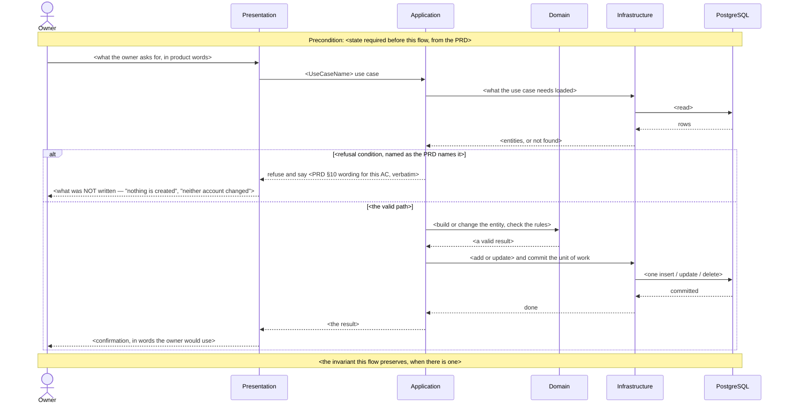
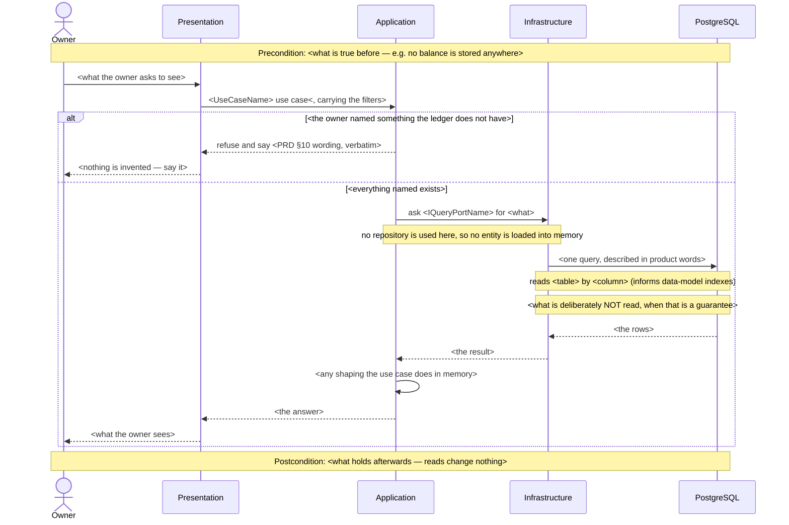
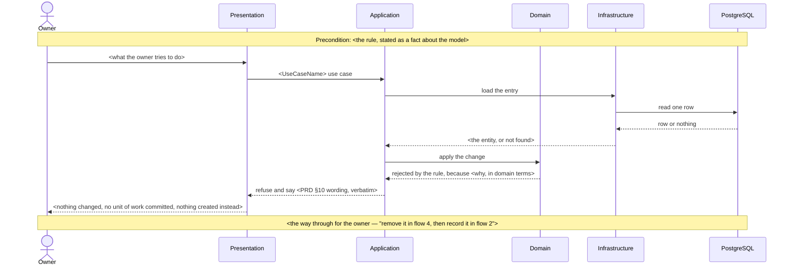

<!-- Scaffolds for finnavis-complete-sequence-diagrams. Each block is embedded INLINE in           -->
<!-- docs/features/<slug>/sad.md §6, appended after the last existing flow.                        -->
<!--                                                                                               -->
<!-- Participants are NOT placeholders. They are the containers §5 of this feature's sad.md         -->
<!-- declared, with the repo's fixed aliases (references/participants.md). Replace the <...> text   -->
<!-- in messages, notes and headings — never the participant names.                                 -->
<!--                                                                                                -->
<!-- Heading format, so the next audit can trace it:                                                -->
<!--   **Critical flow <N>: <what happens>** (US-<nn> — AC-<nn>, AC-<nn>)                           -->
<!-- <N> is the next free number. Numbers already committed never move.                             -->

---

## Write flow — anything that changes the ledger

<!-- Shows: the rules running in Domain, the unit of work committing, and what is NOT written on   -->
<!-- each refusal. Refusal wording comes from PRD §10 word for word.                                -->

**Critical flow <N>: <what happens>** (US-<nn> — AC-<nn>, AC-<nn>)

<!-- When the commit itself can fail and the failure matters — a multi-row write, a transfer —      -->
<!-- nest this inside the valid path instead of ending at "committed":                              -->
<!--                                                                                                -->
<!--     alt the commit fails                                                                       -->
<!--         PG-->>Inf: rolled back                                                                 -->
<!--         Inf-->>App: failure                                                                    -->
<!--         App-->>Pres: report the failure                                                        -->
<!--         Pres-->>Owner: <nothing changed — name both sides>                                     -->
<!--     else the commit succeeds                                                                   -->
<!--         ...                                                                                    -->
<!--     end                                                                                        -->

---

## Read flow — balances, history, a breakdown

<!-- NO Domain participant. The read path goes through a query port (ADR-0004), so no entity is     -->
<!-- loaded — and since the arrows cannot show that, a note says it.                                -->
<!-- Every read is an index hint: name the table and the column in a note, and repeat it in the     -->
<!-- Notes-flagged section for the data-model stage.                                                 -->

**Critical flow <N>: <what is read>** (US-<nn> — AC-<nn>, AC-<nn>)

---

## Refusal-only flow — the flow exists to show that something cannot happen

<!-- Use when the whole point is a rule that refuses: "turn a transaction into a transfer",         -->
<!-- "delete an account that has movements". Keep it short. The value is the refusal and the way   -->
<!-- out, not the setup.                                                                            -->

**Critical flow <N>: refuse to <what>** (US-<nn> — AC-<nn>)

