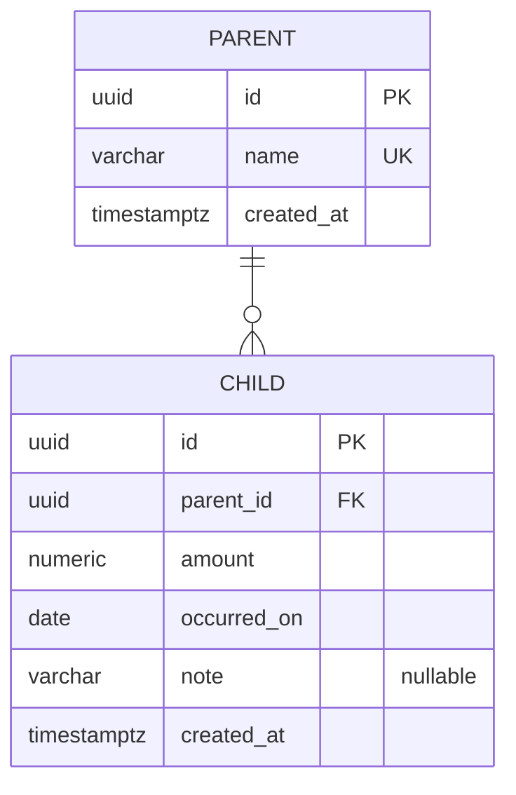

# Data model — <slug>

<!-- The SQL under docs/features/<slug>/migrations/ is a REFERENCE SPEC, not a migration. This repo
uses EF Core migrations; implement-tasks writes the entity configurations, runs
`./build.sh migrate <Name>`, and diffs `dotnet ef migrations script` output against the staged spec.
See .claude/rules/migrations.md. -->

> **Inputs:** [PRD](./PRD.md) §4, §5 · [SAD](./sad.md) §5, §6 (<N> flows), §8 ·
> [ADR-NNNN](./adr/NNNN-....md) · <earlier features this one builds on>

## ER diagram

<!-- Hand-laid, not auto-generated: relationships first, then one attribute block per table, in the
order the tables are created. Lint it before moving on (references/mermaid-lint.md). -->

<N> tables, matching the <N> aggregates in SAD §5. <One paragraph: the shape the ADRs forced, and
what the schema makes structurally impossible — that is what an ER diagram is actually for.>

<One paragraph on what is NOT stored: a balance, a rollup, a cache. Say why, with the ADR.>

## Decisions taken in this document

<!-- The section the upstream documents could not write. Each item is a decision with its reason,
not a derivation. If this section is empty, either the PRD was unusually complete or the decisions
are hiding in the tables below, where nobody will find them. -->

These are schema-level choices the PRD and SAD left open. Each one is a decision, not a derivation.

1. **<The decision, as a sentence.>** <Why. Which AC, abuse case or ADR pushed it. What it closes —
   name the PRD §8 or SAD §11 question if it closes one. What it costs if it is wrong.>

2. **<Next decision.>** <…>

## Entities

### `<table_name>`

| Column | Type | Constraints | Notes |
|---|---|---|---|
| `id` | UUID | PK, app-generated (UUID v7) | `Guid.CreateVersion7()` in Application — ADR-0005 |
| `<col>` | `VARCHAR(N)` | NOT NULL | <what it is, and where N came from> |
| `<col>` | `NUMERIC(19,4)` | NOT NULL | <money — never float> |
| `<col>` | `DATE` | NOT NULL | <a calendar day the owner picks, not a timestamp> |
| `<col>` | UUID | NOT NULL, FK → `<other>(id)` | <what the relationship means> |
| `created_at` | TIMESTAMPTZ | NOT NULL DEFAULT now() | |

<A line under the table whenever a reader might expect a constraint and not find one: "X is not a
CHECK — it is a domain invariant, refused in the <Entity> before the row is built.">

## Indexes

Every index below is justified by a concrete query from a SAD §6 flow. Candidates with no query
behind them were discarded.

| Index | Columns | Query it serves |
|---|---|---|
| `idx_<table>_<cols>` | `<table>(<cols>)` | <which flow, which filter, which AC. If it is also the FK index, say both.> |

**Indexes deliberately not created:**

- <candidate> — <why not. "PostgreSQL backs a UNIQUE with an index already", "nothing searches this
  column and PRD §8 closed that question", "the plain composite is load-bearing and SAD §10 guards
  it with a plan assertion">.

## Seeds

<!-- All three buckets are addressed. "Empty, and here is why" is a complete answer; a missing
bucket reads as forgotten. -->

- **Bootstrap** — <what, or nothing to bootstrap and why: no user table, no organisation, no
  sign-in>.
- **Lookup** — <usually empty here: enums are stored as strings, not as FKs into a lookup table>.
- **Test fixtures** — not in a migration. See below.

## Test fixtures

<!-- Builders in the test projects, never in a migration. They belong to implement-tasks; listed
here so the shape is agreed first. -->

xUnit with AwesomeAssertions (`CLAUDE.md`), so a builder per entity in a shared test helper:

- `<Entity>Builder` — <what it produces by default>.

**PII guard.** No real-looking personal data in any fixture. **No real bank statement and no real
export from another tracker ever enters the repository** (`CLAUDE.md` Safety) — fixtures copy the
shape only: same header row, same column order, same formats, invented values.

## Open items

<!-- TBD: <what is undecided, which stage owns it, and whether it changes this schema. A TBD that
does not change the schema still belongs here, because the next stage reads this file.> -->
