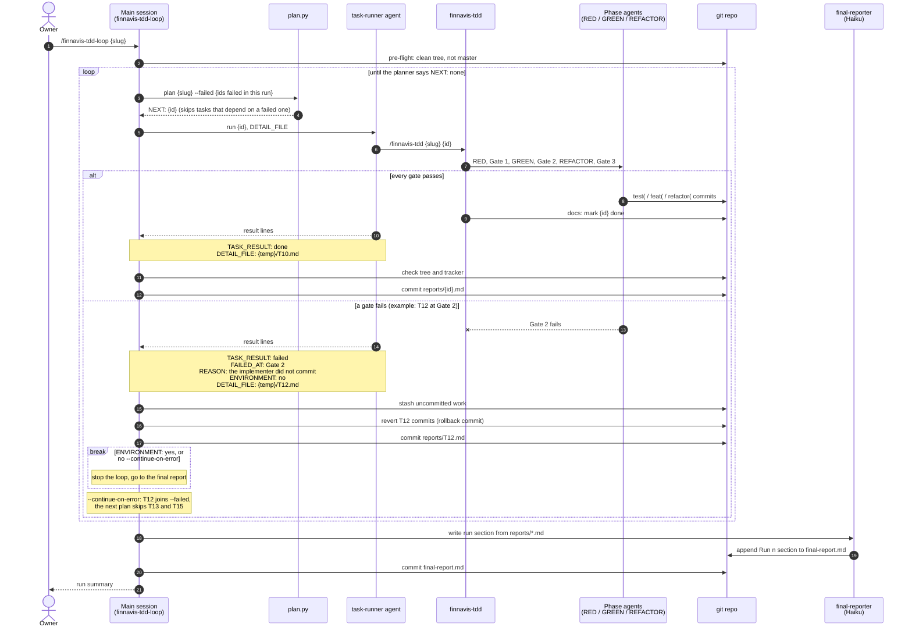
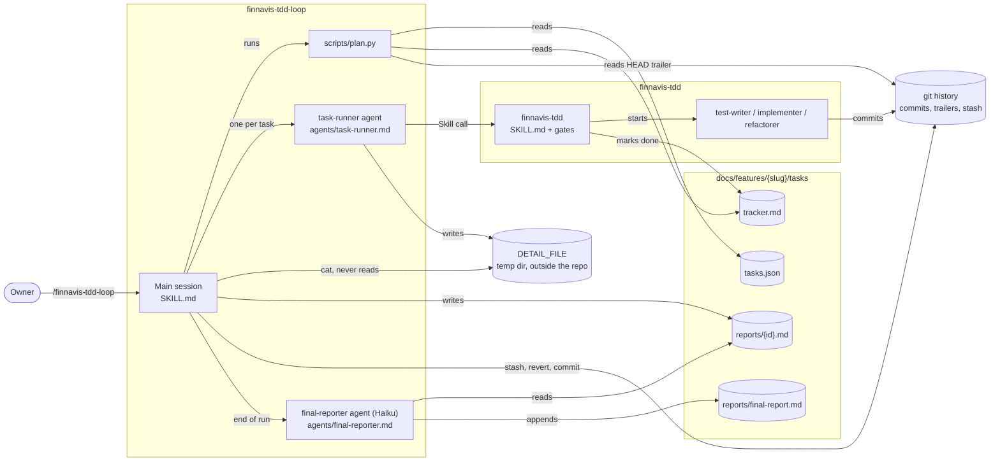

# finnavis-tdd-loop

Runs every `todo` task of a feature epic through `finnavis-tdd`, one task after another, in
dependency order. It replaces starting `/finnavis-tdd <slug> <id>` by hand for each task.

The rules live in [`SKILL.md`](SKILL.md). This file is a short map for a human reader.

## Usage

```
/finnavis-tdd-loop csv-import --dry-run              # show the plan, change nothing
/finnavis-tdd-loop csv-import                        # run; stop on the first failed task
/finnavis-tdd-loop csv-import --continue-on-error    # run; after a failed task, go on
```

## How it works

- **Plan.** `scripts/plan.py` reads `tasks.json`, `tracker.md` and the `Task:` trailer of HEAD.
  It picks the `todo` tasks of the layers `finnavis-tdd` takes (`domain`, `app`, `infra`,
  `wiring`) and orders them by `deps`. A task that an interrupted run left half-done goes first.
  Every skipped task is listed with its reason.
- **One runner per task.** The main session starts a task-runner agent for each task. The runner
  calls `finnavis-tdd`, which starts its own three phase agents: test-writer, implementer,
  refactorer. All the long output stays in the runner. The main session gets back five lines and
  the path of a detail file.
- **Check.** The main session does not trust the runner's answer. It checks that the tree is clean
  and that the task is `done` in `tracker.md`.
- **Failure.** Uncommitted work goes to `git stash`. The task's commits are rolled back with
  `git revert`, so the next task starts from a green baseline. Then the loop stops, or, with
  `--continue-on-error`, goes on with the tasks that do not depend on the failed one. A failure of
  the environment (red baseline, Docker down) always stops the loop.
- **Reports.** After every attempt the loop writes `tasks/reports/<id>.md`: the attempt history
  and the last attempt in full. At the end of the run a Haiku agent appends a `## Run <n>` section
  to `tasks/reports/final-report.md`: done, failed, needs attention, changed since an earlier run,
  not tried. Everything is committed. Nothing is pushed.

## Sequence

One run. The `loop` block repeats once per task. Inside it, `alt` shows the two outcomes of a
task: T10 passes, T12 fails at Gate 2. The notes show the five lines the runner hands back — the
only part of a task that reaches the main session.



## Components



## Files

| File                       | Role                                                            |
|----------------------------|-----------------------------------------------------------------|
| `SKILL.md`                 | The orchestrator: pre-flight, loop, failure handling, reports.  |
| `scripts/plan.py`          | Picks and orders the tasks. Prints `NEXT: <id>` or `NEXT: none`. |
| `agents/task-runner.md`    | Role of the agent that runs one task through `finnavis-tdd`.     |
| `agents/final-reporter.md` | Role of the Haiku agent that writes the run into `final-report.md`. |
