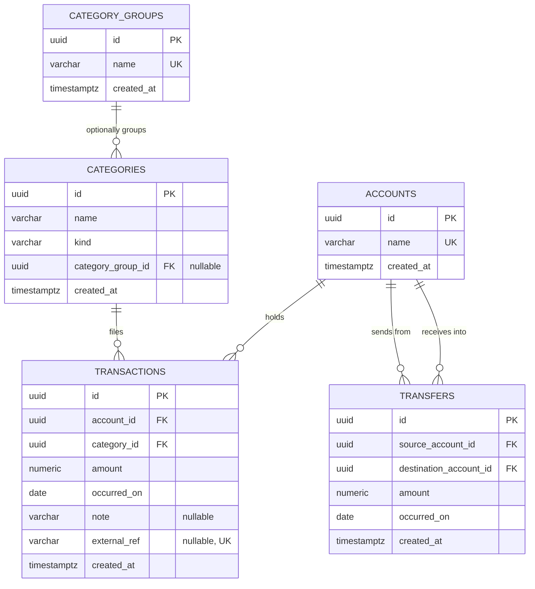

# Data model — core-ledger

<!-- Generated by sdlc:generate-data-model. The SQL under docs/features/core-ledger/migrations/ is a
REFERENCE SPEC, not a migration. This repo uses EF Core migrations; implement-tasks writes the
entity configurations, runs `./build.sh migrate <Name>`, and diffs the generated SQL against the
staged spec. See .claude/rules/migrations.md. -->

> **Inputs:** [PRD](./PRD.md) §4, §5 · [SAD](./sad.md) §5, §6 (nine flows), §8 ·
> [ADR-0001](./adr/0001-keep-transactions-and-transfers-in-separate-tables.md) ·
> [ADR-0002](./adr/0002-compute-every-read-on-demand.md) ·
> [ADR-0003](./adr/0003-edit-and-delete-ledger-rows-in-place.md) ·
> [ADR-0005](./adr/0005-use-uuid-v7-primary-keys-generated-in-the-application-layer.md) ·
> [ADR-0006](./adr/0006-add-a-nullable-external-reference-to-transactions-now.md)

## ER diagram

Five tables, matching the five Domain entities in SAD §5. A transaction and a transfer stay apart
(ADR-0001), so neither table carries a nullable counter-account or a kind discriminator, and the
breakdown satisfies AC-20 structurally: it reads `transactions` and never touches `transfers`.

Nothing here stores a balance or a period total. Every read is computed on demand (ADR-0002), so
there is no rollup table and no cache to invalidate.

## Decisions taken in this document

These are schema-level choices the PRD and SAD left open. Each one is a decision, not a derivation.

1. **A transaction's date is a calendar `DATE`, not a timestamp.** This closes the PRD §8 open
   question about local calendar months. The owner picks which day an entry belongs to; the
   database stores that day with no time and no timezone, so a period filter is a plain date range
   and a late-evening purchase can never slide into the next month. `created_at` stays
   `TIMESTAMPTZ` for record-keeping. `CLAUDE.md`'s "use `DateTimeOffset`, store UTC" rule still
   holds — it governs timestamps, and `occurred_on` is a date, not a timestamp.

2. **A note is `VARCHAR(500)`.** This closes the other PRD §8 open question and the storage-bloat
   abuse case in PRD §6.1. The bound becomes the validation rule in Presentation and Application.

3. **`amount` is always positive; direction comes from the category's kind.** AC-02 refuses a
   zero or negative amount, so a stored negative would contradict the acceptance criterion it is
   meant to satisfy. A balance therefore joins `transactions` to `categories` to learn whether a
   row adds or subtracts. At ~20 000 rows that join is on a primary key and costs nothing (PRD §6).
   A transfer needs no such join — its direction is which of the two account columns it sits in.

4. **Account names are unique; category names are unique per kind.** AC-07 is phrased *"Given the
   owner has no account by that name"*, which only makes sense if a name identifies an account.
   Categories are scoped by kind so that "Gifts" can exist once as spending and once as earning.
   **No acceptance criterion covers a duplicate name**, so this is an added rule — flagged in the
   audit report.

5. **No `updated_at` on any table.** The ledger is mutable (ADR-0003), so the column would be
   defensible, but nothing in the PRD reads a "last changed" value and no acceptance criterion
   needs one. Adding it would ship an unused column.

6. **No `CHECK` constraint anywhere.** AC-02 (amount above zero) and AC-05 (a transfer needs two
   different accounts) are both domain invariants, enforced in the Domain entities. The database
   stays dumb storage (`.claude/rules/migrations.md`).

## Entities

### `accounts`

| Column | Type | Constraints | Notes |
|---|---|---|---|
| `id` | UUID | PK, app-generated (UUID v7) | `Guid.CreateVersion7()` in Application — ADR-0005 |
| `name` | VARCHAR(100) | NOT NULL, UNIQUE | The label the owner chooses, not a bank identifier (PRD §6.1). 100 is a working bound — the PRD states none |
| `created_at` | TIMESTAMPTZ | NOT NULL DEFAULT now() | |

**Aggregate root:** root. Served by `IAccountRepository` (SAD §5).
**Access patterns:** list all accounts (flow 5) → no index needed, the table holds a handful of
rows · check whether any movement names this account before deleting (flow 5) → indexes live on
`transactions` and `transfers`, not here.
**Constraints:** UNIQUE on `name`.
**No balance column.** AC-14 is satisfied by computing the sum at read time (ADR-0002), which is
also what makes AC-21 and AC-22 free — nothing stored has to be corrected when an entry changes.

### `category_groups`

| Column | Type | Constraints | Notes |
|---|---|---|---|
| `id` | UUID | PK, app-generated (UUID v7) | |
| `name` | VARCHAR(100) | NOT NULL, UNIQUE | e.g. "Utilities" over electricity, water and gas |
| `created_at` | TIMESTAMPTZ | NOT NULL DEFAULT now() | |

**Aggregate root:** root, but it has **no repository of its own** — `ICategoryRepository` serves it
(SAD §5), because US-04 treats creating a category and placing it in a group as one job.
**Access patterns:** load one group by id when creating or moving a category (flow 6) → primary
key · join to `categories` for the breakdown (flow 3) → index lives on `categories`.
**Constraints:** UNIQUE on `name`.
**The Default group is not a row here.** It is a bucket the breakdown produces for categories with
no group (SAD §12, flow 3). It cannot be renamed, deleted, or picked when filing a transaction, so
storing it would invite exactly the mistakes the glossary rules out.

### `categories`

| Column | Type | Constraints | Notes |
|---|---|---|---|
| `id` | UUID | PK, app-generated (UUID v7) | |
| `name` | VARCHAR(100) | NOT NULL | |
| `kind` | VARCHAR(16) | NOT NULL | `CategoryKind` — `Expense` or `Income`. Stored as a string, never as an int (`CLAUDE.md`) |
| `category_group_id` | UUID | NULL, FK → `category_groups(id)` | Nullable: a group is optional (SAD §12). Indexed below |
| `created_at` | TIMESTAMPTZ | NOT NULL DEFAULT now() | |

**Aggregate root:** root. Served by `ICategoryRepository`.
**Access patterns:** join to `category_groups` for the breakdown (flow 3) → `idx_categories_category_group_id` ·
join from `transactions` to learn a row's direction (flow 7) → primary key.
**Constraints:** UNIQUE on (`name`, `kind`); FK → `category_groups(id)`.
**Moving a category between groups updates this row only** (AC-13, flow 6). A transaction names its
category and never its group, so no transaction row is rewritten and that category's figure for a
closed period cannot change. The group mapping is resolved at query time (ADR-0002).
**No `ON DELETE CASCADE`.** AC-12 blocks deleting a category that history names, and that check
runs in the Application layer before the delete (flow 6). A cascade would silently do the opposite
of what the acceptance criterion asks for.

### `transactions`

| Column | Type | Constraints | Notes |
|---|---|---|---|
| `id` | UUID | PK, app-generated (UUID v7) | Time-ordered, so it doubles as a tiebreaker when paging history by date (SAD §11) |
| `account_id` | UUID | NOT NULL, FK → `accounts(id)` | Exactly one account — a transaction that touched two would be a transfer (SAD §12). Indexed below |
| `category_id` | UUID | NOT NULL, FK → `categories(id)` | Every transaction names exactly one category (AC-01, AC-03). Indexed below |
| `amount` | NUMERIC(19,4) | NOT NULL | Always above zero — AC-02 is enforced in the Domain entity, not by a `CHECK`. Direction comes from `categories.kind` |
| `occurred_on` | DATE | NOT NULL | The calendar day the owner files it under. See decision 1 |
| `note` | VARCHAR(500) | NULL | Optional free text (AC-01). Stored and returned as plain text, never interpreted (PRD §6.1) |
| `external_ref` | VARCHAR(200) | NULL, UNIQUE | **Always null in this feature.** csv-import and message capture fill it later — ADR-0006 |
| `created_at` | TIMESTAMPTZ | NOT NULL DEFAULT now() | |

**Aggregate root:** root. Served by `ITransactionRepository`.
**Access patterns:** breakdown over a period (flow 3) and history page filtered by period and
account (flow 8) → `idx_transactions_occurred_on_account_id` · balance per account (flow 7) and the
account delete check (flow 5) → `idx_transactions_account_id` · the category delete check (flow 6)
→ `idx_transactions_category_id` · de-duplication by outside reference, later → `ux_transactions_external_ref`.
**Constraints:** UNIQUE on `external_ref`; FK → `accounts(id)`; FK → `categories(id)`.
**Rows are edited and deleted in place** (ADR-0003). There is no reversing entry, no `deleted_at`
and no audit table — AC-22 says a removed entry disappears from history, which is a hard delete.
The accepted cost is that a wrong delete is unrecoverable outside the nightly `pg_dump` (SAD §7, §11).
**PostgreSQL treats nulls as distinct in a unique index**, so the unique `external_ref` permits any
number of null rows — which is every row this feature writes. ADR-0006 flags this as a subtlety the
next feature must not misread.

### `transfers`

| Column | Type | Constraints | Notes |
|---|---|---|---|
| `id` | UUID | PK, app-generated (UUID v7) | |
| `source_account_id` | UUID | NOT NULL, FK → `accounts(id)` | The account the money leaves. Indexed below |
| `destination_account_id` | UUID | NOT NULL, FK → `accounts(id)` | The account the money arrives in. Indexed below |
| `amount` | NUMERIC(19,4) | NOT NULL | One amount for both sides, so AC-04 and AC-15 hold by construction |
| `occurred_on` | DATE | NOT NULL | Same calendar-day rule as `transactions` |
| `created_at` | TIMESTAMPTZ | NOT NULL DEFAULT now() | |

**Aggregate root:** root. Served by `ITransferRepository`.
**Access patterns:** balance per account (flow 7) and the account delete check (flow 5) →
`idx_transfers_source_account_id` and `idx_transfers_destination_account_id` · the history page's
second half (flow 8) → `idx_transfers_occurred_on`.
**Constraints:** FK → `accounts(id)` twice.
**No `category_id` and no `note`.** A transfer carries no category (SAD §12), which is what makes
AC-23 a refusal rather than a validation rule — the column it would need does not exist. The PRD
gives a note only to transactions (AC-16).
**One row, not two.** AC-06 says a transfer is never applied to one side only, and a single row
makes a half-applied transfer unrepresentable rather than merely prevented (flow 2).
**`source_account_id <> destination_account_id` is not a `CHECK`.** AC-05 is a domain invariant,
refused in the `Transfer` entity before the row is ever built.

## Indexes

Every index below is justified by a concrete query from a SAD §6 flow. Candidates with no query
behind them were discarded.

| Index | Columns | Query it serves |
|---|---|---|
| `idx_transactions_occurred_on_account_id` | `transactions(occurred_on, account_id)` | Flow 3 period breakdown filters on the period alone (leading column). Flow 8 history page filters on period **and** account. One index covers both — AC-18, AC-16 |
| `idx_transactions_account_id` | `transactions(account_id)` | Flow 7 balance sums every transaction per account over all time, and flow 5 asks whether any transaction names an account before deleting it. Neither filters by date, so the composite above cannot serve them — AC-14, AC-09 |
| `idx_transactions_category_id` | `transactions(category_id)` | Flow 6 asks whether any transaction names a category before deleting it — AC-12. Also the FK index required by `.claude/rules/migrations.md` |
| `ux_transactions_external_ref` | `transactions(external_ref)` UNIQUE | Required by ADR-0006. Unused in this feature; it makes "this outside thing is already recorded" a database guarantee for csv-import rather than a check that can race |
| `idx_categories_category_group_id` | `categories(category_group_id)` | Flow 3 joins categories to their current group to produce group totals — AC-18, AC-19. Also the FK index |
| `idx_transfers_source_account_id` | `transfers(source_account_id)` | Flow 7 subtracts transfers out of an account, and flow 5 checks them before deleting the account — AC-14, AC-09. Also the FK index |
| `idx_transfers_destination_account_id` | `transfers(destination_account_id)` | Flow 7 adds transfers into an account, and flow 5 checks them too — AC-14, AC-09. Also the FK index |
| `idx_transfers_occurred_on` | `transfers(occurred_on)` | Flow 8 reads the transfers half of the history page by period. The breakdown never reads this table (AC-20), so no composite with a category is wanted |

**Indexes deliberately not created:**

- Nothing on `accounts(name)` or `category_groups(name)` beyond the unique constraints — PostgreSQL
  backs a UNIQUE with an index already.
- No index on `transactions(note)`. Nothing searches notes; PRD §8 closed the extra-filter-dimension
  question as "no" and SAD §8 records it.
- No partial or covering index on the breakdown. ADR-0002 removed every cache and rollup, so
  `idx_transactions_occurred_on_account_id` is load-bearing on its own. SAD §10 QG-2 guards it with
  an `EXPLAIN` assertion inside the latency test, so losing it fails a test rather than quietly
  turning the query into a sequential scan.

## Seeds

**None.** This feature seeds nothing, and that is a decision rather than an omission:

- **Bootstrap** — nothing to bootstrap. There is no user table, no organisation and no sign-in
  (PRD §3), so there is no default row to create.
- **Lookup** — `CategoryKind` is stored as a string, not as a foreign key into a lookup table
  (`CLAUDE.md`), so there is no `category_kinds` table to fill.
- The owner creates their own accounts, categories and groups through the API (US-03, US-04). A
  seeded starter set would be guessing at someone's spending habits.

## Test fixtures

Not yet written — the Domain entities do not exist (SAD §3: the repository is a skeleton). These
belong to `implement-tasks`, listed here so the shape is agreed first.

Builders go in the test projects, never in a migration. The repo uses xUnit with AwesomeAssertions
(`CLAUDE.md`), so a builder-per-entity in a shared test helper fits the existing convention:

- `AccountBuilder` — an account with a generated UUID v7 and a default name.
- `CategoryGroupBuilder` — a named group.
- `CategoryBuilder` — a category with a kind, optionally placed in a group.
- `TransactionBuilder` — a transaction on an account and a category, with an amount, an
  `occurred_on` and an optional note.
- `TransferBuilder` — a transfer between two distinct accounts.

**PII guard.** No real-looking personal data in any fixture. Account names are `Test Account`,
notes are `Test note`, and amounts are invented. **No real bank statement or real export ever
enters the repository** (`CLAUDE.md` Safety) — the QG-1 property-based test generates its own
random sequences and needs no real file.

## Open items

<!-- TBD: the history page size is still unspecified. SAD §6 "Notes flagged while completing §6"
     records that flow 8 passes a page but neither the PRD nor §10 says what a page holds. It does
     not change this schema — paging is a query concern, not a column — but /sdlc-api-forge must
     settle it. -->

<!-- TBD: whether a category filter on the history page excludes transfers entirely. SAD §6 flags
     that AC-16 pulls in two directions here. Again a query concern, not a column: a transfer has no
     category_id, so the schema already makes a category filter unable to match one. -->
