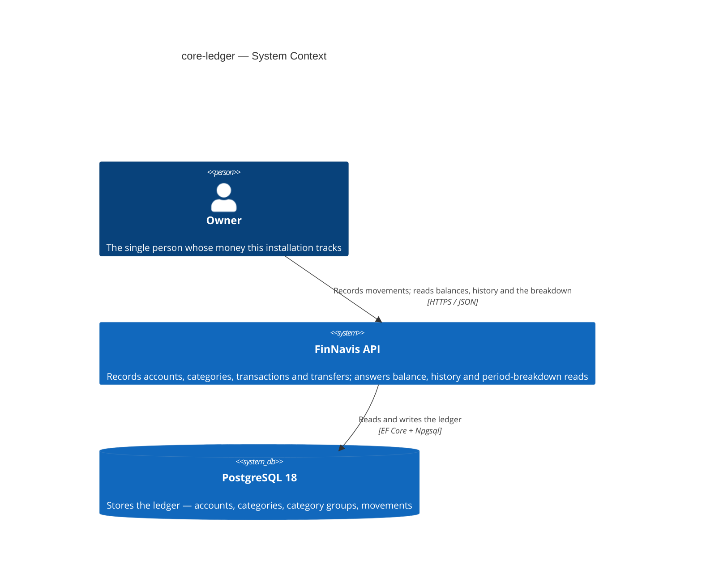
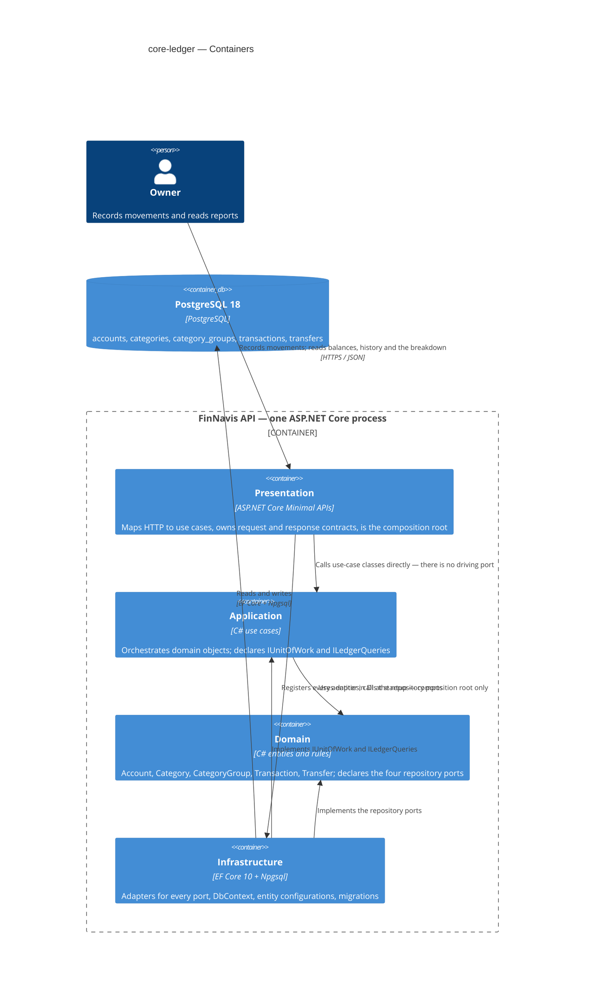
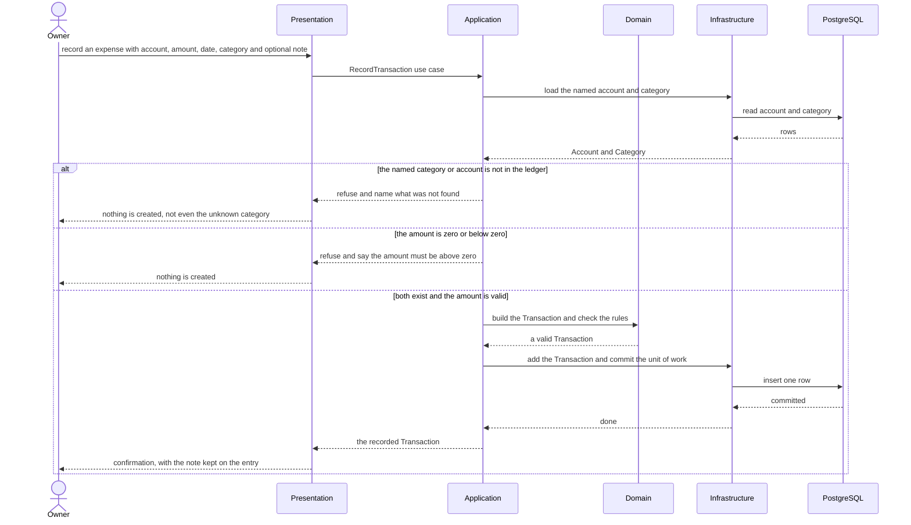
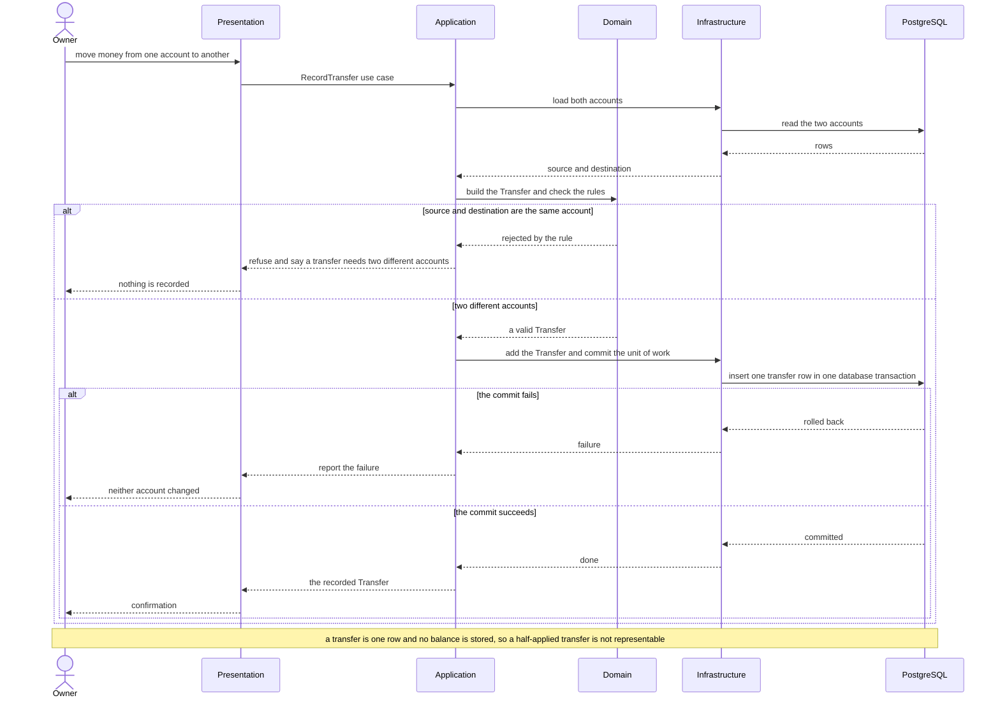
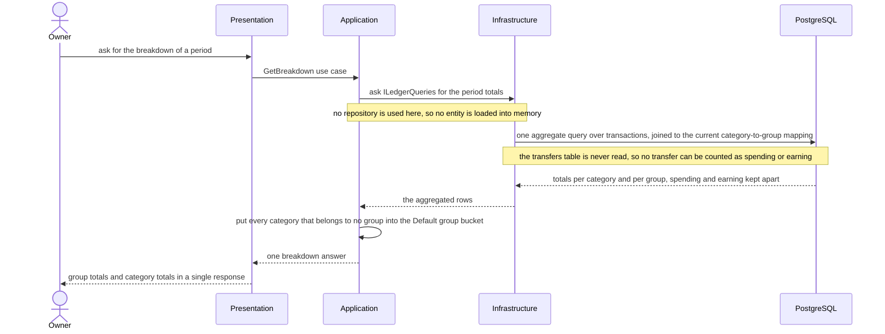
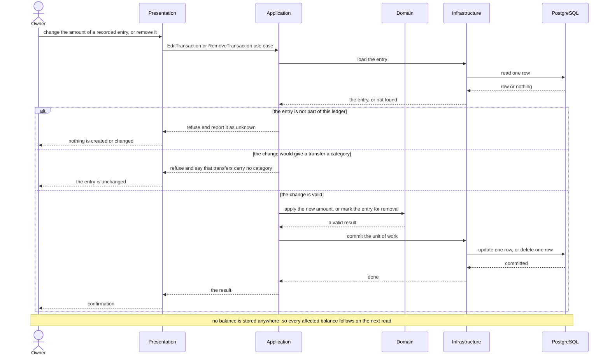

# Software Architecture Document — core-ledger

<!-- Stages 04-05 → see sdlc/plugin/skills/architecture-design/SKILL.md -->
<!-- 12 Arc42 sections. Empty sections — <!-- N/A: <one-line reason> -->. -->
<!-- C4 Context (L1) lives inline in §3. C4 Container (L2) lives inline in §5. -->
<!-- §6 Runtime view seeds the primary flow(s) here; complete-sequence-diagrams (stage 06) then -->
<!--    fills §6 with every critical flow / §5 AC — no cap. -->
<!-- Numbers in §10 come VERBATIM from PRD §6 NFR — no inventing, no rounding. -->

## 1. Introduction and goals

<!-- 🎯 Навіщо: стабільна памʼять про «що + три головні якості + хто зацікавлений».     -->
<!--           Через рік ніхто не згадає на словах, ЯКІ ТРИ ЯКОСТІ для системи критичні. -->
<!-- 📋 Що писати: 1 абзац intent + 3 рядки топ-3 якості + таблиця stakeholders.        -->
<!-- 📌 Приклад: «QG-1: швидкість редагування блоку p95 ≤500 мс»                         -->

**Intent.** Build the ledger the rest of FinNavis stands on. It holds accounts, categories with
optional groups over them, transactions and transfers, and it answers two reads: a filtered history
and one period breakdown that reports group totals and category totals in a single request. One
owner, self-hosted, programmatic access only — the web client is a later feature that consumes what
is built here (PRD §2, §3).

**Top-3 quality goals (1-liners; full scenarios in §10):**

1. **Ledger correctness** — an account balance always equals the sum of the movements recorded on
   it, under any order of recording, editing and deleting.
2. **Interactive latency** — recording a movement and reading history or the breakdown stay fast on
   three years of history (~20 000 movements).
3. **Report stability under re-grouping** — moving a category between groups never changes that
   category's figure for a closed period; only group figures follow the new placement.

**Stakeholders.**

| Role | Interest | Sign-off owner? |
|---|---|---|
| Owner | Records movements; reads balances, history and the period breakdown | No |
| Architect / Tech Lead (Andrey Simonenko) | SAD and ADR approval | Yes |

> Solo project: the same person fills both rows. They are kept apart because the interests differ —
> the Owner cares that the figures are right, the Architect carries the decisions recorded here.

<!-- Decision overrides (¶4) — populated by the Step-7 critic resolution loop, empty otherwise.       -->
<!-- Each: «Decision override: <headline> — rationale: <reason>» so downstream skills see the choice.  -->

## 2. Constraints

<!-- 🎯 Навіщо: §4 (стратегія) працює тільки коли §2 зафіксувала, ЩО ВЖЕ ЗАФІКСОВАНО:    -->
<!--           стек, версії, дедлайн, регуляторні вимоги. Це вхід, не вихід.             -->
<!-- 📋 Що писати: чотири блоки — Технічні / Організаційні / Конвенції / Регуляторні.     -->
<!-- 📌 Приклад: «Postgres 18» (не «Postgres»); «дедлайн Q3 — жорсткий» (не «бажано»).    -->

These are inputs, not choices made here. Everything below was already fixed by the repo before this
feature started — with one exception, marked.

**Technical.**
- .NET 10 / C# 14; nullable enabled; implicit usings; `TreatWarningsAsErrors` (`Directory.Build.props`).
- ASP.NET Core Minimal APIs; OpenAPI document served at `/openapi/v1.json` in Development.
- PostgreSQL through EF Core + Npgsql. **The repo pins no major version today** — `SPEC.md` says
  only "PostgreSQL". This feature picks **18** and pins it; that is a choice made here, not an
  inherited constraint, and it is recorded in §7 together with the compose stack that carries it.
- Clean Architecture, four projects, dependency rule enforced by `tests/FinNavis.ArchitectureTests`
  (`docs/adr/0001-initial-setup.md`).
- Money is `decimal`. Timestamps are `DateTimeOffset`, stored UTC. Enums are stored as strings.
  Tables and columns are `snake_case`.

**Organisational.**
- One developer, working evenings. No deadline, no release window, no second reviewer.
- Every NFR row in PRD §6 except Availability is measured by an **integration harness and a CI
  pipeline that do not exist yet** (`SPEC.md` "Planned, not built yet"). Standing them up is a
  prerequisite task for `/sdlc-break-tasks`, not a side effect of this feature. Carried into §11.

**Conventions.**
- `CLAUDE.md` — layout, dependency rules, DI, API, database and test conventions.
- `ARCHITECTURE.md` — the four rings, and what counts as a port versus a plain interface.
- Repository ports live in `Domain/Abstractions`; outside-world ports in `Application/Abstractions`.
  Infrastructure implements both. Presentation is the only composition root.
- One `IEntityTypeConfiguration<T>` file per entity. Migrations are append-only — never edit an
  applied one.

**Regulatory / external.**
- No external regulation applies. Self-hosted, one owner, the owner's own data. No third-party
  personal data and no card numbers — an account is a label the owner chooses, not a bank
  identifier (PRD §6.1).
- Data classification: **confidential** — one person's complete financial history.
- Security review: **required** (PRD §6.1), because the data is confidential and this feature adds
  no authentication boundary. That absence is the main exposure and is carried into §11.

## 3. Context and scope

<!-- 🎯 Навіщо: малює КОРДОН СИСТЕМИ — хто з нею говорить ззовні, де закінчується зона довіри. -->
<!--           Без §3 §5 і §8 (авторизація) розпливаються — неясно, що «всередині», а що «зовні». -->
<!-- 📋 Що писати: 2-3 речення бізнес-контексту + таблиця зовнішніх систем + Mermaid C4Context. -->
<!-- 📌 Приклад: «зовнішні — нема (свідома відмова від third-party у v1)» — це теж рішення.   -->
<!-- Кордон довіри (trust boundary) — лінія, за якою ти не довіряєш даним без перевірки.       -->

The Owner records every money movement — income, expense and transfer between their own accounts —
through a REST API, and reads back three things: the balance of each account, a filtered history,
and one period breakdown that totals by group and by category at once. The system is self-hosted and
serves exactly one person. It talks to nothing outside itself except its own database.

<!-- brownfield: the repository is a skeleton. Four projects, references and architecture tests
     exist; no entity, endpoint or schema does. There is no existing module to extend, so §5
     decomposes into the four projects that are already there. -->

**External systems (in / out):**

| Actor or system | Type | Interaction |
|---|---|---|
| Owner | Person | Records transactions and transfers; manages accounts and categories; reads balances, history and the period breakdown |
| PostgreSQL 18 | System (separate process, self-hosted alongside the API) | Stores the whole ledger |

**No third-party system is involved, and that is a decision, not an omission.** There is no bank
integration, no identity provider and no message broker in this feature (PRD §3 Non-goals). The
planned consumers — the React PWA, CSV import, export, assistant access — are separate later
features. None of them exists yet, so none appears below; each will consume the API drawn here
rather than change its boundary.

**C4 Context (L1):**



## 4. Solution strategy

<!-- 🎯 Навіщо: 3-4 СТРАТЕГІЧНІ СТОВПИ, з яких потім ростуть усі ADR. Без §4 кожен ADR    -->
<!--           виглядає випадковим — нема зонтика. ⭐ Найгустіша секція — тут ADR-gate    -->
<!--           спрацьовує майже завжди (рішення незворотні + мульти-модульні).            -->
<!-- 📋 Що писати: спершу Target surface(s), потім 3-4 стратегічні вибори.                -->
<!--           На кожен — заголовок + 2-3 речення rationale.                              -->
<!-- 📌 ПЕРШЕ рішення §4 — Target surface(s): ЩО САМЕ будуємо. Записується у frontmatter   -->
<!--           target_surfaces: [...] і гейтить §5 (один контейнер на поверхню) + усі       -->
<!--           наступні стадії. Деривиться з PRD §1 «для кого» + §4 ролей. → _shared/surfaces.md -->
<!-- 📌 Приклад: «Зберігати урок як таблицю блоків» — стовп, з якого виросло ADR-0001.    -->

**Target surface(s) (the first decision — what's being built):** `[backend-service]`

One REST API plus its database. No UI surface, so there is no UI-architecture decision to take here.
PRD §3 is explicit: no web client, no installable app, no offline reading — the React PWA is a
separate later feature that will consume this API. §5 therefore draws one application container.
<!-- Mirror this list into the frontmatter `target_surfaces`. For each declared UI surface          -->
<!-- (web-frontend / mobile-app / desktop-app) add a UI-architecture choice below (web → SSR/SPA/   -->
<!-- hybrid; mobile → native/cross-platform). Multi-surface is usually an ADR (multi-module +       -->
<!-- irreversible). The UI reuses the repo's existing design system / components / tokens from       -->
<!-- architecture-map.md §Frontend — it does not design greenfield. → _shared/surfaces.md           -->

**Top strategic choices (the seeds for ADRs):**

1. **A transaction and a transfer are two different records, in two tables** (ADR-0001). The glossary
   already treats them as different things: a transaction touches one account and carries a
   category, a transfer touches two and carries none. Keeping them apart means neither table needs a
   nullable counter-account or a discriminator, and the breakdown satisfies AC-20 structurally —
   it reads `transactions` and never looks at `transfers`, so a transfer cannot leak into a category
   total. The price is paid on the read side: balance is three sums added together, and history is a
   `UNION ALL` of two shapes. That price is acceptable because transfers are rare in this ledger, and
   it keeps the option of dropping transfers later down to a single migration.

2. **Every read is computed on demand; nothing is pre-aggregated and nothing is cached** (ADR-0002).
   Balance, history and the period breakdown are all queries over the base tables. Three years of
   history is about 20 000 rows (PRD §6) — small enough that one indexed aggregate query sits far
   inside the 500 ms budget. This also makes quality goal 3 free: because the category-to-group
   mapping is resolved at query time, moving a category between groups changes group totals at once
   and cannot change that category's own figure (AC-13).

3. **The ledger is mutable — corrections edit and delete rows in place** (ADR-0003). AC-21 and AC-22
   describe this literally: a removed entry disappears from history and the balances return to what
   they would have been had it never existed. That is a hard delete, not a reversing entry. It also
   keeps history easy to read, which matters for the ≤ 400 ms history page — there are no reversed
   pairs to detect and hide. The accepted cost is that there is no audit trail — carried into §11.

Each tactical decision in later sections should be traceable to one of these strategic seeds. Tactical decisions that *contradict* a strategic choice are red flags — surface them in §11 Risks.

## 5. Building block view

<!-- 🎯 Навіщо: ВНУТРІШНЯ ДЕКОМПОЗИЦІЯ — модулі, контейнери, БД. Статична топологія:   -->
<!--           хто з ким може говорити. Без §5 §6 (сценарії) не має словника учасників. -->
<!-- 📋 Що писати: 1 абзац про стиль (шари/гексагональна/clean/на подіях) +            -->
<!--           дерево папок + Mermaid C4Container.                                       -->
<!-- 📌 ОДИН Container на кожну оголошену target_surface (frontmatter): fullstack        -->
<!--           [backend-service, web-frontend] = backend-API container + web/SPA container; -->
<!--           [backend-service, mobile-app] = API + mobile app. Container(web, …) нижче — -->
<!--           лише приклад однієї поверхні; додай/заміни під оголошене у §4. → _shared/surfaces.md -->
<!-- 📌 Приклад: «web-app, content-api, media-worker, postgres, s3, cdn».                -->

**Clean Architecture, four rings, no new project.** The rings already exist and were fixed by
`docs/adr/0001-initial-setup.md`; this feature fills them in rather than changing the structure.
Inside `Application`, code is organised by feature folder — one folder per thing the owner can do —
which is what the empty `Application/Features/` directory already signals.

The feature introduces **five aggregates and four repository ports**. `CategoryGroup` has no
repository of its own: US-04 treats creating a category, putting it in a group and moving it between
groups as one job, so `ICategoryRepository` serves all of it. A port is added when a use case needs
one, never because a table exists (CLAUDE.md).

The **read path is separate from the write path** (ADR-0004). Writes go through the repository ports
and return domain entities. Reads go through `ILedgerQueries`, declared in
`Application/Abstractions` and implemented in Infrastructure, so aggregation happens in PostgreSQL
and only result rows travel back.

**Internal decomposition:**

```
src/FinNavis.Domain/
├── Entities/        Account, Category, CategoryGroup, Transaction, Transfer
├── ValueObjects/    Money, DateRange
├── Enums/           CategoryKind (Expense | Income)
└── Abstractions/    IAccountRepository, ICategoryRepository,
                     ITransactionRepository, ITransferRepository, IClock

src/FinNavis.Application/
├── Features/Accounts/      Create, Rename, Delete, GetBalances
├── Features/Categories/    Create, Rename, MoveToGroup, Delete
├── Features/Transactions/  Record, Edit, Remove
├── Features/Transfers/     Record, Edit, Remove
├── Features/Reporting/     GetHistory, GetBreakdown
└── Abstractions/           IUnitOfWork, ILedgerQueries

src/FinNavis.Infrastructure/
├── Persistence/            FinNavisDbContext, Configurations/, Migrations/
├── Repositories/           EF Core adapters for the four repository ports
└── Queries/                EF Core adapter for ILedgerQueries

src/FinNavis.Presentation/
├── Endpoints/              AccountEndpoints, CategoryEndpoints, TransactionEndpoints,
│                           TransferEndpoints, ReportingEndpoints
└── Contracts/              request + response records
```

**C4 Container (L2):**

> The four boxes inside the boundary are the four rings. They compile into **one** ASP.NET Core
> process and are not separately deployable — they are drawn as containers because the boundary
> between them is the architecture here, and it is enforced by `tests/FinNavis.ArchitectureTests`.
> `target_surfaces` declares one surface, so there is one application boundary.



## 6. Runtime view

<!-- 🎯 Навіщо: ПОТІК У RUNTIME для 1-2 критичних сценаріїв. Хто з ким коли і у якому     -->
<!--           порядку говорить. Без §6 §5 — лише купа коробок без життя.                  -->
<!-- 📋 Що писати: Mermaid sequenceDiagram. Учасники — імена з §5 (не вигадуй нові!).      -->
<!--           Повідомлення семантичні («складає чорновик»), БЕЗ HTTP-методів/шляхів —     -->
<!--           ендпоінт-рівневі sequence-діаграми зʼявляться у stage 06 (api-forge).        -->
<!-- ⏳ RESERVED FOR SEQUENCES: architecture-design сіє лише primary flow(s) тут.          -->
<!--           complete-sequence-diagrams (stage 06) ДОПОВНЮЄ §6 кожним критичним flow /    -->
<!--           кожним §5 AC — без обмеження. Не намагайся покрити все тут.                  -->
<!-- 📌 Приклад: «methodist → web-app: складає чорновик → web-app → content-api: зберегти». -->

Participants are the §5 rings. Messages are semantic — HTTP verbs, paths and status codes arrive at
the `api-forge` stage, not here. These four flows are seeds;
`/sdlc-complete-sequence-diagrams` then covers every acceptance criterion.

**Critical flow 1: record an expense** (US-01 — AC-01, AC-02, AC-03)



**Critical flow 2: record a transfer, and what happens when it fails** (US-02 — AC-04, AC-05, AC-06)



**Critical flow 3: read the period breakdown** (US-07 — AC-18, AC-19, AC-20)



**Critical flow 4: correct a recorded entry** (US-08 — AC-21, AC-22, AC-23, AC-25)



## 7. Deployment view

<!-- 🎯 Навіщо: ТОПОЛОГІЯ, яку DevOps має знати без читання Helm-чартів — скільки реплік,  -->
<!--           де живе фоновий обробник, ПРИ ЯКИХ ЧИСЛАХ масштабуємось.                     -->
<!-- 📋 Що писати: 2-3 речення про топологію + метрики + алерти + конкретні числа-пороги.   -->
<!-- 📌 Приклад: «500 IC → партиціонування за кварталом» (не «при зростанні подумаємо»).    -->
<!-- 🎯 Можна N/A для XS/S функцій, що переюзають існуюче розгортання без змін.            -->

**The PostgreSQL major version is pinned to 18, and this feature is what pins it.** The repo names
no version today (`SPEC.md` says only "PostgreSQL"), so three things that do not yet exist need a
number: the Testcontainers image tag, the compose tag, and the question of which SQL features are
allowed. An unpinned tag would make a correctness-test failure impossible to attribute — the test
could break on a day nothing in the code changed.

One Docker Compose stack on the owner's own machine or home server: one API container, one
PostgreSQL 18 container, one named volume for the data. One replica of each — no load balancer, no
orchestrator, no second environment. The two containers share a private Docker network and only the
API port is published, and only on the local network. That is what PRD §6.1 means by "the owner
keeps the installation off public networks" — with no authentication in this feature, the network
boundary is the only access control there is.

**This feature creates the deployment unit.** `docker-compose.yml`, the Testcontainers integration
harness and a minimal CI job do not exist today (`SPEC.md`, "Planned, not built yet").
`/sdlc-break-tasks` schedules all three as the **first** tasks of core-ledger, before any ledger
code. Without them not one NFR row can be measured and the correctness target — 0 balance
discrepancies across at least 1 000 randomised sequences — cannot be run at all.

**Backups.** A scheduled nightly `pg_dump` writes a dated dump into a host folder that the owner's
own machine backup already covers, keeping the last N dumps. This is not optional housekeeping: the
ledger is hard-delete with no audit trail (ADR-0003), so a restore from dump is the **only** way
back from a mistaken delete. The residual gap — anything recorded or deleted after the last nightly
dump is still lost — is carried in §11.

**Monitoring.** Deliberately thin, and that is a decision rather than an omission.

- **Logs** — structured logs to stdout, read with `docker compose logs`. No aggregation, no retention
  policy.
- **Metrics** — none. PRD §6 sets no availability target, and every latency figure is measured in the
  integration suite rather than in production. A metrics stack here would instrument a system that
  has nobody to page.
- **Alerts** — none. Downtime costs only the owner's own evening (PRD §6, `SPEC.md`).
- **Tracing** — none. One process, four rings, no network hop to correlate.

**Scaling thresholds.**

- About 20 000 movements over three years of history (PRD §6) — one untuned PostgreSQL instance
  covers that with large margin, which is what makes the compute-on-demand choice in ADR-0002 safe.
- Look again if a single table passes ~1 000 000 rows, or if the breakdown p95 approaches its 500 ms
  target. At manual-entry rates neither is expected inside the product's lifetime; csv-import is the
  feature most likely to change that assumption.

<!-- For XS/S that doesn't change deployment: <!-- N/A: feature reuses existing deployment unit -->. -->

## 8. Crosscutting concepts

<!-- 🎯 Навіщо: НАСКРІЗНІ ПАТЕРНИ, які перетинають кілька модулів: логування, помилки,    -->
<!--           авторизація, ID strategy, outbox, кеш. ⭐ Друга найгустіша секція.          -->
<!--           Якщо патерн всередині одного модуля — він НЕ сюди. Якщо це конвенція        -->
<!--           проєкту в цілому — у CLAUDE.md.                                              -->
<!-- 📋 Що писати: таблиця концепт / конвенція / де визначено. Один рядок на концепт.      -->
<!-- 📌 Приклад: «UUID v7 (час+випадковий, сортується) у app-layer» — як default з CLAUDE.md. -->

| Concept | Convention | Where defined |
|---|---|---|
| Logging | Structured logs to stdout through `Microsoft.Extensions.Logging`. No PII scrubbing — every value is the owner's own data | §7 |
| Authentication | None. One owner, no sign-in. Network isolation is the only control | PRD §3, §6.1 → §11 |
| Authorization | None. There is no second actor to deny and no existence to hide (PRD §5 N/A note) | PRD §5 → §11 |
| Error handling | A broken domain rule produces a sentinel domain error; Presentation maps it to an RFC 9457 Problem Details response. Refusal wording is taken from the PRD acceptance criteria, not invented | here |
| ID strategy | UUID v7, generated in the Application layer with `Guid.CreateVersion7()`, stored as PostgreSQL `uuid` | ADR-0005 |
| External reference | Every transaction carries a nullable `external_ref` with a unique index. Unused and always null in this feature; csv-import and message capture fill it later | ADR-0006 |
| Money | `decimal`, single currency, no currency code stored | CLAUDE.md, PRD §3 |
| Time | `DateTimeOffset`, stored UTC. An `IClock` port in `Domain/Abstractions` keeps date rules testable without the machine clock | CLAUDE.md, ARCHITECTURE.md |
| Validation | Shape only in Presentation; use-case checks in Application; invariants inside Domain entities | here |
| Concurrency | None. One owner and one client, so no optimistic concurrency token in v1 | → §11 |
| Filter dimensions | Period, account and category only. Payee, merchant and free tags are deliberately excluded — the optional note covers the need to find an entry by eye (PRD §8, closed at this stage) | here → §11 |
| Internationalisation | N/A — English only | — |
| Observability | N/A — no metrics, alerts or tracing. See §7 for why | §7 |
| Outbox / events | N/A — one process, no module-to-module messaging in this feature | — |

## 9. Architecture decisions

<!-- 🎯 Навіщо: ЗВОРОТНИЙ ІНДЕКС на папку adr/. `ls adr/` дає файли, §9 дає семантику —    -->
<!--           чому вони існують, до якого зрізу SAD привʼязані, у якому статусі.           -->
<!-- 📋 Що писати: таблиця з 4 колонками. Один рядок на ADR. Mixed status — це OK.         -->
<!-- 📌 Приклад: «0001 | Зберігати урок як таблицю блоків | Accepted | §4».                -->

| # | Title | Status | Section |
|---|---|---|---|
| 0001 | Keep transactions and transfers in separate tables | Accepted | §4 |
| 0002 | Compute every read on demand, with no rollup table and no cache | Accepted | §4 |
| 0003 | Edit and delete ledger rows in place instead of keeping an append-only ledger | Accepted | §4 |
| 0004 | Separate the read path behind a query port instead of reading through repositories | Accepted | §5 |
| 0005 | Use UUID v7 primary keys generated in the Application layer | Accepted | §8 |
| 0006 | Add a nullable external reference to transactions now, before any feature uses it | Accepted | §8 |

ADR files live under `docs/features/core-ledger/adr/NNNN-<title>.md`.

Six ADRs for an M-sized feature, inside the expected 5–12 range. They are not independent: 0001 and
0002 together decide the data shape and the read strategy, 0004 follows from 0002 (on-demand reads
need a path that aggregates in the database), and 0003 is what makes 0002 safe to hold — with
nothing stored, an in-place edit has nothing to invalidate. 0005 and 0006 are both about identity,
and both exist because of features that have not been written yet.

Decisions that did **not** become ADRs, and why: the aggregate and repository split (§5) follows
CLAUDE.md's existing rule of one repository per aggregate; the PostgreSQL version pin, the
deployment topology and the backup approach (§7) are all reversible in an afternoon — a major
version can be changed with one `pg_upgrade` on a single-user database; the crosscutting table (§8)
inherits CLAUDE.md throughout. None of them would surprise a reader six months from now, which is
the test.

The repo also carries `docs/adr/0001-initial-setup.md`, which is project-wide rather than feature-
scoped. Numbering here restarts at 0001 inside this feature's folder, per the SDLC convention.

## 10. Quality requirements

<!-- 🎯 Навіщо: ДЕРЕВО ЯКОСТЕЙ (Quality Tree) — беремо мету з §1 і розкладаємо на          -->
<!--           конкретні листя: тести, метрики, конфіги, drill-и. ⭐ Без §10 §1 — це       -->
<!--           маніфест. З §10 кожна декларація мапиться на щось, ЩО МОЖНА ДОВЕСТИ.        -->
<!-- 📋 Що писати: на кожну якість з §1 — When / Then / How verify. Числа з PRD §6 NFR     -->
<!--           ДОСЛІВНО (не округлюй p95 ≤250мс до ≤300мс — це F6-помилка критика).        -->
<!-- 📌 Приклад: «p95 ≤500 мс на UPDATE блоку, перевіримо k6 load test 100 req/s».        -->

Each goal from §1 expanded into a full scenario. Every number is copied from PRD §6 verbatim. QG-3
carries no number because the PRD states none — it is an invariant, and stating it as one is
honest; inventing a figure would not be.

**QG-1. Ledger correctness**

- **When:** any sequence of recordings, edits and deletions is applied to an account, in any order.
- **Then:** reading that account's balance returns exactly the sum of every transaction and transfer
  recorded against it — **0 balance discrepancies across at least 1 000 randomised sequences**
  (PRD §6). A transfer between the owner's own accounts leaves the total across all accounts
  unchanged (AC-15).
- **How verify:** `BalanceInvariant_AnyOperationSequence_MatchesSumOfMovements`, a property-based
  test that generates random operation sequences and compares the computed balance against an
  independently accumulated expected value. **It runs against PostgreSQL 18 in Testcontainers, not
  against a test double.** ADR-0001 made balance a three-part sum across two tables — transactions
  on the account, minus transfers out of it, plus transfers into it — so the thing most likely to be
  wrong is the SQL, and an in-memory double would never exercise it. The full 1 000 sequences run in
  CI; a smaller sample is enough locally.

**QG-2. Interactive latency**

- **When:** the ledger holds three years of history, about 20 000 movements, seeded before the run.
- **Then:**
  - record a movement — **p95 ≤ 300 ms**
  - period breakdown — **p95 ≤ 500 ms over 3 years of history (~20 000 movements)**
  - history page — **p95 ≤ 400 ms per page**
  - throughput — **≥ 10 requests/s on one instance**
- **How verify:** `RecordTransaction_P95Under300ms`, `Breakdown_20kSeededMovements_P95Under500ms`
  and `HistoryPage_P95Under400ms`, all timed in the integration suite against seeded data in
  Testcontainers; throughput by the CI smoke test. Additionally an `EXPLAIN` assertion that the
  breakdown query uses its index rather than a sequential scan — ADR-0002 removed every cache and
  rollup, so that index is the only thing holding this budget up, and losing it would show as a slow
  test rather than as a wrong answer.

**QG-3. Report stability under re-grouping**

- **When:** a category that already has recorded history is moved to another group, or out of every
  group (AC-13).
- **Then:** that category's figure for any period is unchanged, and group figures from then on
  follow the new placement. Group totals added to the Default group total equal the period total, on
  the spending side and the earning side alike (AC-19). No transfer is counted as spending or as
  earning (AC-20).
- **How verify:** three integration tests against seeded data in Testcontainers —
  `Breakdown_CategoryMovedBetweenGroups_CategoryTotalUnchanged_GroupTotalsFollow` (read the
  breakdown, move the category, read again, compare),
  `Breakdown_GroupTotalsPlusDefaultGroup_EqualPeriodTotal`, and
  `Breakdown_PeriodWithTransfers_CountsNoTransfer`.

**Availability is deliberately not a quality goal.** PRD §6 records no target, with the reason:
self-hosted, one user, and downtime costs only the owner's own evening. §7 follows from that — no
alerts, no metrics stack, one replica.

## 11. Risks and technical debt

<!-- 🎯 Навіщо: ⭐ збирає ВСЕ, що може зламатись — і не лише технічне. Без §11 ризики   -->
<!--           обговорюються на стендапах і губляться; борг лишається у голові того,    -->
<!--           хто його прийняв.                                                          -->
<!-- 📋 Що писати: таблиця ризик/борг — серйозність — мітигація — власник. Технічний    -->
<!--           борг окремою секцією.                                                      -->
<!-- 📌 Приклад: «EM не пушить — member не оновлює дані | High | …». Перший ризик —      -->
<!--           часто продуктовий, не технічний. Це нормально.                            -->

<!-- Severity column literals: Low / Medium / High for regular risks; "Open question" for rows
     created by Step-7 `Save as Open Question` resolutions (see references/socratic-loop.md). -->

| Risk / debt | Severity | Mitigation | Owner |
|---|---|---|---|
| No authentication: anyone who can reach the installation reads and edits the whole ledger | High | Keep the installation off public networks (PRD §6.1). **Resolve when the OAuth feature is scoped** — the due date PRD §8 gives it. The later OAuth feature owns the fix; PRD §5 carries no authorization acceptance criterion for the same reason | Andrey |
| No integration harness, CI pipeline or compose stack exists, so not one NFR row can be measured today | High | Scheduled as the first tasks of this feature, before any ledger code (§7) | Andrey |
| Balance correctness lives in SQL across two tables (ADR-0001) rather than in the shape of the data | Medium | QG-1 property-based test, 1 000 randomised sequences, run against real PostgreSQL in CI (§10) | Andrey |
| Paging history across a `UNION ALL` of two tables (ADR-0001) is awkward, and the ≤ 400 ms per-page target depends on getting it right | Medium | Decided at `/sdlc-api-forge`, which owns the endpoint contract. Both tables are keyed by time-ordered UUID v7 (ADR-0005), so a merged keyset page over date and id is workable; at ~20 000 rows offset paging would also meet the bar | Andrey |
| The breakdown has no cache and no rollup (ADR-0002), so its index is load-bearing — losing it turns the query into a sequential scan | Medium | `EXPLAIN` assertion inside the latency test (§10), so the regression shows up as a failing test | Andrey |
| No audit trail — a wrong edit or delete is unrecoverable (ADR-0003) | Medium | Nightly `pg_dump` to a backed-up host folder (§7). Anything recorded or deleted after the last dump is still lost | Andrey |
| Open question: what is the maximum length of a transaction note? Default now: no limit enforced | Open question | Resolve before `/sdlc-generate-data-model`; carried from PRD §8. PRD §6.1 names an unbounded note as a storage-bloat abuse case | Andrey |
| Open question: how are stored UTC timestamps reconciled with the owner's local calendar month, so a late-evening purchase near a boundary lands in the right period? Default now: undecided | Open question | Resolve before `/sdlc-generate-data-model`; carried from PRD §8. It affects every period boundary in §10's QG-3 scenarios | Andrey |
| Open question: `SPEC.md` Non-goals says "no authentication, one owner" while its draft requirements list Google OAuth and a secured public API | Open question | Resolve when the OAuth feature is scoped; carried from PRD §8 | Andrey |
| No optimistic concurrency token, so a second writer would overwrite silently | Low | Accepted: one owner, one client, and no second writer exists. ADR-0003 names this as the thing to add when one appears | Andrey |

**Accepted debt (acceptable in v1, plan to fix later):**

- `external_ref` ships unused and always null (ADR-0006). Paid deliberately, to spare csv-import a
  migration against a table that by then holds real history.
- Transfers may be withdrawn from the product later — the owner records them rarely. ADR-0001's
  separate-table shape was chosen partly to keep that removal down to one migration against one
  table. Recorded so a future reader knows this was deliberate, not accidental. It changes nothing
  here: PRD US-02 commits to transfers with five acceptance criteria.
- No metrics, alerts or tracing (§7). Accepted because there is no availability target and nobody to
  page.

**Open questions closed during this pass** (they were due at this stage, so they are no longer open):

- Should an entry carry a client-supplied identifier from day one? → yes, as a nullable
  `external_ref`. See ADR-0006.
- Is a filter dimension outside period / account / category needed soon? → no. See §8.

## 12. Glossary

<!-- 🎯 Навіщо: ⭐ СЛОВНИК ДОМЕНУ, який припиняє суперечки через рік («checkpoint —      -->
<!--           weekly чи biweekly? Quarter — календарний чи фіскальний?»).                -->
<!-- 📋 Що писати: таблиця термін / значення. Бізнес-терміни + технічні вперемішку.       -->
<!--           Один термін може мати дві мови у заголовку: «Goal (Обʼєктив)».              -->
<!-- 📌 Приклад: «Lesson | урок усередині курсу, що складається з блоків (text, video)». -->

Domain terms come from `CONTEXT.md`, which is canonical — if anything in this document contradicts
it, `CONTEXT.md` wins. Only the terms this SAD actually uses are listed.

| Term | Meaning |
|---|---|
| Account | A place where the owner's money sits, such as cash, a card or a savings account. A transaction is recorded on exactly one account; a transfer touches two. Not a Category — a category says what the money was for, an account says where it is |
| Balance | How much money sits on one account right now, equal to the sum of every transaction and transfer recorded on it. Not a period total, which covers only a date range. In this design it is never stored — see ADR-0002 |
| Category | A label the owner files a transaction under. Each belongs to either expenses or income, and every transaction names exactly one. Not a Category Group |
| Category Group | An optional container holding related categories for reporting, for example utilities over electricity, water and gas. A category belongs to at most one group. A transaction never names a group |
| Default group | The bucket a period breakdown reports every ungrouped category under, so group figures always add up to the period total. Produced by the breakdown, not created by the owner — it cannot be renamed, deleted or picked when filing a transaction |
| Owner | The single person whose money this installation tracks, and the only actor in the product. Not a user account: there is no sign-in and no second person, so records carry no owner field |
| Transaction | A single income or expense recorded on exactly one account, with an amount, a date, a category and an optional free-text note. Not a Transfer |
| Transfer | Moves money between two different accounts of the owner: one falls and the other rises by the same amount. Carries no category and leaves the owner's total unchanged. Not a Transaction |

**Terms this document introduces that are not in `CONTEXT.md`.** They are technical rather than
domain words, so they do not need a glossary entry there — recorded here for the reader:

| Term | Meaning |
|---|---|
| Query port (`ILedgerQueries`) | The Application-owned abstraction the read path uses, so aggregation runs in PostgreSQL instead of in memory. Separate from a repository port, which is a collection-like view of an aggregate and returns entities. See ADR-0004 |
| External reference (`external_ref`) | A nullable, uniquely indexed column saying which outside thing an entry came from — a statement row, a message. Always null in this feature. See ADR-0006 |
