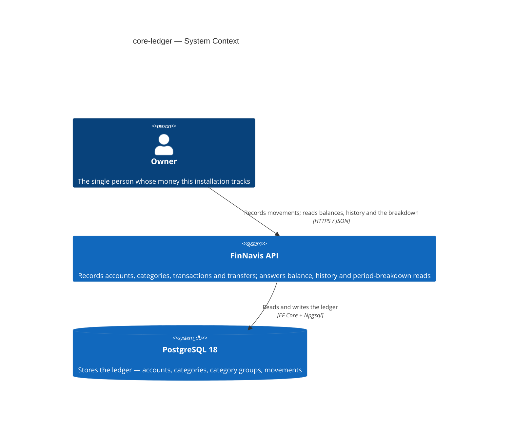
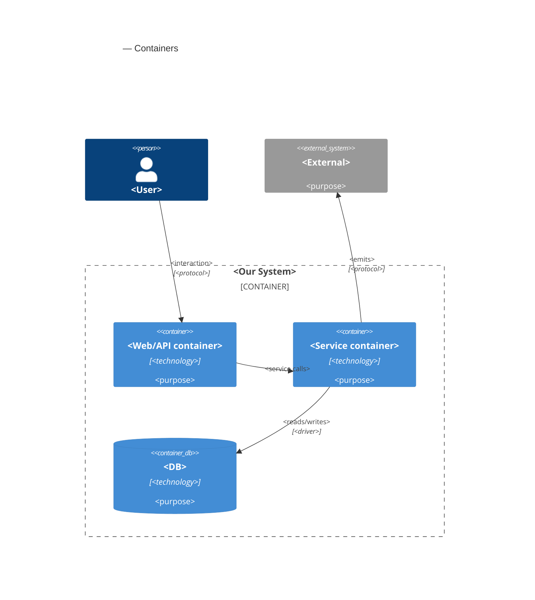
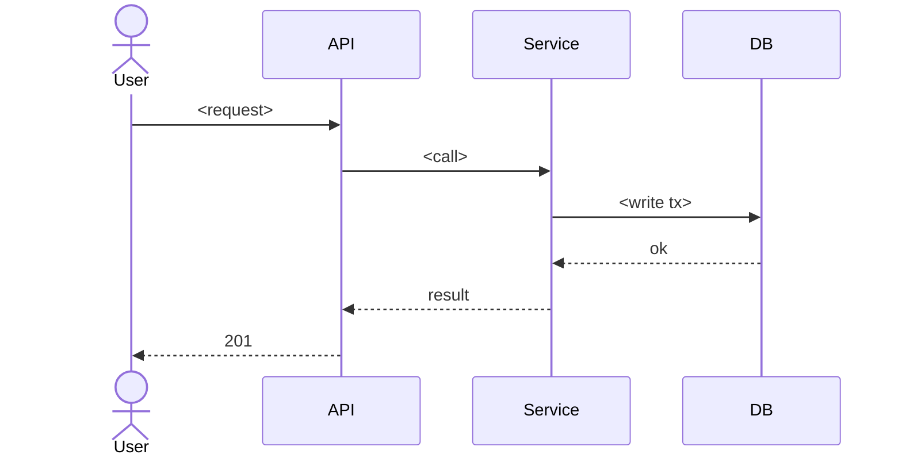

# Software Architecture Document — core-ledger

<!-- Stages 04-05 → see sdlc/plugin/skills/architecture-design/SKILL.md -->
<!-- 12 Arc42 sections. Empty sections — <!-- N/A: <one-line reason> -->. -->
<!-- C4 Context (L1) lives inline in §3. C4 Container (L2) lives inline in §5. -->
<!-- §6 Runtime view seeds the primary flow(s) here; complete-sequence-diagrams (stage 06) then -->
<!--    fills §6 with every critical flow / §5 AC — no cap. -->
<!-- Numbers in §10 come VERBATIM from PRD §6 NFR — no inventing, no rounding. -->

## 1. Introduction and goals

<!-- 🎯 Навіщо: стабільна памʼять про «що + три головні якості + хто зацікавлений».     -->
<!--           Через рік ніхто не згадає на словах, ЯКІ ТРИ ЯКОСТІ для системи критичні. -->
<!-- 📋 Що писати: 1 абзац intent + 3 рядки топ-3 якості + таблиця stakeholders.        -->
<!-- 📌 Приклад: «QG-1: швидкість редагування блоку p95 ≤500 мс»                         -->

**Intent.** Build the ledger the rest of FinNavis stands on. It holds accounts, categories with
optional groups over them, transactions and transfers, and it answers two reads: a filtered history
and one period breakdown that reports group totals and category totals in a single request. One
owner, self-hosted, programmatic access only — the web client is a later feature that consumes what
is built here (PRD §2, §3).

**Top-3 quality goals (1-liners; full scenarios in §10):**

1. **Ledger correctness** — an account balance always equals the sum of the movements recorded on
   it, under any order of recording, editing and deleting.
2. **Interactive latency** — recording a movement and reading history or the breakdown stay fast on
   three years of history (~20 000 movements).
3. **Report stability under re-grouping** — moving a category between groups never changes that
   category's figure for a closed period; only group figures follow the new placement.

**Stakeholders.**

| Role | Interest | Sign-off owner? |
|---|---|---|
| Owner | Records movements; reads balances, history and the period breakdown | No |
| Architect / Tech Lead (Andrey Simonenko) | SAD and ADR approval | Yes |

> Solo project: the same person fills both rows. They are kept apart because the interests differ —
> the Owner cares that the figures are right, the Architect carries the decisions recorded here.

<!-- Decision overrides (¶4) — populated by the Step-7 critic resolution loop, empty otherwise.       -->
<!-- Each: «Decision override: <headline> — rationale: <reason>» so downstream skills see the choice.  -->

## 2. Constraints

<!-- 🎯 Навіщо: §4 (стратегія) працює тільки коли §2 зафіксувала, ЩО ВЖЕ ЗАФІКСОВАНО:    -->
<!--           стек, версії, дедлайн, регуляторні вимоги. Це вхід, не вихід.             -->
<!-- 📋 Що писати: чотири блоки — Технічні / Організаційні / Конвенції / Регуляторні.     -->
<!-- 📌 Приклад: «Postgres 18» (не «Postgres»); «дедлайн Q3 — жорсткий» (не «бажано»).    -->

These are inputs, not choices made here. Everything below was already fixed by the repo before this
feature started.

**Technical.**
- .NET 10 / C# 14; nullable enabled; implicit usings; `TreatWarningsAsErrors` (`Directory.Build.props`).
- ASP.NET Core Minimal APIs; OpenAPI document served at `/openapi/v1.json` in Development.
- **PostgreSQL 18** through EF Core + Npgsql. The major version is pinned: it is the Testcontainers
  image tag and the docker-compose tag. An unpinned tag would make a correctness-test failure
  impossible to attribute.
- Clean Architecture, four projects, dependency rule enforced by `tests/FinNavis.ArchitectureTests`
  (`docs/adr/0001-initial-setup.md`).
- Money is `decimal`. Timestamps are `DateTimeOffset`, stored UTC. Enums are stored as strings.
  Tables and columns are `snake_case`.

**Organisational.**
- One developer, working evenings. No deadline, no release window, no second reviewer.
- Every NFR row in PRD §6 except Availability is measured by an **integration harness and a CI
  pipeline that do not exist yet** (`SPEC.md` "Planned, not built yet"). Standing them up is a
  prerequisite task for `/sdlc-break-tasks`, not a side effect of this feature. Carried into §11.

**Conventions.**
- `CLAUDE.md` — layout, dependency rules, DI, API, database and test conventions.
- `ARCHITECTURE.md` — the four rings, and what counts as a port versus a plain interface.
- Repository ports live in `Domain/Abstractions`; outside-world ports in `Application/Abstractions`.
  Infrastructure implements both. Presentation is the only composition root.
- One `IEntityTypeConfiguration<T>` file per entity. Migrations are append-only — never edit an
  applied one.

**Regulatory / external.**
- No external regulation applies. Self-hosted, one owner, the owner's own data. No third-party
  personal data and no card numbers — an account is a label the owner chooses, not a bank
  identifier (PRD §6.1).
- Data classification: **confidential** — one person's complete financial history.
- Security review: **required** (PRD §6.1), because the data is confidential and this feature adds
  no authentication boundary. That absence is the main exposure and is carried into §11.

## 3. Context and scope

<!-- 🎯 Навіщо: малює КОРДОН СИСТЕМИ — хто з нею говорить ззовні, де закінчується зона довіри. -->
<!--           Без §3 §5 і §8 (авторизація) розпливаються — неясно, що «всередині», а що «зовні». -->
<!-- 📋 Що писати: 2-3 речення бізнес-контексту + таблиця зовнішніх систем + Mermaid C4Context. -->
<!-- 📌 Приклад: «зовнішні — нема (свідома відмова від third-party у v1)» — це теж рішення.   -->
<!-- Кордон довіри (trust boundary) — лінія, за якою ти не довіряєш даним без перевірки.       -->

The Owner records every money movement — income, expense and transfer between their own accounts —
through a REST API, and reads back three things: the balance of each account, a filtered history,
and one period breakdown that totals by group and by category at once. The system is self-hosted and
serves exactly one person. It talks to nothing outside itself except its own database.

<!-- brownfield: the repository is a skeleton. Four projects, references and architecture tests
     exist; no entity, endpoint or schema does. There is no existing module to extend, so §5
     decomposes into the four projects that are already there. -->

**External systems (in / out):**

| Actor or system | Type | Interaction |
|---|---|---|
| Owner | Person | Records transactions and transfers; manages accounts and categories; reads balances, history and the period breakdown |
| PostgreSQL 18 | System (separate process, self-hosted alongside the API) | Stores the whole ledger |

**No third-party system is involved, and that is a decision, not an omission.** There is no bank
integration, no identity provider and no message broker in this feature (PRD §3 Non-goals). The
planned consumers — the React PWA, CSV import, export, assistant access — are separate later
features. None of them exists yet, so none appears below; each will consume the API drawn here
rather than change its boundary.

**C4 Context (L1):**



## 4. Solution strategy

<!-- 🎯 Навіщо: 3-4 СТРАТЕГІЧНІ СТОВПИ, з яких потім ростуть усі ADR. Без §4 кожен ADR    -->
<!--           виглядає випадковим — нема зонтика. ⭐ Найгустіша секція — тут ADR-gate    -->
<!--           спрацьовує майже завжди (рішення незворотні + мульти-модульні).            -->
<!-- 📋 Що писати: спершу Target surface(s), потім 3-4 стратегічні вибори.                -->
<!--           На кожен — заголовок + 2-3 речення rationale.                              -->
<!-- 📌 ПЕРШЕ рішення §4 — Target surface(s): ЩО САМЕ будуємо. Записується у frontmatter   -->
<!--           target_surfaces: [...] і гейтить §5 (один контейнер на поверхню) + усі       -->
<!--           наступні стадії. Деривиться з PRD §1 «для кого» + §4 ролей. → _shared/surfaces.md -->
<!-- 📌 Приклад: «Зберігати урок як таблицю блоків» — стовп, з якого виросло ADR-0001.    -->

**Target surface(s) (the first decision — what's being built):** `[backend-service]`

One REST API plus its database. No UI surface, so there is no UI-architecture decision to take here.
PRD §3 is explicit: no web client, no installable app, no offline reading — the React PWA is a
separate later feature that will consume this API. §5 therefore draws one application container.
<!-- Mirror this list into the frontmatter `target_surfaces`. For each declared UI surface          -->
<!-- (web-frontend / mobile-app / desktop-app) add a UI-architecture choice below (web → SSR/SPA/   -->
<!-- hybrid; mobile → native/cross-platform). Multi-surface is usually an ADR (multi-module +       -->
<!-- irreversible). The UI reuses the repo's existing design system / components / tokens from       -->
<!-- architecture-map.md §Frontend — it does not design greenfield. → _shared/surfaces.md           -->

**Top strategic choices (the seeds for ADRs):**

1. **A transaction and a transfer are two different records, in two tables** (ADR-0001). The glossary
   already treats them as different things: a transaction touches one account and carries a
   category, a transfer touches two and carries none. Keeping them apart means neither table needs a
   nullable counter-account or a discriminator, and the breakdown satisfies AC-20 structurally —
   it reads `transactions` and never looks at `transfers`, so a transfer cannot leak into a category
   total. The price is paid on the read side: balance is three sums added together, and history is a
   `UNION ALL` of two shapes. That price is acceptable because transfers are rare in this ledger, and
   it keeps the option of dropping transfers later down to a single migration.

2. **Every read is computed on demand; nothing is pre-aggregated and nothing is cached** (ADR-0002).
   Balance, history and the period breakdown are all queries over the base tables. Three years of
   history is about 20 000 rows (PRD §6) — small enough that one indexed aggregate query sits far
   inside the 500 ms budget. This also makes quality goal 3 free: because the category-to-group
   mapping is resolved at query time, moving a category between groups changes group totals at once
   and cannot change that category's own figure (AC-13).

3. **The ledger is mutable — corrections edit and delete rows in place** (ADR-0003). AC-21 and AC-22
   describe this literally: a removed entry disappears from history and the balances return to what
   they would have been had it never existed. That is a hard delete, not a reversing entry. It
   matches the repo's database convention and keeps history easy to read. The accepted cost is that
   there is no audit trail — carried into §11.

Each tactical decision in later sections should be traceable to one of these strategic seeds. Tactical decisions that *contradict* a strategic choice are red flags — surface them in §11 Risks.

## 5. Building block view

<!-- 🎯 Навіщо: ВНУТРІШНЯ ДЕКОМПОЗИЦІЯ — модулі, контейнери, БД. Статична топологія:   -->
<!--           хто з ким може говорити. Без §5 §6 (сценарії) не має словника учасників. -->
<!-- 📋 Що писати: 1 абзац про стиль (шари/гексагональна/clean/на подіях) +            -->
<!--           дерево папок + Mermaid C4Container.                                       -->
<!-- 📌 ОДИН Container на кожну оголошену target_surface (frontmatter): fullstack        -->
<!--           [backend-service, web-frontend] = backend-API container + web/SPA container; -->
<!--           [backend-service, mobile-app] = API + mobile app. Container(web, …) нижче — -->
<!--           лише приклад однієї поверхні; додай/заміни під оголошене у §4. → _shared/surfaces.md -->
<!-- 📌 Приклад: «web-app, content-api, media-worker, postgres, s3, cdn».                -->

<One paragraph: layered / hexagonal / clean / event-driven. Why.>

**Internal decomposition:**

```
<e.g. internal/modules/goals/>
├── domain/       <entities + sentinel errors>
├── app/          <use cases / services>
├── infra/        <repository + outbox impl>
├── ports/        <HTTP handlers, DTOs, error mapping>
└── module.go     <self-wiring>
```

**C4 Container (L2):**



## 6. Runtime view

<!-- 🎯 Навіщо: ПОТІК У RUNTIME для 1-2 критичних сценаріїв. Хто з ким коли і у якому     -->
<!--           порядку говорить. Без §6 §5 — лише купа коробок без життя.                  -->
<!-- 📋 Що писати: Mermaid sequenceDiagram. Учасники — імена з §5 (не вигадуй нові!).      -->
<!--           Повідомлення семантичні («складає чорновик»), БЕЗ HTTP-методів/шляхів —     -->
<!--           ендпоінт-рівневі sequence-діаграми зʼявляться у stage 06 (api-forge).        -->
<!-- ⏳ RESERVED FOR SEQUENCES: architecture-design сіє лише primary flow(s) тут.          -->
<!--           complete-sequence-diagrams (stage 06) ДОПОВНЮЄ §6 кожним критичним flow /    -->
<!--           кожним §5 AC — без обмеження. Не намагайся покрити все тут.                  -->
<!-- 📌 Приклад: «methodist → web-app: складає чорновик → web-app → content-api: зберегти». -->

**Critical flow 1: <flow name>**



<!-- For XS/S: 1 flow above is enough. For M+: add 2-4 more (e.g. failure-mode flow, async flow). -->

**Critical flow 2: <e.g. async event propagation>** — <if applicable, otherwise N/A>.

## 7. Deployment view

<!-- 🎯 Навіщо: ТОПОЛОГІЯ, яку DevOps має знати без читання Helm-чартів — скільки реплік,  -->
<!--           де живе фоновий обробник, ПРИ ЯКИХ ЧИСЛАХ масштабуємось.                     -->
<!-- 📋 Що писати: 2-3 речення про топологію + метрики + алерти + конкретні числа-пороги.   -->
<!-- 📌 Приклад: «500 IC → партиціонування за кварталом» (не «при зростанні подумаємо»).    -->
<!-- 🎯 Можна N/A для XS/S функцій, що переюзають існуюче розгортання без змін.            -->

<Topology in 2-3 sentences. Where it runs (k8s / VM / serverless), replicas, scaling thresholds.>

**Monitoring:**
- <Metrics — e.g. Prometheus `<metric_name>`>
- <Alerts — e.g. "outbox lag > 10 min → page on-call">
- <Tracing — e.g. OpenTelemetry HTTP spans>

**Scaling thresholds:**
- <e.g. 500 IC × 5 goals × 26 checkpoints/Q = 65k rows/year — comfortable in one table>
- <e.g. partitioning by quarter at >500k rows/year>

<!-- For XS/S that doesn't change deployment: <!-- N/A: feature reuses existing deployment unit -->. -->

## 8. Crosscutting concepts

<!-- 🎯 Навіщо: НАСКРІЗНІ ПАТЕРНИ, які перетинають кілька модулів: логування, помилки,    -->
<!--           авторизація, ID strategy, outbox, кеш. ⭐ Друга найгустіша секція.          -->
<!--           Якщо патерн всередині одного модуля — він НЕ сюди. Якщо це конвенція        -->
<!--           проєкту в цілому — у CLAUDE.md.                                              -->
<!-- 📋 Що писати: таблиця концепт / конвенція / де визначено. Один рядок на концепт.      -->
<!-- 📌 Приклад: «UUID v7 (час+випадковий, сортується) у app-layer» — як default з CLAUDE.md. -->

| Concept | Convention | Where defined |
|---|---|---|
| Logging | <e.g. structured slog, fields `module=<name>`> | <CLAUDE.md §X or here> |
| Authentication | <e.g. JWT via session middleware> | <CLAUDE.md §X> |
| Error handling | <e.g. domain sentinel → ports/errors.go → apperr JSON> | <CLAUDE.md §X> |
| ID strategy | <e.g. UUID v7 in app layer> | <CLAUDE.md §X> |
| Internationalisation | <e.g. N/A, English only> | — |
| Observability | <e.g. OpenTelemetry on HTTP boundaries> | — |
| Outbox / events | <module-specific patterns, if any> | <here> |

## 9. Architecture decisions

<!-- 🎯 Навіщо: ЗВОРОТНИЙ ІНДЕКС на папку adr/. `ls adr/` дає файли, §9 дає семантику —    -->
<!--           чому вони існують, до якого зрізу SAD привʼязані, у якому статусі.           -->
<!-- 📋 Що писати: таблиця з 4 колонками. Один рядок на ADR. Mixed status — це OK.         -->
<!-- 📌 Приклад: «0001 | Зберігати урок як таблицю блоків | Accepted | §4».                -->

| # | Title | Status | Section |
|---|---|---|---|
| <NNNN> | <imperative — e.g. "Use sliding window for rate limiting"> | Accepted | §<N> |
| <NNNN> | <imperative — e.g. "Co-locate outbox worker in API process"> | Accepted | §<N> |

ADR files live under `docs/features/<slug>/adr/NNNN-<title>.md`.

## 10. Quality requirements

<!-- 🎯 Навіщо: ДЕРЕВО ЯКОСТЕЙ (Quality Tree) — беремо мету з §1 і розкладаємо на          -->
<!--           конкретні листя: тести, метрики, конфіги, drill-и. ⭐ Без §10 §1 — це       -->
<!--           маніфест. З §10 кожна декларація мапиться на щось, ЩО МОЖНА ДОВЕСТИ.        -->
<!-- 📋 Що писати: на кожну якість з §1 — When / Then / How verify. Числа з PRD §6 NFR     -->
<!--           ДОСЛІВНО (не округлюй p95 ≤250мс до ≤300мс — це F6-помилка критика).        -->
<!-- 📌 Приклад: «p95 ≤500 мс на UPDATE блоку, перевіримо k6 load test 100 req/s».        -->

Each top-3 goal from §1 expanded into a full scenario:

**QG-1. <quality attribute>**
- **When:** <trigger condition>
- **Then:** <expected behavior with numbers from PRD NFR>
- **How verify:** <test / chaos drill / load test / observability>

**QG-2. <quality attribute>**
- **When:** <trigger>
- **Then:** <expected>
- **How verify:** <how>

**QG-3. <quality attribute>**
- **When:** <trigger>
- **Then:** <expected>
- **How verify:** <how>

## 11. Risks and technical debt

<!-- 🎯 Навіщо: ⭐ збирає ВСЕ, що може зламатись — і не лише технічне. Без §11 ризики   -->
<!--           обговорюються на стендапах і губляться; борг лишається у голові того,    -->
<!--           хто його прийняв.                                                          -->
<!-- 📋 Що писати: таблиця ризик/борг — серйозність — мітигація — власник. Технічний    -->
<!--           борг окремою секцією.                                                      -->
<!-- 📌 Приклад: «EM не пушить — member не оновлює дані | High | …». Перший ризик —      -->
<!--           часто продуктовий, не технічний. Це нормально.                            -->

<!-- Severity column literals: Low / Medium / High for regular risks; "Open question" for rows
     created by Step-7 `Save as Open Question` resolutions (see references/socratic-loop.md). -->

| Risk / debt | Severity | Mitigation | Owner |
|---|---|---|---|
| <e.g. Outbox lag may reach hours during downstream outage> | Medium | <Alert >10 min, on-call playbook, retry backoff> | <DevOps> |
| <e.g. No event schema versioning in v1> | Medium | <ADR-NNNN planned for v2, graceful handling of unknown fields> | <Backend> |
| Open architectural decision: <decision-headline> | Open question | Resolve before <stage trigger or YYYY-MM-DD>; <inline rationale from Step-7 Save-as-OQ> | <owner> |

**Accepted debt (acceptable in v1, plan to fix later):**
- <e.g. Goal entity is not versioned (immutable) — OK for v1, may need audit versioning in v2>

## 12. Glossary

<!-- 🎯 Навіщо: ⭐ СЛОВНИК ДОМЕНУ, який припиняє суперечки через рік («checkpoint —      -->
<!--           weekly чи biweekly? Quarter — календарний чи фіскальний?»).                -->
<!-- 📋 Що писати: таблиця термін / значення. Бізнес-терміни + технічні вперемішку.       -->
<!--           Один термін може мати дві мови у заголовку: «Goal (Обʼєктив)».              -->
<!-- 📌 Приклад: «Lesson | урок усередині курсу, що складається з блоків (text, video)». -->

| Term | Meaning |
|---|---|
| <e.g. Goal> | <quarterly intent in statement form> |
| <e.g. KR> | <Key Result — measurable target linked to a Goal> |
| <e.g. Checkpoint> | <bi-weekly progress update on a KR> |
