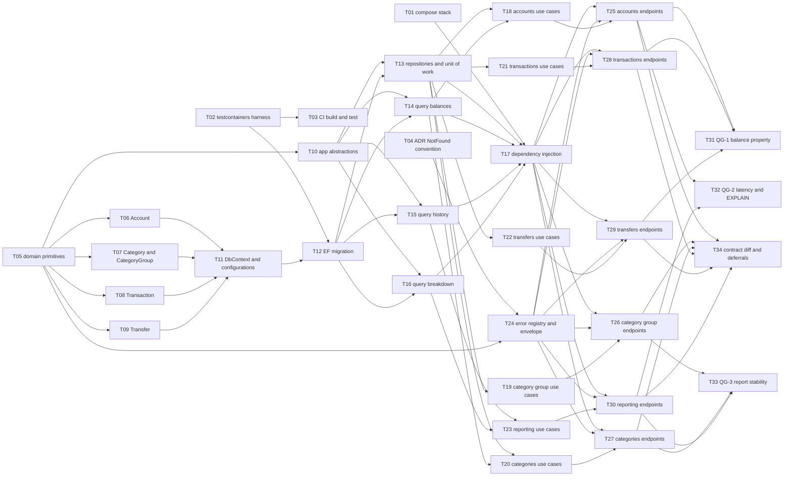

# Epic — core-ledger

> **PRD:** [PRD.md](../PRD.md) · **Design:** [sad.md](../sad.md) · **Data model:** [data-model.md](../data-model.md) · **API:** [openapi.yaml](../contracts/openapi.yaml) · **ADRs:** [adr/](../adr/)
>
> **Size:** M (from [`.size`](../.size)) — see the note under *Risks / Hard rules* about the
> re-check the PRD amendment asked for. **Surface:** `backend-service`, read from `sad.md`
> frontmatter `target_surfaces` — so there is **no `ui` task layer**.

## Goal

Build the ledger the rest of FinNavis stands on: accounts, categories with optional groups over
them, transactions and transfers, plus two reads — a filtered history and one period breakdown that
reports group totals and category totals in a single request (PRD §2). Every other item on the
product list — import, export, summaries, assistant access — reads from or writes to a ledger that
does not exist yet, so nothing else can start until this ships.

The epic also **creates the deployment unit**: the compose stack, the Testcontainers harness and
the CI job do not exist today, and not one PRD §6 NFR row can be measured without them
([sad.md §7](../sad.md)).

## Scope

- **In:** the four rings (`Domain`, `Application`, `Infrastructure`, `Presentation`), five
  aggregates and five repository ports, one EF Core migration for five tables and eight indexes,
  the `ILedgerQueries` read path, 21 HTTP operations, the 27-code error registry and the flat error
  envelope, and the three quality gates from `sad.md` §10.
- **Out (PRD §3):** no web client, installable app or offline reading · no sign-in and no OAuth ·
  no import, export or spreadsheet integration · no charts, statistics or monthly summaries · no
  multi-currency, bank integration, budget or forecast.
- **Out of this epic, though named upstream:** the nightly `pg_dump` backup (sad.md §7), wiring
  `spectral lint` into a `check` target, and closing the missing not-found branch in
  [sad.md §6 flow 2](../sad.md). Each is tracked below.

## Task map

**Parallel branches.** Four tasks start at once: `T01` (compose), `T02` (harness), `T04` (ADR) and
`T05` (domain primitives). After `T05` the four entity tasks run together; after `T12` the three
read-path queries run together; `T18`–`T23` are six parallel use-case branches, and `T25`–`T30` six
parallel endpoint branches.

**Serialization lanes** (how `implement-tasks` reads the DAG):

- `layer: migration` is always serialized — `T12` is the only one.
- Overlapping `files_hint` serializes regardless of layer: `T02`/`T12` share `PostgresFixture.cs`;
  `T17`/`T24` share `Program.cs`; `T03`/`T32` share `.github/workflows/ci.yml`.
- No `ui` layer exists — `target_surfaces` declares `backend-service` only.

## Tasks

See [tracker.md](./tracker.md) for status. Machine contract: [tasks.json](./tasks.json).

| # | Task | Layer | Blocked by | DoD (short) |
|---|---|---|---|---|
| [T01](./T01-setup-compose-stack.md) | Compose stack with PostgreSQL 18 | wiring | — | Both containers start, only the API port is published, `down -v` leaves nothing |
| [T02](./T02-setup-testcontainers-harness.md) | Testcontainers PostgreSQL 18 fixture | tests | — | Fixture starts PG 18, each test gets a clean database, `SmokeTests.cs` deleted |
| [T03](./T03-setup-ci-build-and-test.md) | CI job: build + test | wiring | T02 | Workflow runs `build` then `test`; a failing test turns it red |
| [T04](./T04-adr-notfound-module-convention.md) | ADR for the `*.NotFound` module | docs | — | ADR written, both contracts match it, the deferral is closed |
| [T05](./T05-domain-primitives.md) | Money, DateRange, CategoryKind, IClock, domain error | domain | — | Value-object tests pass, Domain still references nothing |
| [T06](./T06-domain-account.md) | `Account` + `IAccountRepository` | domain | T05 | Rename keeps identity (AC-08); no balance field |
| [T07](./T07-domain-category-and-group.md) | `Category` + `CategoryGroup` + ports | domain | T05 | Other-side placement refused (AC-30); no `Default` object |
| [T08](./T08-domain-transaction.md) | `Transaction` + port | domain | T05 | Non-positive amount refused (AC-02); second account refused (AC-24) |
| [T09](./T09-domain-transfer.md) | `Transfer` + port | domain | T05 | Same-account refused (AC-05); no category field (AC-23) |
| [T10](./T10-app-abstractions.md) | `IUnitOfWork` + `ILedgerQueries` | app | T05 | Both ports declared; Application references no EF Core |
| [T11](./T11-infra-dbcontext-and-configurations.md) | DbContext + 5 configurations | infra | T06, T07, T08, T09 | Matches `data-model.md` row by row; no CHECK, no cascade |
| [T12](./T12-migration-core-ledger-initial.md) | EF migration, diffed against the spec | migration | T11, T02 | Generated script matches the staged spec; applies and reverts |
| [T13](./T13-infra-repositories-and-unit-of-work.md) | 5 repository adapters + unit of work | infra | T12, T10 | Each port round-trips; a failed commit rolls everything back |
| [T14](./T14-infra-queries-balances.md) | Balance query + 2 existence checks | infra | T12, T10 | Balance equals the sum (AC-14); total unchanged (AC-15) |
| [T15](./T15-infra-queries-history.md) | History page: `UNION ALL` + keyset cursor | infra | T12, T10 | Paging returns every row once; empty period is not a failure (AC-17) |
| [T16](./T16-infra-queries-breakdown.md) | Breakdown aggregate query | infra | T12, T10 | Sides kept apart (AC-18); SQL never names `transfers` (AC-20) |
| [T17](./T17-wiring-dependency-injection.md) | DI registration, composition root | wiring | T01, T13, T14, T15, T16 | Every port resolves; a test proves it |
| [T18](./T18-app-accounts-use-cases.md) | 4 account use cases | app | T13, T14 | AC-07, AC-08, AC-09, AC-10, AC-25, AC-35 covered by unit tests |
| [T19](./T19-app-category-groups-use-cases.md) | 4 category-group use cases | app | T13 | Delete clears links and removes the group in one unit of work (AC-29) |
| [T20](./T20-app-categories-use-cases.md) | 5 category use cases | app | T13, T14 | AC-11 to AC-13, AC-30, AC-32 to AC-34, AC-36 covered |
| [T21](./T21-app-transactions-use-cases.md) | 3 transaction use cases | app | T13 | AC-01, AC-03, AC-21, AC-22, AC-24, AC-25 covered |
| [T22](./T22-app-transfers-use-cases.md) | 3 transfer use cases | app | T13 | AC-04, AC-05, AC-06, AC-23, AC-25 covered |
| [T23](./T23-app-reporting-use-cases.md) | History + breakdown use cases | app | T15, T16 | Default group assembled, never stored (AC-19) |
| [T24](./T24-ports-error-envelope-and-registry.md) | Error registry + flat envelope | ports | T05, T04 | 27 codes match the contract; no `problem+json` anywhere |
| [T25](./T25-ports-accounts-endpoints.md) | 4 account endpoints | ports | T18, T24, T17 | Shapes match the contract; PRD outcomes for AC-07 to AC-10, AC-35 |
| [T26](./T26-ports-category-groups-endpoints.md) | 4 category-group endpoints | ports | T19, T24, T17 | `deleteCategoryGroup` returns 204, no body (AC-29) |
| [T27](./T27-ports-categories-endpoints.md) | 5 category endpoints | ports | T20, T24, T17 | `setCategoryGroup` tells its two 404 refusals apart |
| [T28](./T28-ports-transactions-endpoints.md) | 3 transaction endpoints | ports | T21, T24, T17 | Money as a string; `external_ref` not surfaced |
| [T29](./T29-ports-transfers-endpoints.md) | 3 transfer endpoints | ports | T22, T24, T17 | No category field anywhere (AC-23) |
| [T30](./T30-ports-reporting-endpoints.md) | History + breakdown endpoints | ports | T23, T24, T17 | Cursor page wrapper with `prev_cursor`; empty period is a 200 |
| [T31](./T31-tests-qg1-balance-property.md) | QG-1 balance property test | tests | T25, T28, T29 | 1 000 randomised sequences, **0** discrepancies |
| [T32](./T32-tests-qg2-latency-and-explain.md) | QG-2 latency + `EXPLAIN` | tests | T30, T25 | p95 ≤ 300 / 500 / 400 ms; index assertion fails when dropped |
| [T33](./T33-tests-qg3-breakdown-stability.md) | QG-3 report stability | tests | T30, T27, T26 | Category figures survive every reshape; no `Default` row exists |
| [T34](./T34-docs-contract-diff-and-conventions.md) | Served document vs the contract | docs | T25–T30 | 21 operations and 27 codes agree; deferrals 2 and 6 closed |

**Acceptance-criteria coverage.** All 36 PRD §5 criteria are claimed by at least one task. AC-14,
AC-15, AC-19 and AC-20 are claimed at three levels (query, use case, quality gate) because that is
where each is actually proved.

## Risks / Hard rules

Constraints a task must not break. Each is already a Hard rule upstream — breaking one is a review
failure, not a judgement call.

- **No `CHECK` constraint, no trigger, no stored procedure, no business `DEFAULT`.** Business logic
  lives in the Domain entities (`.claude/rules/migrations.md`, `data-model.md` decision 6).
- **No FK cascade on `categories.category_group_id`.** AC-29's link clearing is the use case's job.
  With `NO ACTION`, forgetting it fails loudly instead of silently rewriting rows
  (`data-model.md` decision 8).
- **The Default group is never a row, an entity or an id.** It is produced by the breakdown
  (sad.md §12). An implementer who creates a real `Default` row has misread AC-29.
- **Every error response is the flat `{code, message, details?}` envelope.** ASP.NET Core's
  `application/problem+json` default must be turned off, or the API answers with two shapes
  depending on how deep into the pipeline the request got (`CLAUDE.md` §API, `docs/adr/0002`,
  `docs/adr/0003`).
- **Money is `decimal` in code and a `string` on the wire.** A JSON number is an IEEE double in
  most clients and loses the fourth decimal place of `NUMERIC(19,4)`
  (`.claude/rules/openapi.md` deviation 2).
- **Enums are stored as strings, never as int** (`CLAUDE.md`).
- **The contract is the source of truth; handlers follow it.** The document at `/openapi/v1.json`
  is generated from the code and is **diffed against** the contract, never the other way round.
- **No response record is shared between operations**, even when two look identical today
  (`CLAUDE.md` §API).
- **Dependencies point inward only.** `tests/FinNavis.ArchitectureTests` enforces it;
  `Infrastructure.csproj` lists `Application` only, on purpose.
- **No real bank statement, real export, real connection string or real key enters the repository**
  (`CLAUDE.md` Safety). Fixtures are synthetic.

### Open items this epic does not close

| Item | Where it came from | Why it is parked |
|---|---|---|
| Nightly `pg_dump` backup | sad.md §7, §11 | Left out of this epic by the task-breakdown gate. It is the **only** way back from a mistaken delete (ADR-0003) — schedule it before real history exists |
| `spectral lint` in a `check` target | `.claude/rules/openapi.md` | The repo has no `check` task; `api-sync-report.md` Section D parks it |
| [sad.md §6 flow 2](../sad.md) has no not-found branch | `api-sync-report.md` Section D | Run `/finnavis-complete-sequence-diagrams core-ledger --flow "record a transfer"` separately. The contract already returns both codes, so [T29](./T29-ports-transfers-endpoints.md) follows the contract |
| No authentication at all | PRD §6.1, sad.md §11 (**High**) | Owned by the later OAuth feature. Keep the installation off public networks |
| Size re-check after the 2026-10-20 amendment | PRD §1 | `.size`, the PRD frontmatter and `sad.md` all still read **M**, but the PRD says *"the earlier M can no longer be asserted"*. 34 tasks at ~17 person-days points at L. Run `/sdlc-classify-size core-ledger` |
