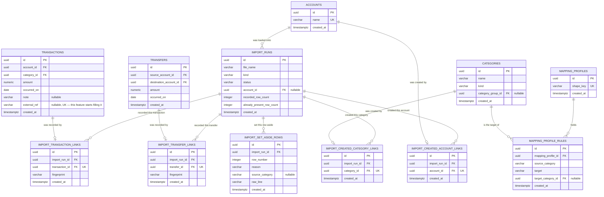

# Data model — csv-import

<!-- The SQL under docs/features/csv-import/migrations/ is a REFERENCE SPEC, not a migration. This
repo uses EF Core migrations; implement-tasks writes the entity configurations, runs
`./build.sh migrate <Name>`, and diffs `dotnet ef migrations script` output against the staged spec.
See .claude/rules/migrations.md. -->

> **Inputs:** [PRD](./PRD.md) §4, §5, §9 · [SAD](./sad.md) §5, §6 (six flows), §8, §11 ·
> [ADR-0002](./adr/0002-match-on-an-exact-external-reference-first-then-a-date-and-amount-window.md) ·
> [ADR-0003](./adr/0003-take-one-snapshot-of-candidate-movements-before-the-run-writes.md) ·
> [ADR-0004](./adr/0004-commit-an-entire-import-run-in-one-database-transaction.md) ·
> [ADR-0007](./adr/0007-keep-import-bookkeeping-in-the-features-own-tables.md) ·
> [ADR-0008](./adr/0008-detect-post-import-hand-edits-with-a-stored-content-fingerprint.md) ·
> [ADR-0009](./adr/0009-recognise-a-statement-shape-by-its-header-row.md)
>
> **Builds on:** [`core-ledger/data-model.md`](../core-ledger/data-model.md) — its five tables are
> read and written by this feature and **no column of theirs changes** (ADR-0007). Its ADR-0005
> (UUID v7), ADR-0006 (`transactions.external_ref`) and ADR-0003 (hard delete, no audit trail) are
> inherited, not re-decided.

## ER diagram

The last four blocks are `core-ledger`'s tables, drawn unchanged. They are here because this
feature's foreign keys point at them, and the diagram would lie without them. **Not one of their
columns is added, widened or re-typed** — ADR-0007 is what makes the migration additive, so PRD §9's
"nothing already recorded loses anything" is true by construction rather than by care.

**Eight new tables, two aggregates.** `ImportRun` owns five of them, `MappingProfile` owns two
(SAD §5). The split into one link table per target — a transaction, a transfer, a created account, a
created category — is what makes a link unable to point at the wrong kind of thing: every foreign
key is `NOT NULL`, so there is no "exactly one of these is set" rule to enforce anywhere. That is
the same argument `core-ledger` ADR-0001 used to keep transactions and transfers apart.

**Nothing here stores a balance, a rollup or a copy of the file.** A set-aside row keeps its own
line because the Owner has to act on it (AC-13, AC-14); every row that was *recorded* keeps nothing
from the file except what landed in the ledger, and the file itself is never written to disk
(ADR-0001).

## Decisions taken in this document

These are schema-level choices the PRD and SAD left open. Each one is a decision, not a derivation.

1. **A mapping rule has two targets, not three.** `MappingRuleTarget` is `Category` or
   `TransferBetweenOwnAccounts`. PRD AC-01 offers a third — *"recorded with no category"* — and it
   cannot be stored: `core-ledger`'s `transactions.category_id` is `NOT NULL`, `CONTEXT.md` says
   every transaction names exactly one category, and SAD §6 flow 2 draws no branch for it. Confirmed
   with the owner on 2026-10-18: a category is required and the Owner provides it; there is no
   default category (`CONTEXT.md`'s *Default group* is a different thing — a bucket the breakdown
   produces, not a row). A file category the Owner does not want to file simply gets no rule, and
   its rows are set aside with reason `NoRuleCovers` (AC-08, AC-14). **AC-01 still reads as if three
   targets exist** — the audit carries the exact edit.

2. **`shape_key` is the normalised header row, stored readable, not a hash.** ADR-0009 left the
   computation to this stage. The key is the file's column names, each trimmed and lowercased,
   trailing empty columns dropped, joined with `|`, in the file's own column order. `VARCHAR(1000)`
   with a unique index. A hash would be 64 fixed characters and completely opaque; the day the Owner
   asks "why did my file match that profile", a readable key answers it and a hash does not — and
   ADR-0009 already names the two ways this misfires (two banks with identical headers, a bank
   renaming one column). The normalisation rules are part of the identity, so changing them later is
   a migration over this table, exactly as ADR-0009 warned.

3. **One link table per target, every foreign key `NOT NULL`.** ADR-0007 handed this split here and
   framed the alternative as "one link table with nullable foreign keys and a check constraint" —
   but `.claude/rules/migrations.md` forbids `CHECK`, so that alternative degrades to a rule the
   database cannot see. Four narrow tables cost four more entity configurations and buy an invariant
   that is unrepresentable rather than merely prevented. Chosen by the owner on 2026-10-18.

4. **The fingerprint is SHA-256, and its field list is fixed here.** SAD §11 asked this stage to name
   it explicitly. See *The content fingerprint* below. Stored as `VARCHAR(64)`, lowercase hex.

5. **`external_ref` is a qualified value, never the bank's bare row number.** ADR-0002 left this to
   the data-model stage. The value is `<source>:<the file's own row identifier>`, where `<source>` is
   the `mapping_profiles.id` that was applied for a statement load, and the literal `history` for a
   history migration. The reason is `ux_transactions_external_ref` being **global**: two banks both
   numbering a row `12345` would collide, and the unique index would refuse a real second row — the
   silent drop of real spending that ADR-0002 calls the worst failure available. `NULL` when the file
   supplies no identifier; PostgreSQL treats nulls as distinct, so any number of such rows is fine
   (`core-ledger` ADR-0006) and the proximity tier does the whole job for them.

6. **The run stores its two counts; it does not derive them.** `recorded_row_count` and
   `already_present_row_count` are columns. "Already there" is not derivable from anything — a row
   judged already present leaves no trace in the ledger. "Recorded" looks derivable by counting
   movement links, but undo deletes those links while the run row survives with status `Undone`
   (§11: undone runs are the only trace that a load happened and was reversed), so a counted value
   would silently become 0 and AC-13's report would start lying. `set_aside_row_count` is **not**
   stored: those rows survive undo and flow 5 reads all of them anyway.

7. **`ON DELETE CASCADE` on every foreign key pointing into `core-ledger`'s tables, and nowhere
   else.** This is a deliberate departure from `core-ledger`'s "no cascade anywhere" and it is what
   makes ADR-0008 true. ADR-0008 states that a movement the Owner deleted by hand "is simply absent
   at undo time… so undo proceeds for the rest". Without a cascade, PostgreSQL would refuse that
   delete outright, and `core-ledger` AC-22 — a removed entry disappears from history — would stop
   working for every imported row. The cascade does not do the opposite of an acceptance criterion;
   it is the only shape under which two of them hold at once. The foreign keys into `import_runs`
   and `mapping_profiles` carry no cascade: nothing deletes a run.

8. **`import_runs.account_id` is `ON DELETE SET NULL`, and is read together with `kind`.** A null
   would otherwise mean two things. It does not: `kind = 'HistoryMigration'` never had an account,
   `kind = 'Statement'` with a null account means the account was deleted since. Without `SET NULL`,
   deleting an account would be blocked for ever by a run that names it — a surprise `core-ledger`
   AC-09 has no refusal message for.

9. **Three set-aside reasons, not four.** `SetAsideReason` is `NoRuleCovers`,
   `TransferBetweenOwnAccounts`, `ForeignCurrency` — the three branches SAD §6 flows 2 and 4 actually
   draw. SAD §8 *listed* a fourth, "the named account is unknown", but AC-09 refuses the **whole
   load** when the named account does not exist, so no row is ever set aside for it. Reported as a
   finding and **corrected in SAD §8 on 2026-10-18**.

10. **Bounds, and where each number came from.** The PRD gives none of them, so each is a working
    bound stated as such, and each becomes the validation rule in Presentation and Application:
    `file_name VARCHAR(255)` (the common filesystem limit), `source_category VARCHAR(200)` (matches
    `external_ref`'s existing bound), `raw_line VARCHAR(2000)` and `shape_key VARCHAR(1000)`. The
    last two are also the cheapest half of PRD §6.1's abuse case: a "statement" whose header or whose
    line exceeds these is not a statement, and the reader refuses the file before anything is
    recorded. PRD §8's open question about a file-size limit is **not** closed by them — that is a
    byte count and a row count, neither of which is a column.

11. **No `updated_at`, no `undone_at`, no soft delete.** `created_at` only, per the rules file. Flow
    5 asks *whether* a run has been undone, which `status` answers; nothing reads *when*. A set-aside
    row and a link are both written once and never edited.

12. **No `CHECK` constraint anywhere.** Two rules in this schema look like candidates and are not:
    `target_category_id` must be set exactly when `target = 'Category'`, and a run of kind
    `HistoryMigration` must have no `account_id`. Both are domain invariants, refused in the
    `MappingRule` and `ImportRun` entities before a row is built (`.claude/rules/migrations.md`).

13. **No new index on `transactions` or `transfers`.** SAD §8 and §11 *said* the candidate
    snapshot's index "does not exist in any document yet" and that this feature's migration must
    create it. That was written on 2026-10-17 and **both were corrected on 2026-10-18**;
    `core-ledger/data-model.md` landed on 2026-10-18 and declares
    five. The three that matter are already there — see the negative list under *Indexes* for the
    query-by-query reasoning and the escape hatch if the `EXPLAIN` assertion ever disagrees. This is
    what keeps ADR-0007's promise literal: the migration **adds tables and alters none**.

## The content fingerprint

SAD §11 asks this stage to name the field list explicitly, because "the day a movement gains a
field, AC-18 silently stops noticing edits to it". Here it is.

**Algorithm.** SHA-256 over the UTF-8 bytes of the string below, rendered as 64 lowercase hex
characters. Stored in `fingerprint VARCHAR(64) NOT NULL`.

**The string**, fields joined with `|` (U+007C), in this exact order:

| Link table | Fields, in order |
|---|---|
| `import_transaction_links` | `account_id` · `category_id` · `amount` · `occurred_on` · `note` |
| `import_transfer_links` | `source_account_id` · `destination_account_id` · `amount` · `occurred_on` |

**Formatting**, so that the import and the undo can never disagree:

- a `UUID` is the lowercase canonical form, `8-4-4-4-12`;
- `amount` is `decimal.ToString("F4", CultureInfo.InvariantCulture)` — four decimal places always,
  matching `NUMERIC(19,4)`, so `12.5` and `12.5000` cannot hash differently;
- `occurred_on` is `yyyy-MM-dd`;
- `note` is the stored text, or the empty string when it is null.

**Deliberately not covered.** `id` and `created_at` are immutable, so including them would add
nothing. `transactions.external_ref` is written by the import and no `core-ledger` edit path exposes
it — AC-18 is about hand edits, and there is no hand to make one. `transfers` has no `note` and no
category, so its list is shorter by construction, not by omission.

**The revisit rule stands.** The day a movement gains a field the Owner can edit, this list has to
grow with it. SAD §11 asks for a comment in the entity configuration pointing at ADR-0008; that is a
task for `implement-tasks`, and it is in the audit's follow-ups.

## Entities

### `mapping_profiles`

| Column | Type | Constraints | Notes |
|---|---|---|---|
| `id` | UUID | PK, app-generated (UUID v7) | `Guid.CreateVersion7()` in Application — `core-ledger` ADR-0005 |
| `shape_key` | VARCHAR(1000) | NOT NULL, UNIQUE | The normalised header row — ADR-0009 and decision 2. Trimmed, lowercased, trailing empty columns dropped, joined with `\|`, original column order kept |
| `created_at` | TIMESTAMPTZ | NOT NULL DEFAULT now() | |

**Aggregate root:** root. Served by `IMappingProfileRepository` (SAD §5).
**Access patterns:** look up one profile by shape key, once per load (flows 1 and 2) →
`ux_mapping_profiles_shape_key`.
**Constraints:** UNIQUE on `shape_key`.
**No `name` column.** ADR-0009 rejected it explicitly: a name that takes no part in the lookup can
only go stale, and AC-13 asks for counts and set-aside rows, never for the name of the profile that
was applied.
**Nothing deletes a profile.** ADR-0009 records that profiles accumulate silently and accepts it.

### `mapping_profile_rules`

| Column | Type | Constraints | Notes |
|---|---|---|---|
| `id` | UUID | PK, app-generated (UUID v7) | |
| `mapping_profile_id` | UUID | NOT NULL, FK → `mapping_profiles(id)` ON DELETE CASCADE | A rule has no life outside its profile. Cascade because re-confirming a shape replaces its rules wholesale |
| `source_category` | VARCHAR(200) | NOT NULL | The file's **own** category text, as the file writes it. Bound from decision 10 |
| `target` | VARCHAR(30) | NOT NULL | `MappingRuleTarget` — `Category` or `TransferBetweenOwnAccounts`. Two values, not three (decision 1). Stored as a string, never as an int (`CLAUDE.md`) |
| `target_category_id` | UUID | NULL, FK → `categories(id)` | The Owner's category this rule files the row under. Set exactly when `target = 'Category'`; null for `TransferBetweenOwnAccounts`, which records nothing |
| `created_at` | TIMESTAMPTZ | NOT NULL DEFAULT now() | |

**Aggregate root:** child of `MappingProfile`. **No port of its own** — a port is added per aggregate
when a use case needs one, never because a table exists (`CLAUDE.md`, SAD §5).
**Access patterns:** loaded with its profile, always (flows 1 and 2) →
`ux_mapping_profile_rules_profile_source_category`, which leads with `mapping_profile_id` · the FK to
`categories` needs its own index (rules file) → `idx_mapping_profile_rules_target_category_id`.
**Constraints:** UNIQUE on (`mapping_profile_id`, `source_category`); FK → `mapping_profiles(id)`;
FK → `categories(id)`.
**`target_category_id` is not guarded by a `CHECK`.** "Set exactly when the target is a category" is
a domain invariant, refused in the `MappingRule` entity before the row is built.
**No recorded movement points at a rule**, which is the whole of AC-04: changing a rule cannot change
anything already recorded, because nothing recorded knows a rule exists (SAD §5).
**This FK reaches into `core-ledger`.** Deleting a category that a rule targets is now blocked by
PostgreSQL. `core-ledger` AC-12 already refuses deleting a category that *history* names, but a rule
is not history and has no refusal message — carried as a finding.

### `import_runs`

| Column | Type | Constraints | Notes |
|---|---|---|---|
| `id` | UUID | PK, app-generated (UUID v7) | Time-ordered, so a run's id also orders runs by when they happened |
| `file_name` | VARCHAR(255) | NOT NULL | "The name the file came with" (PRD §9). Stored and shown as plain text, never interpreted (PRD §6.1). Bound from decision 10 |
| `kind` | VARCHAR(20) | NOT NULL | `ImportRunKind` — `Statement` or `HistoryMigration`. The two entry points of ADR-0005. Stored as a string |
| `status` | VARCHAR(20) | NOT NULL | `ImportRunStatus` — `Completed` or `Undone`. Read by flow 5 and by flow 6's already-undone refusal. Stored as a string |
| `account_id` | UUID | NULL, FK → `accounts(id)` ON DELETE SET NULL | The account a statement was loaded onto (PRD §9). Always null when `kind = 'HistoryMigration'`, which names an account per row instead. Read together with `kind` — decision 8 |
| `recorded_row_count` | INTEGER | NOT NULL | AC-13. Stored, not counted — decision 6 |
| `already_present_row_count` | INTEGER | NOT NULL | AC-13. Not derivable from anything: a row judged already there leaves no trace in the ledger |
| `created_at` | TIMESTAMPTZ | NOT NULL DEFAULT now() | "The day it was handed over" (PRD §9). A record-keeping moment, so `TIMESTAMPTZ` rather than `DATE` |

**Aggregate root:** root. Served by `IImportRunRepository` (SAD §5).
**Access patterns:** read one run with its five child collections (flows 5 and 6) → primary key,
then the `import_run_id` index on each child · the FK to `accounts` needs its own index (rules file)
→ `idx_import_runs_account_id`.
**Constraints:** FK → `accounts(id)`.
**No separate "handed over on" column.** `created_at` already is that moment, and the run is written
once in the same commit as everything it did (ADR-0004).
**No `Failed` status.** ADR-0004 commits the whole run in one database transaction, so a load that
fails leaves no run row at all — which is exactly what AC-22 asks the Owner to be able to rely on.
**No `mapping_profile_id`.** Nothing reads it: AC-13 asks for counts and set-aside rows, and ADR-0009
rejected naming profiles in the first place.
**No `undone_at`.** Flow 5 asks whether a run was undone, not when.
**An undone run keeps its row.** `core-ledger` keeps no audit trail (its ADR-0003), so these rows are
the only trace in the product that a load happened and was reversed. §11 accepts that they accumulate.

### `import_transaction_links`

| Column | Type | Constraints | Notes |
|---|---|---|---|
| `id` | UUID | PK, app-generated (UUID v7) | |
| `import_run_id` | UUID | NOT NULL, FK → `import_runs(id)` | Which run recorded this transaction. No cascade — nothing deletes a run |
| `transaction_id` | UUID | NOT NULL, UNIQUE, FK → `transactions(id)` ON DELETE CASCADE | The row in `core-ledger`'s table. Cascade is decision 7: it is what makes ADR-0008's "a hand-deleted movement is simply absent at undo" true, and keeps `core-ledger` AC-22 working for imported rows |
| `fingerprint` | VARCHAR(64) | NOT NULL | SHA-256 hex over the fields named in *The content fingerprint* — ADR-0008. Written by the import, read only if the run is ever undone |
| `created_at` | TIMESTAMPTZ | NOT NULL DEFAULT now() | |

**Aggregate root:** child of `ImportRun`. No port of its own.
**Access patterns:** walk every link of one run, to report it (flow 5) and to undo it (flow 6) →
`idx_import_transaction_links_import_run_id` · the uniqueness of `transaction_id` is also its FK
index → `ux_import_transaction_links_transaction_id`.
**Constraints:** UNIQUE on `transaction_id`; FK → `import_runs(id)`; FK → `transactions(id)`.
**UNIQUE on `transaction_id` means one transaction belongs to at most one run.** No acceptance
criterion says so, and it is still right: two runs claiming the same row would make undo ambiguous
in a way nothing in the design resolves. Carried as a finding.
**The fingerprint lives here, not on the transaction** (ADR-0007 and ADR-0008): it describes what
*this load wrote*, not what the movement *is*.

### `import_transfer_links`

| Column | Type | Constraints | Notes |
|---|---|---|---|
| `id` | UUID | PK, app-generated (UUID v7) | |
| `import_run_id` | UUID | NOT NULL, FK → `import_runs(id)` | |
| `transfer_id` | UUID | NOT NULL, UNIQUE, FK → `transfers(id)` ON DELETE CASCADE | Same shape and the same cascade reason as the transaction link |
| `fingerprint` | VARCHAR(64) | NOT NULL | Four fields rather than five — `transfers` has no category and no note |
| `created_at` | TIMESTAMPTZ | NOT NULL DEFAULT now() | |

**Aggregate root:** child of `ImportRun`. No port of its own.
**Access patterns:** identical to the transaction link.
**Constraints:** UNIQUE on `transfer_id`; FK → `import_runs(id)`; FK → `transfers(id)`.
**Only a history migration ever writes a row here.** A statement load sets a move between the Owner's
own accounts aside instead (AC-06), because a statement names only one side of it.
**A transfer carries no `external_ref`.** `core-ledger` ADR-0006 put that column on `transactions`
only, so a transfer recorded here is reachable by ADR-0002's proximity tier alone. SAD §11 records
this; nothing is added for it, because the export is loaded once.

### `import_created_account_links`

| Column | Type | Constraints | Notes |
|---|---|---|---|
| `id` | UUID | PK, app-generated (UUID v7) | |
| `import_run_id` | UUID | NOT NULL, FK → `import_runs(id)` | |
| `account_id` | UUID | NOT NULL, UNIQUE, FK → `accounts(id)` ON DELETE CASCADE | An account this run created because the export named one the ledger lacked (AC-10). Cascade: if the Owner deletes it by hand, undo has nothing left to remove |
| `created_at` | TIMESTAMPTZ | NOT NULL DEFAULT now() | |

**Aggregate root:** child of `ImportRun`. No port of its own.
**Access patterns:** walk one run's creations, to undo them (flow 6) →
`idx_import_created_account_links_import_run_id` · the uniqueness of `account_id` is also its FK
index.
**Constraints:** UNIQUE on `account_id`; FK → `import_runs(id)`; FK → `accounts(id)`.
**Only a history migration writes here.** A statement load creates no account; AC-09 refuses the
whole load when the named account does not exist.
**This table is the whole of AC-17.** Without it, undo cannot tell an account the run created from
one the Owner made years ago. Whether a created account is actually removed is a second question,
answered at undo time by `IImportQueries` — "does a movement outside this run name it?" — and that
query needs no index of its own, because `core-ledger` already indexes `transactions.account_id`,
`transfers.source_account_id` and `transfers.destination_account_id`.

### `import_created_category_links`

| Column | Type | Constraints | Notes |
|---|---|---|---|
| `id` | UUID | PK, app-generated (UUID v7) | |
| `import_run_id` | UUID | NOT NULL, FK → `import_runs(id)` | |
| `category_id` | UUID | NOT NULL, UNIQUE, FK → `categories(id)` ON DELETE CASCADE | A category this run created (AC-10). Same cascade reason |
| `created_at` | TIMESTAMPTZ | NOT NULL DEFAULT now() | |

**Aggregate root:** child of `ImportRun`. No port of its own.
**Access patterns:** as above → `idx_import_created_category_links_import_run_id`, plus the unique
index on `category_id`. The AC-17 check reads `core-ledger`'s existing
`idx_transactions_category_id`.
**Constraints:** UNIQUE on `category_id`; FK → `import_runs(id)`; FK → `categories(id)`.
**A category group is never created by an import.** The export names categories, and `CONTEXT.md`
makes a group optional; a created category simply has none, which the breakdown reports under the
Default group.

### `import_set_aside_rows`

| Column | Type | Constraints | Notes |
|---|---|---|---|
| `id` | UUID | PK, app-generated (UUID v7) | |
| `import_run_id` | UUID | NOT NULL, FK → `import_runs(id)` | No cascade: these rows survive an undo, because they were never in the ledger to begin with |
| `row_number` | INTEGER | NOT NULL | The row's 1-based ordinal in the file. Gives the report a stable order and lets the Owner find the line. SAD §6 leaves paging and ordering to the API-contract stage; this is the column it will order by |
| `reason` | VARCHAR(40) | NOT NULL | `SetAsideReason` — `NoRuleCovers` (AC-08), `TransferBetweenOwnAccounts` (AC-06), `ForeignCurrency` (AC-07). Three values — decision 9. Stored as a string |
| `source_category` | VARCHAR(200) | NULL | The file's own category text for this row. AC-08 names the uncovered category back, and this is what it reads. Null means the file named no category for the row |
| `raw_line` | VARCHAR(2000) | NOT NULL | The file's own line, kept so the Owner can act on it (AC-13, AC-14). **This is the raw bank text** SAD §11 flags as confidential: shop names the Owner did not write. Never interpreted, never logged (SAD §7, §8) |
| `created_at` | TIMESTAMPTZ | NOT NULL DEFAULT now() | |

**Aggregate root:** child of `ImportRun`. No port of its own — reading a run's set-aside rows is a
read of one `ImportRun` through its own repository (SAD §5).
**Access patterns:** list every set-aside row of one run (flow 5) →
`idx_import_set_aside_rows_import_run_id`.
**Constraints:** FK → `import_runs(id)`.
**A set-aside row is never recorded on its own** (AC-14). Nothing turns one into a transaction; only
a later load of the same file can, and that load writes its own run. That is why these rows carry no
foreign key into the ledger and no status column — there is no state for them to be in.
**An old run keeps listing a row as set aside after a later run recorded it.** §11 accepts this: a
run report is a record of one event, not a live view.

## Indexes

Every index below is justified by a concrete query from a SAD §6 flow, or by the FK rule in
`.claude/rules/migrations.md`. Candidates with no query behind them were discarded.

| Index | Columns | Query it serves |
|---|---|---|
| `ux_mapping_profiles_shape_key` | `mapping_profiles(shape_key)` UNIQUE | Flows 1 and 2 look up one profile by the file's header row, once per load — AC-01, AC-05. The uniqueness is the point: ADR-0009 makes the shape key the identity of a profile |
| `ux_mapping_profile_rules_profile_source_category` | `mapping_profile_rules(mapping_profile_id, source_category)` UNIQUE | Loads every rule of one profile (flows 1, 2, 3) — the leading column is the filter. Also the FK index on `mapping_profile_id`. The uniqueness stops two rules disagreeing about the same file category |
| `idx_mapping_profile_rules_target_category_id` | `mapping_profile_rules(target_category_id)` | The FK index required by `.claude/rules/migrations.md`. Without it, deleting or updating a category scans this table |
| `idx_import_runs_account_id` | `import_runs(account_id)` | The FK index required by the rules file. Without it, `ON DELETE SET NULL` scans this table on every account delete |
| `idx_import_transaction_links_import_run_id` | `import_transaction_links(import_run_id)` | Flow 5 reads everything one run brought; flow 6 walks the same links to delete them — AC-13, AC-16. Also the FK index |
| `ux_import_transaction_links_transaction_id` | `import_transaction_links(transaction_id)` UNIQUE | One transaction belongs to at most one run. Also the FK index on `transaction_id`, which `ON DELETE CASCADE` needs on every transaction delete |
| `idx_import_transfer_links_import_run_id` | `import_transfer_links(import_run_id)` | Same two flows, the transfers half — AC-13, AC-16. Also the FK index |
| `ux_import_transfer_links_transfer_id` | `import_transfer_links(transfer_id)` UNIQUE | Same reasons as the transaction link |
| `idx_import_created_account_links_import_run_id` | `import_created_account_links(import_run_id)` | Flow 6 walks one run's created accounts to decide which to remove — AC-17. Also the FK index |
| `ux_import_created_account_links_account_id` | `import_created_account_links(account_id)` UNIQUE | An account was created by at most one run. Also the FK index that `ON DELETE CASCADE` needs |
| `idx_import_created_category_links_import_run_id` | `import_created_category_links(import_run_id)` | Flow 6, the categories half — AC-17. Also the FK index |
| `ux_import_created_category_links_category_id` | `import_created_category_links(category_id)` UNIQUE | Same reasons as the account link |
| `idx_import_set_aside_rows_import_run_id` | `import_set_aside_rows(import_run_id)` | Flow 5 lists every set-aside row of one run — AC-13, AC-14. Also the FK index |

**Indexes deliberately not created:**

- **Nothing new on `transactions` or `transfers`** — the one that needs saying, because SAD §8 and
  §11 both say this feature's migration must add one. Taken query by query:
  - *The candidate snapshot for a statement load* (flows 2, 3): one account, roughly a 30-day range.
    `core-ledger`'s `idx_transactions_occurred_on_account_id` leads with `occurred_on`, so a month
    is a selective range scan with `account_id` as the index condition. A dedicated
    `(account_id, occurred_on)` would be marginally tighter and is not worth a second index at the
    ~20 000 movements `core-ledger` sizes for.
  - *The candidate snapshot for a history migration* (flow 4): several accounts across three years —
    close to the whole table, which PostgreSQL will read sequentially whatever index exists. PRD §6's
    ≤ 60 s is not in danger from this.
  - *The exact match tier* (flow 3): `ux_transactions_external_ref` already exists —
    `core-ledger` ADR-0006 added it for exactly this caller.
  - *The AC-17 check* (flow 6): an existence check per created account or category, served by
    `idx_transactions_account_id`, `idx_transactions_category_id`,
    `idx_transfers_source_account_id` and `idx_transfers_destination_account_id` — all four already
    declared by `core-ledger`.
  **The escape hatch.** SAD §10's `MigrateHistory_1500RowsSeveralAccounts_P95Under60s` carries an
  `EXPLAIN` assertion. If it ever shows a sequential scan for a *monthly* load, the index to add is
  `transactions(account_id, occurred_on)` — and by then `transactions` holds rows, so it is a
  `CREATE INDEX CONCURRENTLY` in its own migration, outside a transaction.
- **Nothing on `import_runs(created_at)`, `(kind)` or `(status)`** — no flow in SAD §6 lists runs.
  Flow 5 reads one run by id. When a "my import history" screen appears, `created_at` is the index
  it will want; adding it now would be the just-in-case index.
- **Nothing on `import_set_aside_rows(reason)`** — flow 5 returns every set-aside row of a run and
  filters none of them. Filtering by reason is a client-side concern over a short list.
- **Nothing full-text on `import_set_aside_rows(raw_line)` or `mapping_profiles(shape_key)`** —
  nothing searches either. `core-ledger` closed the same question for `transactions.note`.
- **No second index on any UNIQUE column** — PostgreSQL backs a unique constraint with an index
  already, which is why every `ux_*` row above doubles as the FK index its column needs.
- **No `CONCURRENTLY` anywhere in this feature's spec.** Every table here is created empty in the
  same migration, so there is no write lock to avoid. The rule applies to an index on an existing
  table, which this feature does not add — see the escape hatch above for the one case that would.

## Seeds

**None.** All three buckets, each answered rather than left out:

- **Bootstrap** — nothing to bootstrap. There is no user table, no organisation and no sign-in
  (PRD §3), so no default row exists to create. A mapping profile cannot be seeded either: its
  identity is a real bank's header row (ADR-0009), which nobody has yet.
- **Lookup** — empty, structurally. `ImportRunKind`, `ImportRunStatus`, `SetAsideReason` and
  `MappingRuleTarget` are all stored as strings, never as foreign keys into a lookup table
  (`CLAUDE.md`), so there is no table to fill.
- **Test fixtures** — not in a migration. See below.

**There is deliberately no default category seed.** Confirmed with the owner on 2026-10-18 while
resolving decision 1: a category is required and the Owner provides it. `CONTEXT.md`'s *Default
group* is a different concept — a bucket the breakdown produces, which "cannot be renamed, deleted,
or picked when filing a transaction" — and seeding a *category* would create exactly the row that
definition rules out.

## Test fixtures

Not yet written — the Domain entities do not exist (SAD §11: `src/` holds four `AssemblyMarker.cs`
files and `Program.cs`). These belong to `implement-tasks`, listed here so the shape is agreed first.

Builders go in the test projects, never in a migration. xUnit with AwesomeAssertions (`CLAUDE.md`),
so a builder per entity alongside `core-ledger`'s five:

- `ImportRunBuilder` — a `Completed` run of a given kind, with a file name and zero counts.
- `ImportTransactionLinkBuilder` — a link from a run to a transaction, with the fingerprint computed
  from that transaction rather than hardcoded, so a change to the field list fails the test instead
  of passing it.
- `ImportTransferLinkBuilder` — the same for a transfer.
- `ImportCreatedAccountLinkBuilder` / `ImportCreatedCategoryLinkBuilder` — a run and the thing it
  created.
- `SetAsideRowBuilder` — a row with a reason, a line and a row number.
- `MappingProfileBuilder` — a profile with a shape key and a list of rules.
- `MappingRuleBuilder` — one rule, defaulting to `target = Category`.

**PII guard.** No real-looking personal data in any fixture. File names are `test-statement.csv`,
raw lines carry invented merchants, shape keys are invented headers. **No real bank statement and no
real export from another tracker ever enters the repository** (`CLAUDE.md` Safety) — the synthetic
sample files copy the shape only: same header row, same column order, same date and amount formats,
with invented merchants and amounts. SAD §11 already flags that a synthetic file may be wrong about
the real shape; that is a test-fixture risk, not a schema one.

## Open items

<!-- TBD: the `history` qualifier in `external_ref` (decision 5) is stable for one export handed
     over twice, but not across two *different* exports — PRD §1 records that the Owner holds three
     sources. Two exports numbering a row identically would collide on
     `ux_transactions_external_ref` and the second real row would be refused. It changes no column:
     the fix, if needed, is a different qualifier string. It cannot be settled until PRD §8's "does
     either file carry a stable operation number?" is answered by opening a real file — and if the
     answer is no, the exact tier never fires for a migration and this is moot. -->

<!-- TBD: PRD §8's file-size limit is still open, and decision 10's bounds do not close it. A
     `VARCHAR(2000)` line and a `VARCHAR(1000)` header refuse a file whose *rows* are wrong shaped;
     PRD §6.1's abuse case is a file with millions of correctly-shaped rows. That ceiling is enforced
     while the file streams (ADR-0006, SAD §8 Validation), so it is a configuration value, not a
     column. Owner: Andrey, due before implementation starts. -->

<!-- TBD: whether the set-aside list of a run is paged and how it is ordered. SAD §6 "Left for the
     API-contract stage" raises it and PRD §8 has no question covering it. `row_number` is the
     column it will order by, so the schema is ready either way. Owned by the API-contract stage. -->

<!-- TBD: ADR-0002's proximity-tier parameters — the width of the date window, whether the file's
     text takes part, and what happens when one file row matches two ledger movements. They land in
     the snapshot query's WHERE clause (ADR-0003), not in a column, so this schema holds whichever
     way they go. Owner: Andrey, due before implementation starts; carried from PRD §8 and SAD §11. -->
