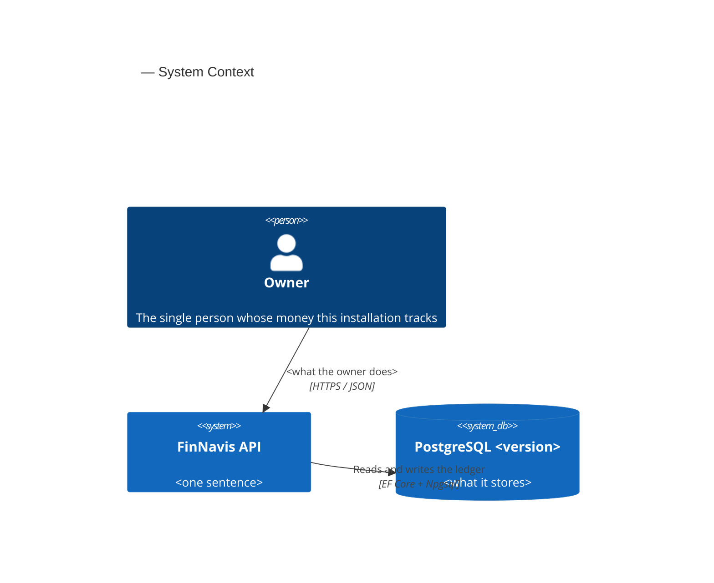
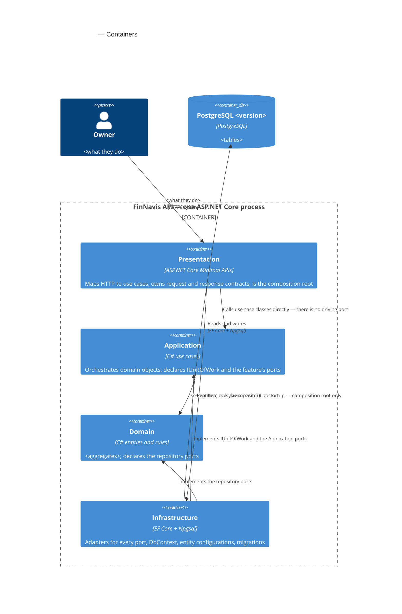
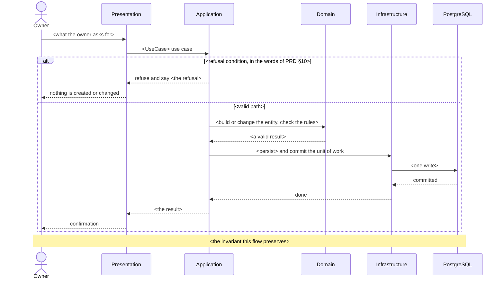

# Software Architecture Document — csv-import

<!-- Arc42, 12 sections. An empty section is not allowed; <!-- N/A: <one-line reason> --> is. -->
<!-- C4 Context (L1) lives inline in §3. C4 Container (L2) lives inline in §5. -->
<!-- §6 covers every critical flow — no later stage finishes it in this project. -->
<!-- Numbers in §10 come from PRD §6 verbatim. No rounding, no inventing. -->
<!-- Anything in CLAUDE.md / ARCHITECTURE.md is an inherited constraint here, never a choice. -->

## 1. Introduction and goals

<!-- Why: in a year nobody remembers which three qualities this feature was built around. -->
<!-- Write: one intent paragraph + the top-3 quality goals as one-liners + the stakeholder table. -->
<!-- Watch: one person owns this. Two rows, both the same human. No invented reviewer or PM. -->

**Intent.** Load a file the Owner hands over into the ledger. Two jobs run over one write path and
differ in three policies (PRD §1): the monthly bank statement, where the rules for a shape of file
are confirmed once and nothing is created that the ledger lacks; and the one-time move of three
years of history out of the old tracker, where the file's own names are the truth and the missing
accounts and categories are created. Every movement a load records remembers the load that brought
it, so a load can be read back and undone as a whole; handing the same file over again records
nothing a second time. There is no screen — PRD §3 keeps the client as a separate later feature, so
this one ships the load itself.

**Top-3 quality goals (1-liners; full scenarios in §10):**

1. **Nothing is recorded twice** — a row that names a movement already in the ledger is counted as
   already there and is not recorded again, whether that movement came from an earlier load or was
   typed by hand (AC-15, AC-20, AC-21).
2. **A load is all-or-nothing, and reversible** — a load that fails part-way leaves the ledger
   exactly as it was, and a finished load can be removed as a whole, with undo of 1500 rows at
   p95 ≤ 30 s (AC-16 — AC-22, PRD §6).
3. **A bulk load fits inside one evening's patience** — the move of the old history, about 1500 rows
   across several accounts, at p95 ≤ 60 s (PRD §6).

**Stakeholders.**

| Role | Interest | Sign-off owner? |
|---|---|---|
| Owner | Hands over a statement or an export; confirms what each of the file's categories means; reads what a load did; undoes a load that went wrong | No |
| Architect / Tech Lead (Andrey Simonenko) | SAD and ADR approval | Yes |

> Solo project: the same person fills both rows. They are kept apart because the interests differ —
> the Owner cares that the figures are right, the Architect carries the decisions recorded here.

<!-- ¶4 Decision overrides — filled by the Phase 5 critic resolution loop, empty otherwise. -->
<!-- Each: «Decision override: <headline> — rationale: <reason>» so a later reader sees the choice. -->

## 2. Constraints

<!-- Why: §4 only works once §2 has fixed what was already fixed. These are inputs, not choices. -->
<!-- Write: four blocks — Technical / Organisational / Conventions / Regulatory. -->
<!-- Watch: assembled from the repo, not asked. Mark anything this feature pins for the first time. -->

These are inputs, not choices made here. Everything below was already fixed by the repo before this
feature started<, with the exceptions marked>.

**Technical.**
- <language, framework, build rules from Directory.Build.props and CLAUDE.md>
- <datastore and its version — say plainly if the repo pins none and this feature does>
- <architecture style and what enforces it>
- <type-level rules the feature leans on: decimal, DateTimeOffset UTC, enums as strings, snake_case>

**Organisational.**
- One developer, working evenings. No deadline, no release window, no second reviewer.
- <which PRD §6 rows cannot be measured today, and what has to exist first>

**Conventions.**
- `CLAUDE.md` — layout, dependency rules, DI, API, database and test conventions.
- `ARCHITECTURE.md` — the four rings, and what counts as a port versus a plain interface.
- <only the conventions this feature actually leans on>

**Regulatory / external.**
- <external regulation, or the reasoned absence of it>
- Data classification: <…>
- <what the missing authentication boundary means, from PRD §6.1>

## 3. Context and scope

<!-- Why: draws the system boundary — who talks to it, where the trust boundary ends. -->
<!-- Write: 2-3 sentences of business context + the external-systems table + the C4Context block. -->
<!-- Watch: name what is deliberately absent. A reader cannot tell an absence from an omission. -->

<Business context in 2-3 sentences: what the system does, for whom, and what it talks to.>

<!-- brownfield: <what exists in src/ today, and what this feature is the first to build> -->

**External systems (in / out):**

| Actor or system | Type | Interaction |
|---|---|---|
| Owner | Person | <what they do> |
| PostgreSQL <version> | System (separate process, self-hosted alongside the API) | <what it stores> |

<One paragraph naming what is deliberately not here, and which later features will consume this
boundary rather than change it.>

**C4 Context (L1):**



## 4. Solution strategy

<!-- Why: the 3-4 pillars every ADR grows from. The densest section — the ADR gate fires here most. -->
<!-- Write: target surface FIRST, then 3-4 strategic choices, each with 2-3 sentences of rationale. -->
<!-- Watch: mirror the surface list into the frontmatter. It gates §5 and every later stage. -->

**Target surface(s) (the first decision — what is being built):** `<[backend-service]>`

<Why that surface, citing PRD §3. For a UI surface, the UI-architecture decision goes here — and it
opens by saying that src/web does not exist yet.>

**Top strategic choices (the seeds for ADRs):**

1. **<the decision, in a sentence>** (ADR-<NNNN>). <2-3 sentences: what it buys, citing a §1 quality
   goal and a §2 constraint, and what it costs.>
2. **<the decision>** (ADR-<NNNN>). <2-3 sentences.>
3. **<the decision>** (ADR-<NNNN>). <2-3 sentences.>

Each tactical decision in a later section should trace to one of these. A tactical decision that
contradicts one is a red flag — it goes to §11, not into silence.

## 5. Building block view

<!-- Why: the static topology — who may talk to whom. §6 has no vocabulary without it. -->
<!-- Write: the style paragraph + the folder tree + the aggregates and ports + the C4Container block. -->
<!-- Watch: render the tree from ARCHITECTURE.md § Folder layout — substitute this feature's areas -->
<!--        and operations, drop the branches it does not touch, and mark as new any folder that -->
<!--        does not exist yet. No Application/Features/, no central Presentation/Contracts/. -->

**Clean Architecture, four rings, no new project.** <Which rings this feature touches and what it
adds to each. Conventions quoted from CLAUDE.md are inherited, not decided here.>

<The aggregates this feature introduces, which of them get a repository port, and why any of them
does not. One port per aggregate a use case needs — never one per table.>

<Whether the read path is separate from the write path, and why.>

**Internal decomposition:**

<!-- Render the tree from ARCHITECTURE.md § Folder layout. Only the branches this feature touches, -->
<!-- with its real area, resource and operation names in place of the placeholders. Annotate every -->
<!-- folder the feature is the first to create, so a reader can tell new from existing. -->

```
<the rendered tree>
```

Each leaf folder under `Endpoints/` holds one operation: the endpoint plus the request and response
records only that operation uses. There is no central `Contracts/` folder.

**C4 Container (L2):**

> <Why the four rings are drawn as containers even though they compile into one process.>



## 6. Runtime view

<!-- Why: boxes without flows are not architecture. This is where the refusals become visible. -->
<!-- Write: one sequenceDiagram per critical flow, participants named from §5, messages semantic. -->
<!-- Watch: §6 is CLOSED here — no later stage adds flows. Cite the AC ids in each heading. -->

Participants are the §5 rings. Messages are semantic — request methods, paths and status codes
belong to the API-contract stage, not here.

**Critical flow 1: <what happens>** (US-<nn> — AC-<nn>, AC-<nn>)



**Critical flow 2: <…>** (US-<nn> — AC-<nn>)

<!-- Keep going until every critical path in the PRD has a flow. Group flows that differ only in -->
<!-- which noun they touch; note the difference underneath rather than drawing it twice. -->

## 7. Deployment view

<!-- Why: the topology a future reader needs without opening compose files. -->
<!-- Write: topology + what this feature creates + backups + monitoring + scaling thresholds. -->
<!-- Watch: "no metrics" is a decision with a reason, not a blank row. Numbers, not "later we'll see". -->

<Topology in 2-3 sentences: what runs where, how many replicas, what is published and to whom.>

**This feature creates <…>.** <Anything that does not exist yet and has to be built first, scheduled
before feature code.>

**Backups.** <The approach and why it matters for this feature in particular, plus the residual gap.>

**Monitoring.** <Deliberately thin, and why.>

- **Logs** — <…>
- **Metrics** — <…>
- **Alerts** — <…>
- **Tracing** — <…>

**Scaling thresholds.**

- <the volume from PRD §6, and why the design is comfortable with it>
- <the row count or latency at which to look again, with a number>

<!-- A feature that changes nothing here: <!-- N/A: feature reuses the existing deployment unit --> -->
<!-- with one sentence of justification above it. -->

## 8. Crosscutting concepts

<!-- Why: patterns that cross rings — logging, errors, ids, time, validation, indexes. -->
<!-- Write: one row per concept: concept / convention / where it is defined. -->
<!-- Watch: a repo-wide convention belongs in CLAUDE.md. N/A still says why. -->

| Concept | Convention | Where defined |
|---|---|---|
| Logging | <…> | <…> |
| Authentication | <…> | <…> |
| Authorization | <…> | <…> |
| Error handling | <…> | <…> |
| ID strategy | <…> | <…> |
| Money | <…> | CLAUDE.md |
| Time | <…> | CLAUDE.md, ARCHITECTURE.md |
| Validation | <…> | <…> |
| Concurrency | <…> | <…> |
| Indexes | <the read path this feature adds and the index it needs> | <§10, §11> |
| Internationalisation | <…> | — |
| Observability | <…> | §7 |
| Outbox / events | <…> | — |

## 9. Architecture decisions

<!-- Why: the reverse index into adr/. `ls adr/` gives files; §9 gives the reason they exist. -->
<!-- Write: one row per ADR, then how they relate, then what did NOT become an ADR and why. -->
<!-- Watch: closed in both directions — a row for every file, a file for every row. -->

| # | Title | Status | Section |
|---|---|---|---|
| <NNNN> | <the decision, in decision form> | Accepted | §<N> |

ADR files live under `docs/features/<slug>/adr/NNNN-<title>.md`.

<How many, and whether that fits the size class. Which ones form one contract together and which
follows from which.>

<What did **not** become an ADR, and why — the reversible calls, and the ones CLAUDE.md already
made. This paragraph is what stops the next reader re-litigating a settled choice.>

## 10. Quality requirements

<!-- Why: without §10, §1 is a manifesto. Each goal has to map to something provable. -->
<!-- Write: per §1 goal — When / Then / How verify. Test names in Method_Scenario_ExpectedResult form. -->
<!-- Watch: every number comes from PRD §6 verbatim. A goal with no number says so honestly. -->

Each goal from §1 expanded into a full scenario. Every number is copied from PRD §6 verbatim.

**QG-1. <quality goal>**

- **When:** <the trigger condition>
- **Then:** <the expected result, with the PRD §6 number>
- **How verify:** <test name, where it runs, and what makes it fail>

**QG-2. <quality goal>**

- **When:** <…>
- **Then:** <…>
- **How verify:** <…>

**QG-3. <quality goal>**

- **When:** <…>
- **Then:** <…>
- **How verify:** <…>

<Any quality the PRD deliberately sets no target for, and the reason — so §7 reads as a consequence
rather than as neglect.>

## 11. Risks and technical debt

<!-- Why: collects everything that can break, plus the debt taken on purpose. -->
<!-- Write: the table, then accepted debt, then the open questions this pass closed. -->
<!-- Watch: severity is Low / Medium / High, or the literal "Open question" with owner AND due. -->

| Risk / debt | Severity | Mitigation | Owner |
|---|---|---|---|
| <risk> | <Low\|Medium\|High> | <mitigation, pointing at the section or test that catches it> | <name> |
| Open question: <the undecided thing. Default now: <…>> | Open question | Resolve before <stage or date>; <where it came from> | <name> |

**Accepted debt (acceptable now, plan to fix later):**

- <what is wrong on purpose, and why that is the right call today>

**Open questions closed during this pass** (they were due at this stage, so they are no longer open):

- <the question> → <the answer>. See <ADR or section>.

## 12. Glossary

<!-- Why: stops the argument a year from now about what a word meant. -->
<!-- Write: the CONTEXT.md terms this document uses, then the technical terms it introduces. -->
<!-- Watch: CONTEXT.md is canonical. A new *domain* word belongs there, not here. -->

Domain terms come from `CONTEXT.md`, which is canonical — if anything in this document contradicts
it, `CONTEXT.md` wins. Only the terms this SAD actually uses are listed.

| Term | Meaning |
|---|---|
| <term> | <definition with its boundary — what it is NOT> |

**Terms this document introduces that are not in `CONTEXT.md`.** They are technical rather than
domain words, so they do not need an entry there — recorded here for the reader:

| Term | Meaning |
|---|---|
| <term> | <definition> |
