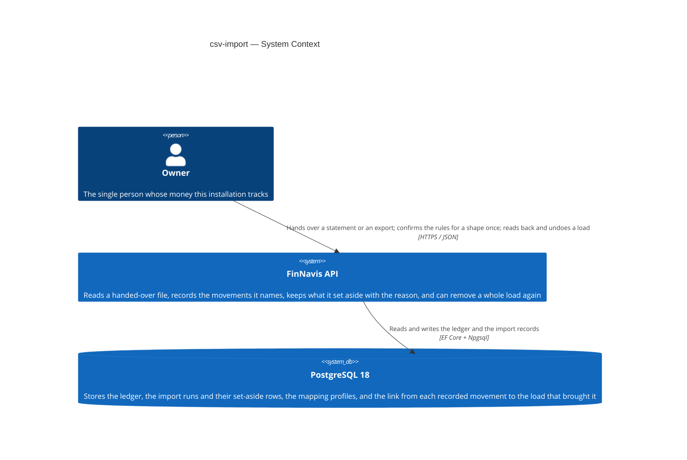
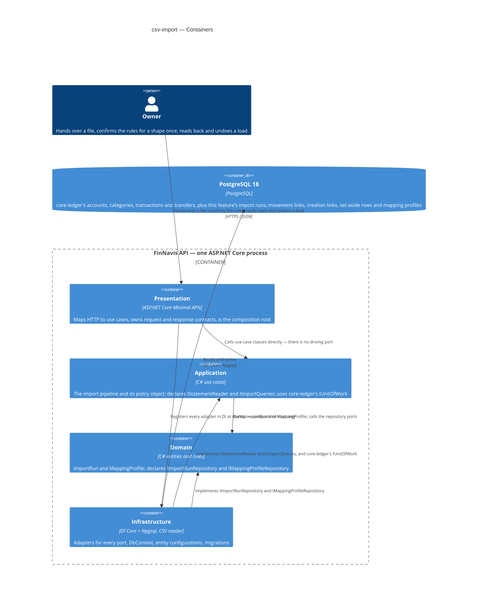
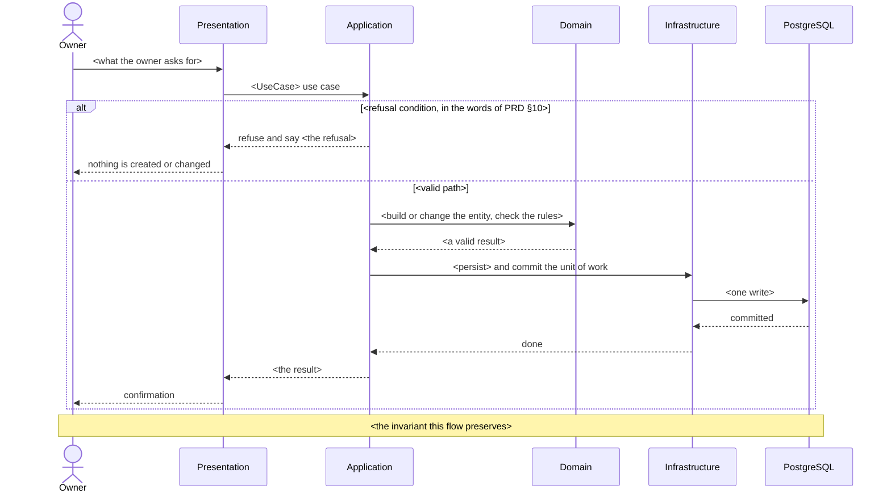

# Software Architecture Document — csv-import

<!-- Arc42, 12 sections. An empty section is not allowed; <!-- N/A: <one-line reason> --> is. -->
<!-- C4 Context (L1) lives inline in §3. C4 Container (L2) lives inline in §5. -->
<!-- §6 covers every critical flow — no later stage finishes it in this project. -->
<!-- Numbers in §10 come from PRD §6 verbatim. No rounding, no inventing. -->
<!-- Anything in CLAUDE.md / ARCHITECTURE.md is an inherited constraint here, never a choice. -->

## 1. Introduction and goals

<!-- Why: in a year nobody remembers which three qualities this feature was built around. -->
<!-- Write: one intent paragraph + the top-3 quality goals as one-liners + the stakeholder table. -->
<!-- Watch: one person owns this. Two rows, both the same human. No invented reviewer or PM. -->

**Intent.** Load a file the Owner hands over into the ledger. Two jobs run over one write path and
differ in three policies (PRD §1): the monthly bank statement, where the rules for a shape of file
are confirmed once and nothing is created that the ledger lacks; and the one-time move of three
years of history out of the old tracker, where the file's own names are the truth and the missing
accounts and categories are created. Every movement a load records remembers the load that brought
it, so a load can be read back and undone as a whole; handing the same file over again records
nothing a second time. There is no screen — PRD §3 keeps the client as a separate later feature, so
this one ships the load itself.

**Top-3 quality goals (1-liners; full scenarios in §10):**

1. **Nothing is recorded twice** — a row that names a movement already in the ledger is counted as
   already there and is not recorded again, whether that movement came from an earlier load or was
   typed by hand (AC-15, AC-20, AC-21).
2. **A load is all-or-nothing, and reversible** — a load that fails part-way leaves the ledger
   exactly as it was, and a finished load can be removed as a whole, with undo of 1500 rows at
   p95 ≤ 30 s (AC-16 — AC-22, PRD §6).
3. **A bulk load fits inside one evening's patience** — the move of the old history, about 1500 rows
   across several accounts, at p95 ≤ 60 s (PRD §6).

**Stakeholders.**

| Role | Interest | Sign-off owner? |
|---|---|---|
| Owner | Hands over a statement or an export; confirms what each of the file's categories means; reads what a load did; undoes a load that went wrong | No |
| Architect / Tech Lead (Andrey Simonenko) | SAD and ADR approval | Yes |

> Solo project: the same person fills both rows. They are kept apart because the interests differ —
> the Owner cares that the figures are right, the Architect carries the decisions recorded here.

<!-- ¶4 Decision overrides — filled by the Phase 5 critic resolution loop, empty otherwise. -->
<!-- Each: «Decision override: <headline> — rationale: <reason>» so a later reader sees the choice. -->

## 2. Constraints

<!-- Why: §4 only works once §2 has fixed what was already fixed. These are inputs, not choices. -->
<!-- Write: four blocks — Technical / Organisational / Conventions / Regulatory. -->
<!-- Watch: assembled from the repo, not asked. Mark anything this feature pins for the first time. -->

These are inputs, not choices made here. Everything below was already fixed by the repo or by an
earlier feature before this one started, with the two exceptions marked.

**Technical.**
- .NET 10 / C# 14; nullable enabled; implicit usings; `TreatWarningsAsErrors`
  (`Directory.Build.props`).
- ASP.NET Core Minimal APIs; OpenAPI document served at `/openapi/v1.json` in Development.
- **PostgreSQL 18** through EF Core + Npgsql. The major version was pinned by `core-ledger`
  (`core-ledger/sad.md` §2 and §7), not by a root file — the root `SPEC.md` still says only
  "PostgreSQL". Cite that feature, not `SPEC.md`, for the number.
- Clean Architecture, four projects, dependency rule enforced by `tests/FinNavis.ArchitectureTests`
  (`docs/adr/0001-initial-setup.md`).
- Money is `decimal`. Timestamps are `DateTimeOffset`, stored UTC. Enums are stored as strings.
  Tables and columns are `snake_case`.
- **Pinned here for the first time:** a CSV reading library in Infrastructure. The repo names none,
  and this feature is the first to need one. Domain and Application never see it — it sits behind
  an Application port (§5), so the package choice stays an Infrastructure detail and is settled at
  implementation rather than here.

**Inherited from `core-ledger`, not re-decided here.** Each is an Accepted ADR of a feature that
ships before this one. Re-opening any of them would be a new ADR that supersedes the old one, not a
fresh choice:

- UUID v7 primary keys generated in the Application layer (ADR-0005). The deciding argument in that
  record was this feature: an Import run can build its rows and the links between them in memory
  and commit them as one unit, because the identifiers exist before the insert.
- `transactions.external_ref`, nullable with a unique index, present before any row exists
  (ADR-0006). It was added for this feature and `core-ledger` writes null into it everywhere. That
  record deliberately left *how* a duplicate is recognised to this feature.
- The ledger is corrected by editing and deleting rows in place, with no audit trail (ADR-0003).
  Undo here is therefore a real delete rather than a reversing entry. That is inherited, not chosen.
- Reads that aggregate go through a query port in `Application/Abstractions`, not through the
  repositories (ADR-0004).
- Transactions and transfers live in two separate tables (ADR-0001), so anything that has to cover
  both kinds of movement covers two tables.

**Organisational.**
- One developer, working evenings. No deadline, no release window, no second reviewer.
- **`core-ledger` has no code.** PRD §9 names the ledger as a hard prerequisite — accounts,
  categories, transactions, transfers, balances. Today `src/` holds four `AssemblyMarker.cs` files
  and `Program.cs`: no entity, no migration, no endpoint. This feature cannot begin until that one
  ships, and every inherited ADR above describes a table that does not exist yet. Carried into §11.
- Both PRD §6 rows need the integration test harness, a seeded ledger and a real sample file. None
  of the three exists (`SPEC.md` "Planned, not built yet"; PRD §6 says the same in its own
  measurement note). Carried into §7 and §11.
- PRD §1 records that the scope grew past what the idea-brief priced — RICE was scored from effort
  signal M, and the scope written is L. That ranking must be re-checked before this feature is
  scheduled. Not an architecture matter; carried into §11 so it is not lost.

**Conventions.**
- `CLAUDE.md` — layout, dependency rules, DI, API, database and test conventions.
- `ARCHITECTURE.md` — the four rings, and what counts as a port versus a plain interface.
- Repository ports live in `Domain/Abstractions`; outside-world ports in `Application/Abstractions`.
  `ARCHITECTURE.md` names `IStatementImporter` as its example of the second kind — this feature is
  the first to actually add one.
- Business areas sit at the root of the Application project; each endpoint folder holds its own
  request and response records. No `Features/` wrapper, no central `Contracts/`.
- One `IEntityTypeConfiguration<T>` per entity. Migrations are append-only — never edit an applied
  one.
- `SPEC.md` "Safe schema change" — a change reaching a database that already holds rows must lose
  or alter no row. This feature is the first whose own writes land next to history the owner typed
  by hand, so the rule is load-bearing here rather than theoretical (AC-12).

**Regulatory / external.**
- No external regulation applies. Self-hosted, one owner, the owner's own data. No bank
  integration: the file is handed over by the owner, so no third party is called and no credential
  is held.
- Data classification: **confidential**, and this feature widens what that covers. For the first
  time the product stores text the owner did not write — shop names and descriptions produced by
  their bank — together with the name the file came with (PRD §6.1).
- Security review: **required** (PRD §6.1), for a reason specific to this feature: it is the first
  time the product reads a file from outside itself. The question to read the design with is the
  PRD's own — what does a file that is not what it claims to be do before anything is recorded?
- No authentication boundary, so anyone who reaches the installation can load a file into the
  ledger, not only read it. Accepted for now; the installation stays off public networks. Carried
  into §11.

## 3. Context and scope

<!-- Why: draws the system boundary — who talks to it, where the trust boundary ends. -->
<!-- Write: 2-3 sentences of business context + the external-systems table + the C4Context block. -->
<!-- Watch: name what is deliberately absent. A reader cannot tell an absence from an omission. -->

The Owner hands a file to the system — either a statement their bank produced for one account, or
an export of three years of history from the tracker they are leaving — and the system turns its
rows into movements in the ledger. It reads back what each load did, and removes a load as a whole
when one went wrong. The system is self-hosted and serves exactly one person. It still talks to
nothing outside itself except its own database.

**The trust boundary moves in this feature, and that is the point of the section.** Until now every
byte in the ledger was typed in by the Owner, so the only untrusted input was a malformed request.
From here on a file the Owner did not write — produced by a bank, in a shape the bank controls —
crosses into the system and its text is stored. The boundary is still drawn at the API: the file is
*data the Owner carries in*, not a system the product talks to. Nothing is fetched, no credential is
held, and no bank is called. That is why the bank does not appear as an external system below.

<!-- brownfield: src/ holds four AssemblyMarker.cs files and Program.cs. No entity, no endpoint, no
     migration. core-ledger owns the ledger this feature writes into and has no code either, so the
     only thing on disk that this feature can build on is the four projects and the architecture
     tests. This feature is the first to read anything from outside the process. -->

**External systems (in / out):**

| Actor or system | Type | Interaction |
|---|---|---|
| Owner | Person | Hands over a statement or an export; confirms once what each category a statement shape carries means; reads back what a load recorded, found already there and set aside; undoes a load |
| PostgreSQL 18 | System (separate process, self-hosted alongside the API) | Stores the ledger `core-ledger` owns, plus this feature's own records: the import runs, the mapping profiles, the set-aside rows and the link from each recorded movement back to the load that brought it |

**Nothing else is here, and each absence is a decision.** There is no bank connection, no identity
provider, no object store and no message broker (PRD §3 Non-goals). In particular there is no file
store: §4 (Solution strategy) decides that the uploaded file is never kept, which is what keeps this
diagram at two external boxes instead of three.

PRD §3 also rules out every source other than a file the Owner hands over — chat messages, email
and receipt photographs are all named there as non-goals, and none of them is designed for,
scheduled or assumed anywhere in this document. If one is ever built it is its own feature with its
own SAD; what it would reuse is the write path drawn here, not this boundary. The React PWA is the
same case: PRD §3 says there is no screen in this feature, and `src/web` is an empty folder.

**C4 Context (L1):**



## 4. Solution strategy

<!-- Why: the 3-4 pillars every ADR grows from. The densest section — the ADR gate fires here most. -->
<!-- Write: target surface FIRST, then 3-4 strategic choices, each with 2-3 sentences of rationale. -->
<!-- Watch: mirror the surface list into the frontmatter. It gates §5 and every later stage. -->

**Target surface(s) (the first decision — what is being built):** `[backend-service]`

One REST API plus the database `core-ledger` already defines. PRD §3 is explicit — "No screen —
there is no client yet; this feature ships the load itself" — and `src/web` holds a README and
nothing else (`SPEC.md`, "Planned, not built yet"). There is no UI surface, so no UI-architecture
decision is taken here, and §5 (Building block view) draws one application container.

**Top strategic choices (the seeds for ADRs):**

1. **The uploaded file is never stored** (ADR-0001). Confirming the rules for a statement shape
   (AC-01) needs the file read before the first load, because the Owner can only name what each of
   the file's categories means once the system can show which categories it carries. That makes the
   first load of a new shape two calls — read, then load — and the file is handed over for both.
   The alternative, keeping the file under an upload id, buys one fewer upload per bank and costs
   an `IFileStorage` port, an adapter, a volume in §7 (Deployment view), a lifetime policy for
   abandoned uploads, and whole bank statements sitting on disk. §2 classifies that text
   confidential and PRD §6.1 names it the feature's main new exposure, so the cheapest way to
   protect it is not to have it. The price paid: the Owner uploads twice, once per bank, ever.

2. **A row is matched against the ledger before it is recorded — exactly first, by proximity
   second — and always against a snapshot taken before the run writes anything** (ADR-0002,
   ADR-0003). This is quality goal 1 and the feature's main risk: a false match deletes real
   spending silently, while a missed match leaves a visible row the Owner can remove. Two tiers,
   because neither covers the other. The exact tier uses `transactions.external_ref`, which
   ADR-0006 of `core-ledger` put there for this purpose and left unique-indexed, so a second load
   of a row the bank numbered is refused by the database rather than by a guess. The proximity tier
   — same account, date within a window, same amount — is unavoidable regardless, because AC-21
   requires a file row to match a movement the Owner typed by hand, and a hand-typed movement
   carries no `external_ref` at all.

   The two records are separate because the two halves are separable. ADR-0002 fixes the *shape* of
   the rule; its parameters — how wide the date window is, whether the file's text takes part, how
   that text is normalised — need a real statement and a real export opened first, and stay open
   questions in §11 (Risks and technical debt), carried from PRD §8. ADR-0003 fixes *how* the match
   is executed and holds whatever the parameters turn out to be: one query before the first write,
   then matching against that snapshot only. The deciding argument there is correctness, not speed.
   `CONTEXT.md` says two identical spends are two real spends and both belong in the ledger, so the
   check must not see rows this same run just added — which a snapshot taken up front gives for
   free, and a per-row check interleaved with inserts has to be made careful about.

3. **A load is one unit: one database transaction to record it, and one record of everything it
   did** (ADR-0004). AC-22 requires a load that fails part-way to leave the ledger exactly as it
   was, which is quality goal 2 — so the whole run commits through a single `IUnitOfWork`, the port
   `core-ledger` already declares. This is affordable because ADR-0005 of `core-ledger` generates
   UUID v7 keys in the Application layer: every row and every link between rows exists in memory
   before anything is written. The cost is a ceiling rather than a defect — one transaction holding
   a whole file stops being the right shape somewhere above the row count this product will ever
   see. ADR-0004 names that number, and §7 (Deployment view) repeats it as a scaling threshold.

4. **Both jobs run through one pipeline with two entry points** (ADR-0005). PRD §1 says the monthly
   statement and the one-time move of the old history share the write path and differ in exactly
   three policies: whether missing accounts and categories are created, whether a rules-confirmation
   step exists, and what a move between the Owner's own accounts becomes — set aside under AC-06,
   recorded as a Transfer under AC-11. Those three live in one policy object; everything else —
   reading the file, matching, setting rows aside, recording the run, undoing it — exists once. Two
   use cases with their own endpoints keep the two jobs honestly different at the edge, so loading a
   monthly statement can never create an account because of one wrong field in a request.

Each tactical decision in a later section should trace to one of these. A tactical decision that
contradicts one is a red flag — it goes to §11, not into silence.

## 5. Building block view

<!-- Why: the static topology — who may talk to whom. §6 has no vocabulary without it. -->
<!-- Write: the style paragraph + the folder tree + the aggregates and ports + the C4Container block. -->
<!-- Watch: render the tree from ARCHITECTURE.md § Folder layout — substitute this feature's areas -->
<!--        and operations, drop the branches it does not touch, and mark as new any folder that -->
<!--        does not exist yet. No Application/Features/, no central Presentation/Contracts/. -->

**Clean Architecture, four rings, no new project.** The rings were fixed by
`docs/adr/0001-initial-setup.md` and this feature fills them in. It touches all four: two new
aggregates and their repository ports in Domain, a new business area and two new outside-world
ports in Application, four kinds of adapter in Infrastructure, and two new endpoint resources in
Presentation. The conventions quoted below — areas at the root of Application, contracts inside
each operation's own folder, one `IEntityTypeConfiguration<T>` per entity — come from `CLAUDE.md`
and `ARCHITECTURE.md`. They are inherited here, not decided.

**Two new aggregates, two new repository ports.** `CONTEXT.md` already separates them:

- **`ImportRun`** — one load of one file taken as a whole. It holds the name the file came with, the
  day it was handed over, which of the two jobs it was, the account it was loaded onto when the file
  names only one, and its status. Three kinds of child entity live inside it and have no life
  outside it: the **set-aside rows** with the reason each was not recorded; the **movement links**
  saying which Transaction or Transfer this run recorded, each carrying the content fingerprint of
  ADR-0008; and the **creation links** saying which Account or Category this run created, which is
  what AC-17 needs to undo them.
- **`MappingProfile`** — the rules remembered for one shape of file, keyed by the shape itself
  (ADR-0009). Each **rule** inside it says what one of the file's own categories means: one of the
  Owner's categories, a move between the Owner's own accounts, or recorded with no category. A
  profile outlives every run that uses it, and AC-04 is why it is a separate aggregate — changing a
  rule must leave recorded rows exactly as they were, which is only true if no recorded row points
  at a rule.

So the ports are `IImportRunRepository` and `IMappingProfileRepository`, both in
`Domain/Abstractions`. **None of the child entities gets a port of its own.** A port is added per
aggregate when a use case needs one, never because a table exists (`CLAUDE.md`) — `core-ledger`
made the same call for `CategoryGroup` and this follows it. Reading the set-aside rows of a run
(AC-13) and walking its movements to undo them (AC-16) are both reads of one `ImportRun`, served by
its own repository.

The four aggregates this feature writes into — Account, Category, Transaction, Transfer — belong to
`core-ledger` and are reached through the repository ports it already declares. **This feature adds
no column to any of them** (ADR-0007): the links above are rows in its own tables, pointing at
core-ledger's by id.

**The read path is separate, and this feature adds one query port of its own.** `core-ledger`
ADR-0004 settled that reads which aggregate go behind a port in `Application/Abstractions` rather
than through a repository. Two of this feature's reads qualify, and neither belongs to a single
aggregate:

- the candidate snapshot of ADR-0003 — every ledger movement that could match a row in the file,
  bounded by the accounts the file names and the date range it covers, fetched in one query before
  the run writes anything;
- the AC-17 check on undo — whether any movement from outside this run now names an Account or
  Category the run created.

Both go into a new `IImportQueries`, not into `core-ledger`'s `ILedgerQueries`. That record
anticipated the split ("may later split into one port per report"), and the alternative would make
the ledger's own reporting port know about imports. The remaining reads from PRD §9 need no new
port: the rules for a shape come from `IMappingProfileRepository`, and everything one load brought
comes from `IImportRunRepository`.

**One new outside-world port: `IStatementReader`** (ADR-0006). It turns a stream of bytes into a
stream of rows and knows nothing about the ledger, the rules or the matching. `ARCHITECTURE.md`
uses the name `IStatementImporter` as its illustration of an Application port; the real port is
narrower than that name suggests, because a port that *imports* would pull the mapping rules into
Infrastructure.

**Internal decomposition:**

Folders marked `NEW` do not exist today. Branches this feature does not touch are left out.

```
src/FinNavis.Domain/
├── Entities/              ImportRun (aggregate root) with its set-aside rows, movement links and
│                          creation links; MappingProfile (aggregate root) with its rules
├── Enums/                 ImportRunKind, ImportRunStatus, SetAsideReason, MappingRuleTarget
│                          — all stored as strings (CLAUDE.md)
└── Abstractions/          IImportRunRepository, IMappingProfileRepository

src/FinNavis.Application/
├── Import/           NEW  business area, at the project root — the shared pipeline and the policy
│                          object of ADR-0005, plus the use cases: InspectFile,
│                          ConfirmMappingProfile, LoadStatement, MigrateHistory, GetImportRun,
│                          UndoImportRun
└── Abstractions/          IStatementReader NEW, IImportQueries NEW. IUnitOfWork is core-ledger's
                           and is reused unchanged — ADR-0004 needs no new commit abstraction

src/FinNavis.Infrastructure/
├── Persistence/
│   ├── Configurations/    one IEntityTypeConfiguration<T> per new entity
│   └── Migrations/        one new migration. It adds tables and alters none, so `SPEC.md`'s
│                          safe-schema-change rule holds without a backfill (ADR-0007)
├── Repositories/          EfImportRunRepository, EfMappingProfileRepository
├── Queries/               EfImportQueries — the candidate snapshot and the AC-17 check
└── Import/           NEW  the CSV adapter behind IStatementReader

src/FinNavis.Presentation/
└── Endpoints/
    ├── ImportRuns/   NEW  LoadStatement/, MigrateHistory/, Get/, Undo/
    └── MappingProfiles/ NEW  Inspect/, Confirm/
```

Two names worth a line. The Application area is `Import/` — singular, because it is a business area
like `Reporting/`, not a resource. The Presentation resources are `ImportRuns/` and
`MappingProfiles/` — plural, and named from `CONTEXT.md`, because they are what the API exposes. The
two confirm-step operations sit under `MappingProfiles/` rather than under `ImportRuns/`: `Inspect/`
reads a file and reports the categories it carries without recording anything, and it exists only to
feed `Confirm/`.

Each leaf folder under `Endpoints/` holds one operation: the endpoint plus the request and response
records only that operation uses. There is no central `Contracts/` folder.

**C4 Container (L2):**

> The four boxes inside the boundary are the four rings. They compile into **one** ASP.NET Core
> process and are not separately deployable — they are drawn as containers because the boundary
> between them is the architecture here, and `tests/FinNavis.ArchitectureTests` enforces it.
> `target_surfaces` declares one surface, so there is one application boundary and no client box.



## 6. Runtime view

<!-- Why: boxes without flows are not architecture. This is where the refusals become visible. -->
<!-- Write: one sequenceDiagram per critical flow, participants named from §5, messages semantic. -->
<!-- Watch: §6 is CLOSED here — no later stage adds flows. Cite the AC ids in each heading. -->

Participants are the §5 rings. Messages are semantic — request methods, paths and status codes
belong to the API-contract stage, not here.

**Critical flow 1: <what happens>** (US-<nn> — AC-<nn>, AC-<nn>)



**Critical flow 2: <…>** (US-<nn> — AC-<nn>)

<!-- Keep going until every critical path in the PRD has a flow. Group flows that differ only in -->
<!-- which noun they touch; note the difference underneath rather than drawing it twice. -->

## 7. Deployment view

<!-- Why: the topology a future reader needs without opening compose files. -->
<!-- Write: topology + what this feature creates + backups + monitoring + scaling thresholds. -->
<!-- Watch: "no metrics" is a decision with a reason, not a blank row. Numbers, not "later we'll see". -->

<Topology in 2-3 sentences: what runs where, how many replicas, what is published and to whom.>

**This feature creates <…>.** <Anything that does not exist yet and has to be built first, scheduled
before feature code.>

**Backups.** <The approach and why it matters for this feature in particular, plus the residual gap.>

**Monitoring.** <Deliberately thin, and why.>

- **Logs** — <…>
- **Metrics** — <…>
- **Alerts** — <…>
- **Tracing** — <…>

**Scaling thresholds.**

- <the volume from PRD §6, and why the design is comfortable with it>
- <the row count or latency at which to look again, with a number>

<!-- A feature that changes nothing here: <!-- N/A: feature reuses the existing deployment unit --> -->
<!-- with one sentence of justification above it. -->

## 8. Crosscutting concepts

<!-- Why: patterns that cross rings — logging, errors, ids, time, validation, indexes. -->
<!-- Write: one row per concept: concept / convention / where it is defined. -->
<!-- Watch: a repo-wide convention belongs in CLAUDE.md. N/A still says why. -->

| Concept | Convention | Where defined |
|---|---|---|
| Logging | <…> | <…> |
| Authentication | <…> | <…> |
| Authorization | <…> | <…> |
| Error handling | <…> | <…> |
| ID strategy | <…> | <…> |
| Money | <…> | CLAUDE.md |
| Time | <…> | CLAUDE.md, ARCHITECTURE.md |
| Validation | <…> | <…> |
| Concurrency | <…> | <…> |
| Indexes | <the read path this feature adds and the index it needs> | <§10, §11> |
| Internationalisation | <…> | — |
| Observability | <…> | §7 |
| Outbox / events | <…> | — |

## 9. Architecture decisions

<!-- Why: the reverse index into adr/. `ls adr/` gives files; §9 gives the reason they exist. -->
<!-- Write: one row per ADR, then how they relate, then what did NOT become an ADR and why. -->
<!-- Watch: closed in both directions — a row for every file, a file for every row. -->

| # | Title | Status | Section |
|---|---|---|---|
| <NNNN> | <the decision, in decision form> | Accepted | §<N> |

ADR files live under `docs/features/<slug>/adr/NNNN-<title>.md`.

<How many, and whether that fits the size class. Which ones form one contract together and which
follows from which.>

<What did **not** become an ADR, and why — the reversible calls, and the ones CLAUDE.md already
made. This paragraph is what stops the next reader re-litigating a settled choice.>

## 10. Quality requirements

<!-- Why: without §10, §1 is a manifesto. Each goal has to map to something provable. -->
<!-- Write: per §1 goal — When / Then / How verify. Test names in Method_Scenario_ExpectedResult form. -->
<!-- Watch: every number comes from PRD §6 verbatim. A goal with no number says so honestly. -->

Each goal from §1 expanded into a full scenario. Every number is copied from PRD §6 verbatim.

**QG-1. <quality goal>**

- **When:** <the trigger condition>
- **Then:** <the expected result, with the PRD §6 number>
- **How verify:** <test name, where it runs, and what makes it fail>

**QG-2. <quality goal>**

- **When:** <…>
- **Then:** <…>
- **How verify:** <…>

**QG-3. <quality goal>**

- **When:** <…>
- **Then:** <…>
- **How verify:** <…>

<Any quality the PRD deliberately sets no target for, and the reason — so §7 reads as a consequence
rather than as neglect.>

## 11. Risks and technical debt

<!-- Why: collects everything that can break, plus the debt taken on purpose. -->
<!-- Write: the table, then accepted debt, then the open questions this pass closed. -->
<!-- Watch: severity is Low / Medium / High, or the literal "Open question" with owner AND due. -->

| Risk / debt | Severity | Mitigation | Owner |
|---|---|---|---|
| <risk> | <Low\|Medium\|High> | <mitigation, pointing at the section or test that catches it> | <name> |
| Open question: <the undecided thing. Default now: <…>> | Open question | Resolve before <stage or date>; <where it came from> | <name> |

**Accepted debt (acceptable now, plan to fix later):**

- <what is wrong on purpose, and why that is the right call today>

**Open questions closed during this pass** (they were due at this stage, so they are no longer open):

- <the question> → <the answer>. See <ADR or section>.

## 12. Glossary

<!-- Why: stops the argument a year from now about what a word meant. -->
<!-- Write: the CONTEXT.md terms this document uses, then the technical terms it introduces. -->
<!-- Watch: CONTEXT.md is canonical. A new *domain* word belongs there, not here. -->

Domain terms come from `CONTEXT.md`, which is canonical — if anything in this document contradicts
it, `CONTEXT.md` wins. Only the terms this SAD actually uses are listed.

| Term | Meaning |
|---|---|
| <term> | <definition with its boundary — what it is NOT> |

**Terms this document introduces that are not in `CONTEXT.md`.** They are technical rather than
domain words, so they do not need an entry there — recorded here for the reader:

| Term | Meaning |
|---|---|
| <term> | <definition> |
