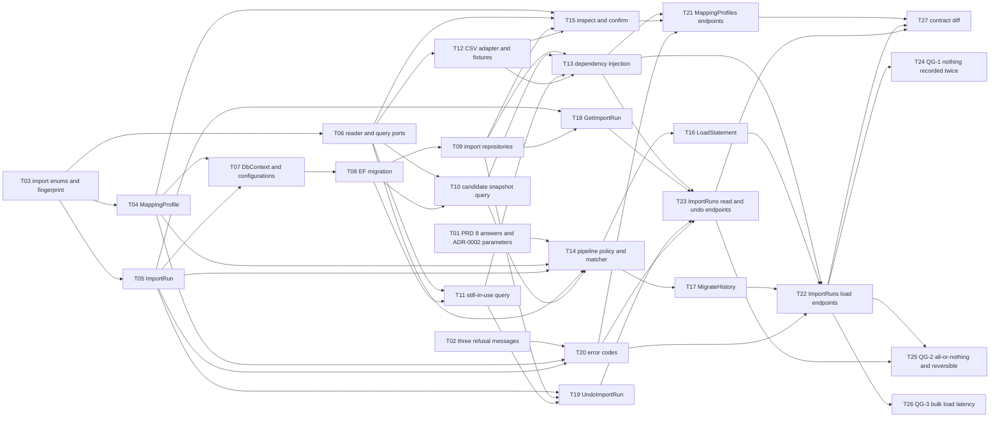

# Epic — csv-import

> **PRD:** [PRD.md](../PRD.md) · **Design:** [sad.md](../sad.md) · **Data model:** [data-model.md](../data-model.md) · **API:** [openapi.yaml](../contracts/openapi.yaml) · **ADRs:** [adr/](../adr/) · **Terms:** [CONTEXT.md](../CONTEXT.md)
>
> **Size:** L (from [`.size`](../.size)). **Surface:** `backend-service`, read from `sad.md`
> frontmatter — so there is **no `ui` task layer**.

## Goal

Ship both import jobs over one write path: the monthly statement load that stops the owner
re-typing ~30 rows, and the one-time move of three years of history out of the old tracker
([PRD §2](../PRD.md)). A load that finished is a success even when it set rows aside, a repeated
load records nothing twice, and a load can be undone as a whole.

**This epic creates no part of the deployment unit, and that is the surprise worth stating.**
`core-ledger` builds the compose stack, the Testcontainers harness and the CI job
([sad.md §7](../sad.md)), and this epic depends on all three plus the whole ledger. Nothing here can
start until `core-ledger` has shipped — `src/` today holds four `AssemblyMarker.cs` files and
`Program.cs`.

## Scope

- **In:** all four rings — two new aggregates (`ImportRun`, `MappingProfile`) with their repository
  ports, the `Import/` business area with six use cases over one pipeline, one EF Core migration for
  8 tables and 13 indexes, two new Application ports (`IStatementReader`, `IImportQueries`), the CSV
  adapter, 6 HTTP operations across 2 resources, 12 error codes added to `core-ledger`'s registry,
  and the three quality gates from [sad.md §10](../sad.md).
- **Out (PRD §3):** no splitting one of the file's categories into two of the owner's · no learning
  from corrections · no pairing a move between the owner's own accounts across two statements · no
  source other than a file the owner hands over — no bank connection, chat, email or receipt
  photographs · no screen.
- **Out of this epic, though named upstream:** the compose stack, the Testcontainers harness and CI
  ([sad.md §7](../sad.md) — `core-ledger` owns all three) · the flat error envelope and the
  `application/problem+json` switch-off (`core-ledger` T24 owns them; T20 here only adds this
  feature's codes) · the three PRD §8 questions due **after** the first three monthly loads · the
  `.claude/skills/finnavis-api-forge/SKILL.md` spelling fix from
  [api-sync-report.md](../contracts/api-sync-report.md) Section D. Each has a row at the bottom.

## Task map

**Parallel branches.** Three tasks start at once: **T01** and **T02** are document work that needs
no code, and **T03** is the root of the Domain ring. T01 is the long pole of the three — it needs a
real statement and a real export opened — and T14 cannot start without it, so start it first.

After T03 the Domain ring fans out three ways: **T04**, **T05** and **T06** run together. After
that the graph has two long arms that only meet at T13:

- the persistence arm — T07 → T08 → then **T09, T10 and T11 in parallel**;
- the file arm — **T12**, which needs only T06 and can run beside the whole persistence arm.

After T14 the two entry points **T16** and **T17** run together, and **T15**, **T18** and **T19**
are a third branch that never touches T14 at all. The three `ports` tasks **T21**, **T22** and
**T23** fan out from T20 and T13, and the three quality gates **T24**, **T25** and **T26** fan out
from T22.

**Serialization lanes** (how the implement stage reads the DAG):

- `layer: migration` is always serialized — **T08** is the only one, so the lane is trivially held.
- Overlapping `files_hint` serializes regardless of layer:
  - **T10 and T11** both write `src/FinNavis.Infrastructure/Queries/EfImportQueries.cs`. They are
    kept separate because each read gets its own task and its own index proof, but they cannot run
    at the same time.
  - **T13, T21, T22 and T23** all touch `src/FinNavis.Presentation/Program.cs` — T13 registers the
    adapters, the other three add their route registration. T13 is upstream of all three; T21, T22
    and T23 share the lane with each other.
  - **T25 and T26** both write `tests/FinNavis.Infrastructure.IntegrationTests/Seeding/`, where the
    ~20 000-movement seeded ledger both gates time against lives.
- The six `app` use-case tasks were deliberately given **one folder each** under
  `src/FinNavis.Application/Import/` — `Pipeline/`, `InspectFile/`, `ConfirmMappingProfile/`,
  `LoadStatement/`, `MigrateHistory/`, `GetImportRun/`, `UndoImportRun/`. Without that, one business
  area with six use cases would put the whole Application ring into a single lane.
- No `ui` layer exists — `target_surfaces` declares `backend-service` only.

## Tasks

See [tracker.md](./tracker.md) for status. Machine contract: [tasks.json](./tasks.json).

| # | Task | Layer | Blocked by | DoD (short) |
|---|---|---|---|---|
| [T01](./T01-docs-prd-open-questions-and-adr-0002.md) | Answer PRD §8's four file questions and fix ADR-0002's proximity parameters | docs | — | PRD §8 rows answered from a real file, ADR-0002 states the window, the text rule and the two-matches rule |
| [T02](./T02-docs-missing-refusal-messages.md) | Add the three missing refusal messages to PRD §10 | docs | — | PRD §10 and `openapi.yaml` carry the same wording for the three drafted codes |
| [T03](./T03-domain-import-enums-and-fingerprint.md) | Add the four import enums and the `MovementFingerprint` value object | domain | — | `12.5` and `12.5000` hash the same; Domain still references nothing |
| [T04](./T04-domain-mapping-profile.md) | Add the `MappingProfile` aggregate, its rules and `IMappingProfileRepository` | domain | T03 | A rule targets a category exactly when its target is `Category`; nothing recorded points at a rule |
| [T05](./T05-domain-import-run.md) | Add the `ImportRun` aggregate with its five child types and `IImportRunRepository` | domain | T03 | Counts and set-aside rows read back; a fingerprint mismatch is reported; an already-undone run is refused |
| [T06](./T06-app-reader-and-query-ports.md) | Declare `IStatementReader` and `IImportQueries` in `Application/Abstractions` | app | T03 | Both ports declared, streaming, no EF Core in Application |
| [T07](./T07-infra-dbcontext-and-configurations.md) | Add the `DbContext` sets and the eight entity configurations | infra | T04, T05 | 8 tables, 13 indexes, enums as strings, ADR-0008 comment on both link configs |
| [T08](./T08-migration-csv-import-initial.md) | Generate the import migration and diff it against the staged spec | migration | T07 | Generated script matches the 8 staged `.up.sql` files; applies and reverts in Testcontainers |
| [T09](./T09-infra-repositories.md) | Add `EfImportRunRepository` and `EfMappingProfileRepository` | infra | T08 | Both round-trip; the shape-key lookup uses its unique index |
| [T10](./T10-infra-query-candidate-snapshot.md) | Implement the candidate snapshot in `EfImportQueries` | infra | T06, T08 | One query over accounts and dates; `EXPLAIN` shows an index scan |
| [T11](./T11-infra-query-created-entity-in-use.md) | Implement the AC-17 still-in-use check in `EfImportQueries` | infra | T06, T08 | An existence check that adds no index |
| [T12](./T12-infra-csv-reader-and-fixtures.md) | Add the CSV adapter behind `IStatementReader` and the synthetic sample files | infra | T06 | Streams rows, builds the shape key, names the missing column; fixtures are synthetic |
| [T13](./T13-wiring-dependency-injection.md) | Register the four import adapters in the Infrastructure container | wiring | T09, T10, T11, T12 | All four ports resolve in one test; ArchitectureTests green |
| [T14](./T14-app-pipeline-policy-and-matcher.md) | Build the shared import pipeline, the policy object and the two-tier duplicate matcher | app | T01, T04, T05, T06, T10 | One pipeline, two policies, two match tiers; two identical rows both land |
| [T15](./T15-app-inspect-and-confirm.md) | Add the `InspectFile` and `ConfirmMappingProfile` use cases | app | T04, T06, T09, T12 | Inspect lists the file's categories; confirm refuses an unknown category |
| [T16](./T16-app-load-statement.md) | Add the `LoadStatement` use case with the statement policy | app | T14 | Three set-aside reasons, one refusal for an unknown account, one commit |
| [T17](./T17-app-migrate-history.md) | Add the `MigrateHistory` use case with the migration policy | app | T14 | Creates what the ledger lacks, records a transfer, changes nothing hand-typed |
| [T18](./T18-app-get-import-run.md) | Add the `GetImportRun` use case | app | T05, T09 | Counts, set-aside rows and the undone flag, read through the repository |
| [T19](./T19-app-undo-import-run.md) | Add the `UndoImportRun` use case | app | T05, T09, T11 | Refuses on a fingerprint mismatch; removes only what nothing else names |
| [T20](./T20-ports-error-codes.md) | Add the `Import` and `MappingProfile` error codes to the registry | ports | T02, T04, T05 | 12 constants returning exactly the contract's strings; no `problem+json` |
| [T21](./T21-ports-mapping-profiles-endpoints.md) | Add the `MappingProfiles` endpoints: `Inspect` and `Confirm` | ports | T13, T15, T20 | Both operations match the contract; 201 on new, 200 on re-confirm |
| [T22](./T22-ports-import-runs-load-endpoints.md) | Add the `ImportRuns` load endpoints: `LoadStatement` and `MigrateHistory` | ports | T13, T16, T17, T20 | Multipart in, `200` with counts and the full set-aside list out |
| [T23](./T23-ports-import-runs-read-and-undo-endpoints.md) | Add the `ImportRuns` read and undo endpoints: `Get` and `Undo` | ports | T13, T18, T19, T20 | Cursor paging over set-aside rows; undo refuses twice over |
| [T24](./T24-tests-qg1-duplicate-safety.md) | Quality gate QG-1 — nothing is recorded twice | tests | T22 | Three named integration tests; no PRD §6 number, and said so |
| [T25](./T25-tests-qg2-undo-and-atomicity.md) | Quality gate QG-2 — a load is all-or-nothing, and reversible | tests | T22, T23 | Undo of 1500 rows, p95 ≤ 30 s, plus four correctness tests |
| [T26](./T26-tests-qg3-bulk-load-latency.md) | Quality gate QG-3 — a bulk load fits inside one evening's patience | tests | T22 | ~1500 rows, p95 ≤ 60 s, with an `EXPLAIN` assertion that can fail |
| [T27](./T27-docs-contract-diff.md) | Diff the served document against the contract and close the deferrals | docs | T21, T22, T23 | `/openapi/v1.json` agrees with the contract; three deferrals struck |

**Acceptance-criteria coverage.** All **22** PRD §5 criteria are claimed by at least one task.
Several are claimed more than once, because they are proved at more than one level:

- **AC-03** (a file naming no date, amount or account) — T12 detects it while streaming, T15 and T17
  refuse on it, T21 returns `Import.MissingRequiredColumn`. Four tasks, because the detection, the
  two refusals and the status code are four different failures.
- **AC-13** (the run report) — T05 holds the counts and the set-aside rows, T18 shapes them, T22
  returns them in full on a load, T23 pages them on a read. The load and the read answer differently
  on purpose ([api-sync-report.md](../contracts/api-sync-report.md), decision 2).
- **AC-17** (undo removes what the run created, unless something else names it) — T05 records the
  creation links, T11 is the query that answers "named from outside?", T19 acts on it, T25 proves it.
- **AC-18** (undo blocked after a hand edit) — T05 compares the fingerprint, T19 refuses, T20 carries
  `Import.MovementsChangedByHand`, T23 returns it, T25 proves the fingerprint still covers every
  editable field.
- **AC-20 / AC-21** (nothing recorded twice) — T10 is the snapshot query, T14 is the two-tier match
  over it, T24 is the gate. The query and the matcher are separable and each can be wrong alone.
- **AC-15, AC-16, AC-19, AC-22** each appear in a use-case task and again in a quality gate, which is
  where the all-or-nothing and undo behaviour is actually measurable.

**Nine tasks carry an empty `acs` on purpose** — T01 and T02 are document work, T03 is a hash
function and four enums, T06 is two interface declarations, T07 and T08 are schema, T09 and T13 are
plumbing, and T27 is a diff. Each says so in its own Why section, and names the task that does claim
the criterion it serves.

## Risks / Hard rules

- **`core-ledger` must ship first, in full.** [PRD §9](../PRD.md) names the ledger as a hard
  prerequisite and [sad.md §11](../sad.md) carries it as the top High risk. Every table this epic
  points at, the compose stack, the Testcontainers harness, the CI job, `IUnitOfWork`, the error
  envelope and the `problem+json` switch-off all belong to `core-ledger`'s epic. **Depend on them;
  do not rebuild any of them here.**
- **No `CHECK` constraint, no trigger, no stored procedure, no business `DEFAULT`.** "A rule carries
  a target category exactly when its target is `Category`" is a domain invariant refused in the
  `MappingRule` entity, not a constraint (`.claude/rules/migrations.md`, [data-model.md](../data-model.md)).
- **Every error response is the flat `{code, message, details?}` envelope**, with `code` spelled
  `Module.ErrorName` (`CLAUDE.md` §API, `docs/adr/0002`, `docs/adr/0003`). ASP.NET Core's
  `application/problem+json` default is turned off by `core-ledger` T24; T20 here asserts it stayed
  off.
- **A load that finished is a `200`, never an error**, even when it set rows aside
  (`CLAUDE.md` §API, `.claude/rules/openapi.md` §6). The error envelope is only for a refusal that
  stopped the whole load.
- **This feature adds no column and no index to `transactions` or `transfers`** (ADR-0007,
  [data-model.md](../data-model.md) § Indexes). `core-ledger` already declares every index the
  candidate snapshot and the AC-17 check need. If T26's `EXPLAIN` ever reports a sequential scan for
  a *monthly* load, the index to add is `transactions(account_id, occurred_on)` as a separate
  `CREATE INDEX CONCURRENTLY` migration.
- **Enums are stored as strings, never as int** (`CLAUDE.md`). All four of this feature's enums.
- **The contract is the source of truth; handlers follow it.** `/openapi/v1.json` is generated from
  the code and diffed **against** [openapi.yaml](../contracts/openapi.yaml), never the other way
  round (`.claude/rules/openapi.md`).
- **No response record is shared between operations**, even when `LoadStatement` and `MigrateHistory`
  answer with the same shape (`CLAUDE.md` §API).
- **Dependencies point inward only.** `tests/FinNavis.ArchitectureTests` enforces it.
- **Never edit an applied migration. Add a new one** (`CLAUDE.md`).
- **No real bank statement and no real export ever enters the repository** (`CLAUDE.md` Safety,
  [sad.md §7](../sad.md)). The committed sample files are synthetic: same header row, same column
  order, same date and amount formats, invented merchants and amounts. The real files stay on the
  owner's own machine and are needed once, for T01.
- **Raw bank text never reaches the logs.** A set-aside row keeps the file's own line; `sad.md` §7
  logs one line per run — the job, the file name and the counts, never the rows.

### Open items this epic does not close

| Item | Where it came from | Why it is parked |
|---|---|---|
| Should a move between the owner's own accounts be paired across two statements into one transfer? | [PRD §8](../PRD.md), idea-brief §15 | Due **after** the first three monthly loads, by the PRD's own schedule. Default now: no — set aside (AC-06) |
| PRD §5 carries no criterion of the `authorization` type | [PRD §8](../PRD.md), [CONTEXT.md](../CONTEXT.md) § Org-filter invariant | There is no second actor to deny. The sign-in feature owns it; until then the installation stays off public networks |
| No authentication, and this feature widens the gap — anyone reaching the installation can now load a whole file | [sad.md §11](../sad.md) | Same owner, same fix. Network isolation is the only control there is |
| The `history` qualifier in `external_ref` is stable for one export, not across two different exports | [data-model.md](../data-model.md) § Open items | Changes no column — the fix is a different qualifier string. Moot if T01 finds no stable operation number |
| The proximity tier stays a heuristic however T01 lands | [sad.md §11](../sad.md) Accepted debt | AC-21 cannot be satisfied any other way: a hand-typed movement has no `external_ref` |
| Undone runs accumulate; nothing deletes them | [sad.md §11](../sad.md) Accepted debt | They are the only trace in the product that a load happened and was reversed |
| Two banks with identical header rows share one `MappingProfile` | ADR-0009, [sad.md §11](../sad.md) | Bounded: a wrong rule shows as a visible category or a set-aside row, and the load is undoable |
| The candidate snapshot grows with the date range, so a three-year migration pulls ~20 000 movements into memory on its first run | ADR-0003, [sad.md §7](../sad.md) | Reached immediately or not at all. Revisit past ~200 000 movements |
| `.claude/skills/finnavis-api-forge/SKILL.md` still states the superseded snake_case code spelling | [api-sync-report.md](../contracts/api-sync-report.md) Section D, new on run 3 | A skill fix, not feature work. It misleads the **next** feature, not this one — but it should be done before `/finnavis-api-forge` runs again |
| The nightly `pg_dump` backup | [sad.md §7](../sad.md) | Inherited from `core-ledger`; parked there too |
| RICE was scored from effort **M** while the scope written is **L** | [PRD §1](../PRD.md), [sad.md §11](../sad.md) | Re-score before this feature is scheduled. This epic measures 27 tasks and ~17 person-days, which confirms the PRD was right to flag it |
